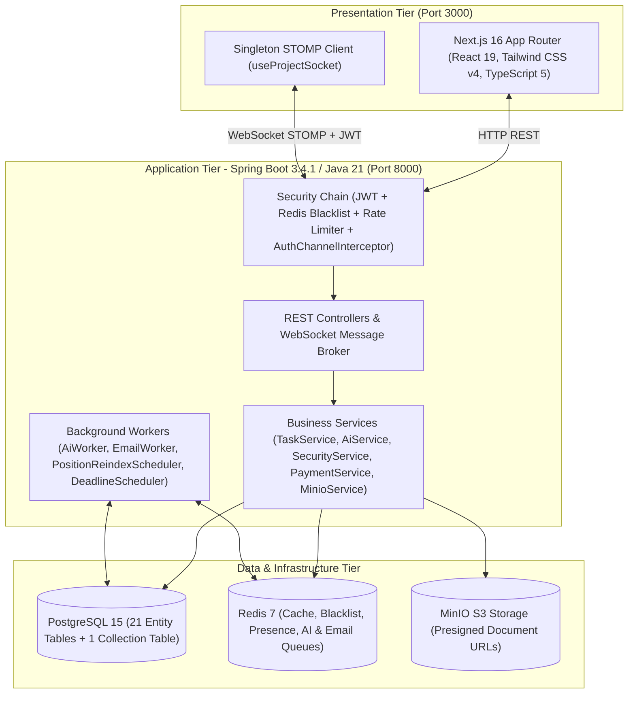

# 🚀 Homix v2.0 — Nền Tảng Quản Lý Dự Án & Công Việc Thông Minh Tích Hợp AI

**Homix v2.0** là nền tảng SaaS quản lý dự án, không gian làm việc (Workspace) và bảng công việc **Kanban thời gian thực** tích hợp **Trí tuệ Nhân tạo Tạo sinh (Generative AI)**. Hệ thống được thiết kế theo kiến trúc phân tầng hiện đại trên nền tảng **Next.js 16 (React 19)**, **Spring Boot 3.4.1 (Java 21 LTS)**, **PostgreSQL 15**, **Redis 7**, và **MinIO Object Storage**.

---

## ✨ Tính Năng Trọng Tâm

- **📋 Bảng Kanban Thời Gian Thực Không Độ Trễ:**
  - Thuật toán định vị số thực **Fractional Positioning** ($O(1)$ cập nhật vị trí kéo thả) kết hợp khóa lạc quan **`@Version` (Optimistic Locking)** và bộ lập lịch tự động chống suy biến số thực (`PositionReindexScheduler`).
  - Đồng bộ tức thời qua **WebSocket STOMP Singleton Multiplexing** (`/topic/projects/{id}`, `/topic/workspaces/{id}`, `/topic/notifications/{userId}`, `/topic/chat/...`).
- **🤖 Động Cơ Trợ Lý AI & Hàng Đợi Bất Đồng Bộ (`AiWorker`):**
  - **AI Auto-Subtasks Bất Đồng Bộ:** Đẩy tác vụ phân rã công việc vào hàng đợi Redis (`ai-subtasks-queue` qua `LPUSH`/`BRPOP`), phản hồi `HTTP 202 Accepted` dưới 50ms và tự động đẩy kết quả qua WebSocket STOMP.
  - **Báo Cáo Giám Đốc PMO 5 Phân Hệ:** Tự động tổng hợp dữ liệu hoạt động 24h và kết xuất 5 mô hình biểu đồ (`doughnut`, `bar`, `radar`, `stackedBar`, `line`).
  - **Tìm Kiếm Ngữ Nghĩa (Semantic Search) & Dual-Fallback AI Gateway:** Tự động chuyển đổi dự phòng giữa **Google Gemini 2.0 Flash** và **OpenRouter** (`DeepSeek R1`, `Qwen 2.5`).
- **🛡️ Bảo Mật Chiều Sâu (Defense-in-Depth) & Phân Quyền Hạt Mịn 16 Quyền:**
  - Xác thực **JWT + Google OAuth 2.0**, thu hồi token tức thì qua **Redis Blacklist**, và **Rate Limiting** (15 yêu cầu AI/phút/IP).
  - Bảo mật kênh truyền WebSocket STOMP qua `AuthChannelInterceptor` (xác thực JWT khi `CONNECT` và kiểm tra quyền thành viên khi `SUBSCRIBE`).
  - Ma trận phân quyền kết hợp **RBAC + ABAC** với 16 mã quyền hạn chi tiết (ghi đè quyền cá nhân, vai trò tùy chỉnh, vai trò hệ thống).
- **📂 Quản Lý Tài Liệu Đa Tầng & Lưu Trữ Đám Mây MinIO S3:**
  - Cây thư mục đệ quy cấp Workspace và Project; phân tách quyền đọc công khai cho ảnh đại diện (`images/*`) và lưu trữ riêng tư cho tài liệu (`documents/*`) thông qua **Presigned URL (15 phút)**.
- **💳 Thanh Toán Đa Cổng & Quản Trị Toàn Cục (System Admin Portal):**
  - Tích hợp cổng thanh toán **VNPay 2.1.0** (đối soát chữ ký số `HmacSHA512` & mã VietQR) và **PayPal Smart Buttons**.
  - Cổng quản trị `/admin` thống kê KPI doanh thu, quản lý người dùng và nhập/xuất báo cáo **Microsoft Excel (`.xlsx`)** qua SheetJS.

---

## 🏗️ Kiến Trúc Tổng Thể Hệ Thống



---

## 📁 Cấu Trúc Thư Mục Monorepo

```text
Homix/
├── .github/
│   └── workflows/
│       └── ci-cd.yml                  # Đường ống CI/CD tự động (GitHub Actions)
├── client/                            # Frontend Application (Next.js 16 + React 19 + Tailwind v4)
│   ├── public/                        # Tài nguyên tĩnh & bộ nhận diện thương hiệu (Logos)
│   ├── src/
│   │   ├── app/                       # Các trang theo kiến trúc Next.js App Router
│   │   ├── components/                # UI dùng chung & 12 Modular Kanban Components (components/kanban/*)
│   │   ├── hooks/                     # Custom React Hooks (useProjectSocket.ts)
│   │   └── lib/                       # REST API Client (api.ts), Singleton STOMP (socket.ts), Đa ngôn ngữ (i18n.tsx)
│   ├── .env.example                   # Mẫu biến môi trường Frontend
│   └── Dockerfile.dev                 # Dockerfile môi trường phát triển Frontend
├── server/                            # Backend Application (Spring Boot 3.4.1 + Java 21 LTS)
│   ├── src/
│   │   ├── main/java/com/example/smartmanager/
│   │   │   ├── admin/                 # Quản trị hệ thống & thống kê doanh thu
│   │   │   ├── ai/                    # AiService, OpenRouterServiceClient, AiWorker & AiJob
│   │   │   ├── auth/                  # JWT, Google OAuth, TokenBlacklistService, SecurityService (16 quyền)
│   │   │   ├── chat/                  # Phòng chat nhóm thời gian thực
│   │   │   ├── comments/              # Thảo luận phân cấp cây & Redis Presence Detection
│   │   │   ├── config/                # SecurityConfig, WebSocketConfig, AuthChannelInterceptor, RateLimitingFilter
│   │   │   ├── email/                 # EmailService & EmailWorker (Redis Queue)
│   │   │   ├── minio/                 # MinioService (Private Bucket & Presigned URLs)
│   │   │   ├── notifications/         # Hệ thống thông báo & lời mời đa kênh
│   │   │   ├── payments/              # Tích hợp VNPay (HMAC-SHA512), PayPal & VietQR
│   │   │   ├── projects/              # Quản lý Dự án, Thành viên & Phê duyệt xóa 2 bước
│   │   │   ├── tasks/                 # Kanban Fractional Positioning, Subtasks & Schedulers
│   │   │   ├── users/                 # Quản lý Hồ sơ & Tài khoản
│   │   │   └── workspaces/            # Quản lý Workspace, Vai trò tùy chỉnh & Kho tài liệu
│   │   ├── main/resources/            # Cấu hình application.yml
│   │   └── test/java/                 # 11 Bộ kiểm thử tự động (JUnit 5 + Mockito)
│   ├── build.gradle                   # Cấu hình phụ thuộc Gradle
│   └── Dockerfile.dev                 # Dockerfile môi trường phát triển Backend
├── init-db/
│   └── schema.sql                     # Kịch bản khởi tạo 21 bảng thực thể + 1 bảng tập hợp chuẩn 3NF
├── docs/                              # Trung tâm Tài liệu & Hồ sơ Học thuật
│   ├── architecture/                  # Đặc tả chức năng, kiến trúc, kế hoạch & checklist thực thi (TASKS.md)
│   ├── thesis/                        # Toàn bộ báo cáo Khóa luận tốt nghiệp, cơ sở tri thức & 15 sơ đồ hệ thống
│   └── templates/                     # Các tệp mẫu Excel (.xlsx) dùng để nhập liệu hàng loạt
├── .env.example                       # Mẫu cấu hình biến môi trường toàn hệ thống
├── .gitignore                         # Cấu hình loại trừ tệp nhạy cảm và thư mục biên dịch
├── docker-compose.yml                 # Điều phối 5 dịch vụ Container (Postgres, Redis, MinIO, Backend, Frontend)
└── README.md                          # Tài liệu tổng quan dự án
```

---

## 🐳 Hướng Dẫn Khởi Chạy Nhanh Với Docker Compose

### 1. Yêu cầu hệ thống
- **Docker Desktop** (đã bật Docker Compose v2).
- Cổng khả dụng trên máy host: `3000` (Frontend), `8000` (Backend), `5433` (PostgreSQL), `6380` (Redis), `9020`/`9021` (MinIO).

### 2. Thiết lập biến môi trường
Sao chép tệp `.env.example` thành `.env` tại thư mục gốc và cập nhật các khóa API cần thiết:
```bash
cp .env.example .env
```

### 3. Khởi chạy toàn bộ 5 dịch vụ Container
```bash
docker compose up -d --build
```

### 4. Địa chỉ truy cập các dịch vụ
| Dịch vụ | Container | Địa chỉ Truy cập | Ghi chú |
| :--- | :--- | :--- | :--- |
| **Web Application (Frontend)** | `smart_frontend` | **http://localhost:3000** | Giao diện Next.js 16 Song ngữ Việt - Anh |
| **REST API & WebSocket (Backend)** | `smart_backend` | **http://localhost:8000/api** | Spring Boot 3.4.1 & STOMP `/ws` |
| **MinIO Console (Object Storage)** | `smart_minio` | **http://localhost:9021** | Quản lý bucket `smartmanager` (API: `:9020`) |
| **PostgreSQL 15 Database** | `smart_postgres` | `localhost:5433` | Database: `smart_task_db` (22 bảng tự động tạo) |
| **Redis 7 Cache & Message Queue** | `smart_redis` | `localhost:6380` | Nội bộ Docker: `redis:6379` |

---

## 🧪 Kiểm Thử & Đảm Bảo Chất Lượng (QA / CI-CD)

### Kiểm tra chất lượng mã nguồn & kiểu dữ liệu Frontend
```bash
cd client
npx eslint src
npx tsc --noEmit
```

### Chạy bộ kiểm thử đơn vị & tích hợp Backend (11 Test Classes)
```bash
cd server
./gradlew test --info
```

---

## 📚 Tài Liệu Tham Chiếu Chi Tiết

- **Kiến trúc & Kế hoạch Hoàn thiện:**
  - [`docs/architecture/KE_HOACH_HOAN_THIEN_HOMIX_V2.md`](docs/architecture/KE_HOACH_HOAN_THIEN_HOMIX_V2.md)
  - [`docs/architecture/TASKS.md`](docs/architecture/TASKS.md)
  - [`docs/architecture/functional_spec.md`](docs/architecture/functional_spec.md)
  - [`docs/architecture/implementation_guide.md`](docs/architecture/implementation_guide.md)
- **Hồ sơ Khóa luận Tốt nghiệp:**
  - [`docs/thesis/Suon_Bao_Cao.md`](docs/thesis/Suon_Bao_Cao.md)
  - [`docs/thesis/PROJECT_THESIS_KNOWLEDGE_BASE.md`](docs/thesis/PROJECT_THESIS_KNOWLEDGE_BASE.md)
  - [`docs/thesis/Mau_Bao_Cao_Chi_Tiet_v3.md`](docs/thesis/Mau_Bao_Cao_Chi_Tiet_v3.md)
- **Tệp Mẫu Nhập Liệu Excel:**
  - [`docs/templates/Mau_File_Cong_Viec_Homix.xlsx`](docs/templates/Mau_File_Cong_Viec_Homix.xlsx)
