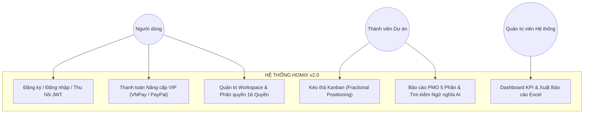
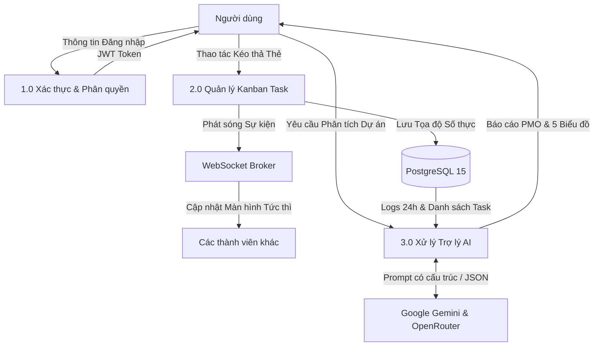
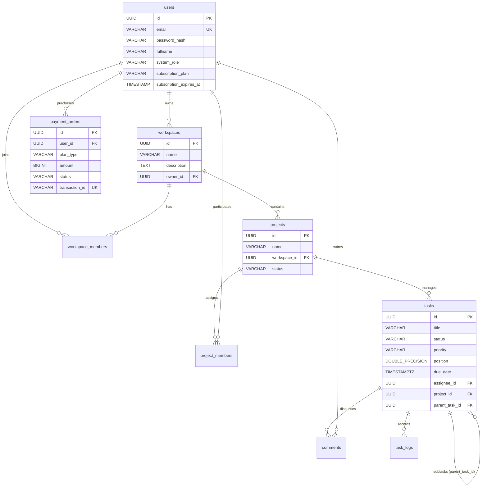

# BÁO CÁO KHÓA LUẬN TỐT NGHIỆP ĐẠI HỌC
**CHUYÊN NGÀNH: CÔNG NGHỆ THÔNG TIN / KỸ THUẬT PHẦN MỀM**

---

# TÊN ĐỀ TÀI:
# NGHIÊN CỨU, THIẾT KẾ VÀ XÂY DỰNG NỀN TẢNG QUẢN LÝ DỰ ÁN VÀ CÔNG VIỆC THÔNG MINH TÍCH HỢP TRÍ TUỆ NHÂN TẠO HOMIX v2.0 (INTELLIGENT TASK & WORKSPACE COLLABORATION PLATFORM)

* **Sinh viên thực hiện:** [Họ và tên Sinh viên]
* **Mã số sinh viên:** [MSSV]
* **Khóa học:** [Khóa học]
* **Giảng viên hướng dẫn:** [Họ và tên Giảng viên hướng dẫn]
* **Thời gian thực hiện:** 2025 – 2026

---

## TÓM TẮT KHÓA LUẬN (ABSTRACT)

### Tóm tắt tiếng Việt
Trong bối cảnh phương thức làm việc linh hoạt (Hybrid & Remote Work) trở thành xu thế chủ đạo trong ngành công nghiệp phần mềm, nhu cầu về một nền tảng quản lý dự án cộng tác thời gian thực, có khả năng tích hợp tự động hóa thông minh là vô cùng cấp thiết. Khóa luận này trình bày toàn bộ quá trình nghiên cứu, thiết kế kiến trúc và hiện thực hóa nền tảng **Homix v2.0** — một giải pháp quản lý công việc và không gian làm việc hiện đại. 

Hệ thống được xây dựng trên nền tảng kiến trúc phân tầng chuẩn mực (**N-Tier Modular Monolith**), sử dụng ngôn ngữ **Java 21 LTS**, framework **Spring Boot 3.4.1** kết hợp với **PostgreSQL 15**, bộ đệm **Redis 7** và kho lưu trữ đối tượng **MinIO S3**. Phía giao diện ứng dụng framework **Next.js 16 (App Router)** và **React 19**, mang lại trải nghiệm tương tác mượt mà và tối ưu hóa kết xuất. 

Các đóng góp khoa học và kỹ thuật nổi bật của đề tài bao gồm:
1. **Giải thuật số thực Fractional Positioning:** Giải quyết triệt để bài toán cập nhật thứ tự kéo thả trên bảng Kanban với độ phức tạp tối ưu O(1), loại bỏ hoàn toàn chi phí cập nhật hàng loạt trên CSDL quan hệ, đi kèm bộ lập lịch `PositionReindexScheduler` chống suy biến số thực (Floating-point Underflow).
2. **Cổng Trí tuệ Nhân tạo Dự phòng Kép (Dual Fallback AI Gateway):** Tích hợp sâu mô hình **Google Gemini 2.0 Flash** và **OpenRouter**, áp dụng kỹ nghệ câu lệnh (Prompt Engineering) có kiểm soát nghiêm ngặt cấu trúc đầu ra để tự động sinh Báo cáo Quản trị PMO 5 phân hệ kèm 5 mô hình biểu đồ định lượng, tìm kiếm ngữ nghĩa (Semantic Search) và phân rã công việc con (Subtasks).
3. **Kiến trúc Bảo mật & Phân quyền Đa tầng:** Triển khai cơ chế thu hồi JWT tức thì qua Redis Blacklist, bộ lọc giới hạn tần suất (Rate Limiter) 15 req/phút/IP, và ma trận phân quyền hạt mịn 16 quyền hạn kết hợp RBAC và ABAC.
4. **Tối ưu hóa Hiện diện Trực tuyến & Real-time:** Ứng dụng giao thức WebSocket STOMP đa kênh kết hợp cơ chế Presence Detection trên Redis để chống spam thông báo, cùng bộ tổng hợp âm thanh Web Audio API.
5. **Thương mại hóa & DevOps:** Tích hợp thành công 2 cổng thanh toán VNPay (HMAC-SHA512) và PayPal, đóng gói 5 dịch vụ độc lập qua Docker Compose và tự động hóa kiểm thử/build qua GitHub Actions CI/CD.

---

## MỤC LỤC TỔNG QUAN

* [CHƯƠNG 1: GIỚI THIỆU ĐỀ TÀI](#chương-1-giới-thiệu-đề-tài)
* [CHƯƠNG 2: CƠ SỞ LÝ THUYẾT VÀ CÔNG NGHỆ ÁP DỤNG](#chương-2-cơ-sở-lý-thuyết-và-công-nghệ-áp-dụng)
* [CHƯƠNG 3: PHÂN TÍCH VÀ THIẾT KẾ HỆ THỐNG](#chương-3-phân-tích-và-thiết-kế-hệ-thống)
* [CHƯƠNG 4: TRIỂN KHAI VÀ HIỆN THỰC HÓA HỆ THỐNG](#chương-4-triển-khai-và-hiện-thực-hóa-hệ-thống)
  * [4.1. Kiến trúc Tổ chức Phân tầng Backend (Spring Boot 3.4.1 & Java 21)](#41-kiến-trúc-tổ-chức-phân-tầng-backend-spring-boot-341--java-21)
  * [4.2. Hiện thực Phân hệ Xác thực và Quản trị Định danh Người dùng](#42-hiện-thực-phân-hệ-xác-thực-và-quản-trị-định-danh-người-dùng)
  * [4.3. Hiện thực Phân hệ Không gian làm việc và Quản trị Dự án Phân cấp](#43-hiện-thực-phân-hệ-không-gian-làm-việc-và-quản-trị-dự-án-phân-cấp)
  * [4.4. Hiện thực Phân hệ Quản lý Tác vụ Kanban và Giải thuật Fractional Positioning](#44-hiện-thực-phân-hệ-quản-lý-tác-vụ-kanban-và-giải-thuật-fractional-positioning)
  * [4.5. Hiện thực Động cơ Trợ lý AI và Chiến lược Dự phòng Kép (Dual Fallback)](#45-hiện-thực-động-cơ-trợ-lý-ai-và-chiến-lược-dự-phòng-kép-dual-fallback)
  * [4.6. Hiện thực Phân hệ Thảo luận, Quản lý Hiện diện Redis và Chat Thời gian thực](#46-hiện-thực-phân-hệ-thảo-luận-quản-lý-hiện-diện-redis-và-chat-thời-gian-thực)
  * [4.7. Hiện thực Phân hệ Thông báo Đa kênh và Hàng đợi Gửi Thư Bất đồng bộ](#47-hiện-thực-phân-hệ-thông-báo-đa-kênh-và-hàng-đợi-gửi-thư-bất-đồng-bộ)
  * [4.8. Hiện thực Phân hệ Cổng Thanh toán và Vòng đời Thuê bao VIP Tự động](#48-hiện-thực-phân-hệ-cổng-thanh-toán-và-vòng-đời-thuê-bao-vip-tự-động)
  * [4.9. Hiện thực Cổng Quản trị Toàn cục và Động cơ Xuất Dữ liệu Excel](#49-hiện-thực-cổng-quản-trị-toàn-cục-và-động-cơ-xuất-dữ-liệu-excel)
  * [4.10. Hiện thực Tầng Giao diện Người dùng và Trải nghiệm Tương tác (Next.js 16)](#410-hiện-thực-tầng-giao-diện-người-dùng-và-trải-nghiệm-tương-tác-nextjs-16)
* [CHƯƠNG 5: DEVOPS, CI/CD VÀ TRIỂN KHAI PRODUCTION](#chương-5-devops-cicd-và-triển-khai-production)
* [CHƯƠNG 6: TỔNG KẾT VÀ HƯỚNG PHÁT TRIỂN](#chương-6-tổng-kết-và-hướng-phát-triển)
* [TÀI LIỆU THAM KHẢO](#tài-liệu-tham-khảo)

---

# CHƯƠNG 1: GIỚI THIỆU ĐỀ TÀI

## 1.1. Bối cảnh và Tính cấp thiết của đề tài
Trong kỷ nguyên số hóa và sự chuyển dịch mạnh mẽ sang mô hình làm việc từ xa (Remote/Hybrid Work), bài toán quản lý công việc và dự án trong các tổ chức công nghệ đòi hỏi tính trực quan, đồng bộ tức thời và tự động hóa cao độ. 

Tuy nhiên, các doanh nghiệp vừa và nhỏ (SMEs) cùng các đội ngũ kỹ thuật hiện nay đang gặp phải 4 điểm nghẽn nghiêm trọng:
1. **Phân mảnh công cụ (Tool Fragmentation):** Chuyển đổi qua lại giữa Jira, Slack, Drive và Excel gây lãng phí 40% thời gian tập trung.
2. **Gánh nặng báo cáo thủ công (Reporting Overhead):** Quản lý dự án mất 1.5 đến 2 giờ mỗi ngày để tổng hợp báo cáo tiến độ và phân tích điểm nghẽn dự án.
3. **Hiện tượng khóa và nghẽn cơ sở dữ liệu trên bảng Kanban:** Các giải pháp kéo thả truyền thống đánh lại số thứ tự nguyên (1, 2, 3...) gây nghẽn giao dịch khi nhiều người cùng thao tác.
4. **Trí tuệ nhân tạo chưa gắn liền với quy trình quản trị:** AI hiện nay chủ yếu dừng ở mức chatbot hỏi đáp rời rạc, chưa thể tự động phân tích nhật ký 24h để lập báo cáo điều hành chuyên sâu.

Đề tài **"Nghiên cứu, thiết kế và xây dựng nền tảng quản lý dự án và công việc thông minh tích hợp Trí tuệ Nhân tạo Homix v2.0"** được thực hiện nhằm giải quyết trọn vẹn các thách thức trên.

## 1.2. Mục tiêu nghiên cứu và Phạm vi đề tài
* **Mục tiêu:** Xây dựng nền tảng phần mềm SaaS toàn diện kết hợp **70% tính năng quản lý cốt lõi** và **30% tính năng AI thông minh**.
* **Phạm vi kỹ thuật:** Backend Java 21 LTS + Spring Boot 3.4.1, CSDL PostgreSQL 15, Cache Redis 7, S3 MinIO, Frontend Next.js 16 (App Router) + React 19, Cổng AI Gemini 2.0 Flash / OpenRouter, Cổng thanh toán VNPay và PayPal.

---

# CHƯƠNG 2: CƠ SỞ LÝ THUYẾT VÀ CÔNG NGHỆ ÁP DỤNG

## 2.1. Phương pháp luận Agile và Mô hình Kanban
Kanban giúp trực quan hóa quy trình làm việc qua 3 cột cơ bản: `TODO` → `IN_PROGRESS` → `DONE`, thiết lập giới hạn công việc đang thực hiện (WIP Limit) để loại bỏ điểm nghẽn.

## 2.2. Kiến trúc Ứng dụng Hướng Module (Modular Monolith)
Phân chia hệ thống thành các mô-đun nghiệp vụ độc lập, giao tiếp qua Service Interfaces rõ ràng, vừa đơn giản trong kiểm thử và triển khai, vừa sẵn sàng tách thành Microservices khi quy mô mở rộng.

## 2.3. Giao tiếp Hai chiều Thời gian thực qua WebSocket & STOMP
Giao thức WebSocket (RFC 6455) kết hợp khung thông điệp STOMP cho phép máy chủ chủ động đẩy các sự kiện kéo thả thẻ, tin nhắn chat và thông báo tức thời tới Client với độ trễ dưới 200ms.

## 2.4. Trí tuệ Nhân tạo Tạo sinh & Kỹ nghệ Prompt Có Cấu trúc
Áp dụng kỹ thuật Prompt Engineering ràng buộc định dạng JSON Array nghiêm ngặt cho Google Gemini 2.0 Flash, đảm bảo AI sinh đúng 5 khối phân tích và 5 bộ dữ liệu biểu đồ tương thích với hệ thống.

---

# CHƯƠNG 3: PHÂN TÍCH VÀ THIẾT KẾ HỆ THỐNG

## 3.1. Đặc tả Yêu cầu Hệ thống
Hệ thống đáp ứng 10 nhóm yêu cầu chức năng (FR1: Xác thực & Thu hồi JWT; FR2: Quản trị Workspace & Mời Excel; FR3: Dự án & Phê duyệt 2 bước; FR4: Kanban Fractional Positioning; FR5: Trợ lý AI Báo cáo PMO; FR6: Thảo luận & Redis Presence; FR7: Thông báo tương tác; FR8: Thanh toán VNPay/PayPal; FR9: Cổng Admin & Xuất Excel; FR10: Design Tokens & i18n Song ngữ) cùng 6 yêu cầu phi chức năng khắt khe về độ trễ, an toàn bảo mật và tính sẵn sàng cao.

## 3.2. Thiết kế Ca sử dụng (Use Case Modeling)



## 3.3. Thiết kế Luồng Dữ liệu (DFD Mức 1)



## 3.4. Thiết kế Cơ sở Dữ liệu Quan hệ (ERD chuẩn 3NF)



---

# CHƯƠNG 4: TRIỂN KHAI VÀ HIỆN THỰC HÓA HỆ THỐNG

Chương này trình bày chi tiết quá trình hiện thực hóa các phân hệ chức năng trên hệ thống thực tế. Phần trình bày tập trung phân tích **ý đồ thiết kế kiến trúc, logic xử lý nghiệp vụ từng bước bằng ngôn ngữ kỹ thuật tự nhiên, phân tích chuyển đổi trạng thái dữ liệu** và trích dẫn các đoạn mã nguồn then chốt đóng vai trò minh chứng cho giải pháp.

---

## 4.1. Kiến trúc Tổ chức Phân tầng Backend (Spring Boot 3.4.1 & Java 21)

Hệ thống Backend được thiết kế theo mô hình phân tầng **N-Tier chuẩn mực**, bao gồm 4 tầng ranh giới rõ ràng:
1. **Tầng Giao diện Lập trình (Controller Tier):** Đón nhận các yêu cầu HTTP RESTful và thông điệp WebSocket từ Client, thực hiện kiểm tra tính hợp lệ của dữ liệu đầu vào thông qua Jakarta Bean Validation (`@Valid`, `@NotBlank`, `@Email`) và phân quyền bảo mật cấp phương thức (`@PreAuthorize`).
2. **Tầng Nghiệp vụ Dịch vụ (Service Tier):** Trái tim của hệ thống, điều phối toàn bộ luồng nghiệp vụ, thực thi các thuật toán toán học (Fractional Positioning), gọi tích hợp bên thứ ba (AI, VNPay, PayPal, MinIO) và quản lý giao dịch cơ sở dữ liệu (`@Transactional`).
3. **Tầng Truy xuất Dữ liệu (Repository Tier):** Kế thừa Spring Data JPA (`JpaRepository`), định nghĩa các câu truy vấn dẫn xuất (Derived Query Methods) và các truy vấn JPQL tối ưu hóa, đảm bảo giao tiếp với PostgreSQL với hiệu năng cao.
4. **Tầng Thực thể Dữ liệu (Domain Entity Tier):** Ánh xạ trực tiếp các bảng quan hệ trong CSDL thành các lớp đối tượng Java, sử dụng định danh duy nhất UUID để hỗ trợ kiến trúc phân tán.

Toàn bộ ứng dụng khởi chạy với điểm kích hoạt chính tại `SmartManagerApplication.java`. Ngay khi Spring Application Context được nạp, phương thức `init()` được chú thích bằng `@PostConstruct` sẽ thiết lập múi giờ mặc định của toàn bộ JVM sang `Asia/Ho_Chi_Minh` (GMT+7). Quyết định thiết kế này đảm bảo mọi thao tác lưu trữ thời gian tạo bản ghi, thời hạn chót của công việc (Due Date), thời gian hết hạn gói VIP và nhật ký kiểm toán đều đồng nhất với múi giờ thực tế của người dùng, loại bỏ hoàn toàn các lỗi lệch giờ khi triển khai trên các máy chủ đám mây quốc tế.

---

## 4.2. Hiện thực Phân hệ Xác thực và Quản trị Định danh Người dùng

Phân hệ xác thực giải quyết bài toán định danh và bảo mật không trạng thái (Stateless Authentication) với 4 kỹ thuật then chốt:

### 1. Quy trình Đăng ký và Cơ chế Tự Động Phân Quyền Quản Trị Hệ Thống
Khi người dùng đăng ký tài khoản mới (`AuthService.register`), hệ thống tiến hành kiểm tra tính duy nhất của email trong CSDL. Mật khẩu người dùng được băm một chiều bằng thuật toán **BCrypt** thông qua `PasswordEncoder.encode()`. 

Điểm đặc thù trong kiến trúc của Homix v2.0 là **cơ chế tự động phân quyền quản trị tối cao (Admin Auto-Promotion)**: Hệ thống định nghĩa phương thức `isSystemAdminEmail()`. Nếu email đăng ký trùng khớp với địa chỉ email quản trị hệ thống định sẵn (`hoamyngothi@gmail.com`), tài khoản sẽ tự động được gán vai trò `systemRole = "ADMIN"` và kích hoạt gói cước cao nhất `subscriptionPlan = "ENTERPRISE"`. Ngược lại, người dùng thông thường nhận vai trò `USER` và gói `FREE`. Đồng thời, phương thức lắng nghe sự kiện `ApplicationReadyEvent` được cấu hình để quét toàn bộ CSDL khi máy chủ khởi động, tự động nâng cấp quyền Admin cho tài khoản hệ thống nếu chưa được cấp trước đó.

```java
// Trích dẫn logic phân quyền tự động trong AuthService.java
if (isSystemAdminEmail(request.getEmail())) {
    user.setSystemRole("ADMIN");
    user.setSubscriptionPlan("ENTERPRISE");
} else {
    user.setSystemRole("USER");
    user.setSubscriptionPlan("FREE");
}
```

### 2. Đăng Nhập Đa Phương Thức và Tích Hợp Google OAuth 2.0
Bên cạnh đăng nhập Email/Password truyền thống, hệ thống hỗ trợ Single Sign-On (SSO) với Google. Khi người dùng xác thực thành công trên giao diện thông qua Google Identity Services (GIS), Client sẽ nhận được một ID Token dạng JWT và gửi về endpoint `POST /api/auth/google`. Tại đây, `AuthService` sử dụng `RestTemplate` để gọi trực tiếp tới máy chủ xác thực của Google (`https://oauth2.googleapis.com/tokeninfo?id_token=...`) nhằm kiểm tra chữ ký và tính hợp lệ của token. Sau khi xác thực danh tính, hệ thống tự động đồng bộ họ tên và ảnh đại diện từ Google, lưu vào CSDL và phát hành một JWT nội bộ để duy trì phiên làm việc.

### 3. Cơ Chế Thu Hồi JWT Tức Thì qua Redis Token Blacklist
Một hạn chế lớn của kiến trúc JWT truyền thống là tính không trạng thái: Sau khi token được phát hành, máy chủ không thể vô hiệu hóa token đó cho đến khi nó tự hết hạn (Expiration Time). Điều này gây ra rủi ro bảo mật nghiêm trọng khi người dùng đã chủ động Đăng xuất (Logout) nhưng token cũ vẫn có thể bị kẻ xấu đánh cắp và sử dụng lại.

Để giải quyết triệt để vấn đề này, Homix v2.0 triển khai **Redis Token Blacklist (`TokenBlacklistService`)**:
* **Khi Người Dùng Đăng Xuất (`POST /api/auth/logout`):** Máy chủ trích xuất chuỗi JWT từ header `Authorization`, tính toán thời gian sống còn lại của token và ghi một khóa có tiền tố `token:blacklist:{jwt}` vào bộ nhớ Redis với giá trị `"blacklisted"` cùng thời gian sống TTL tương ứng (mặc định 24 giờ).
* **Khi Có Bất Kỳ Yêu Cầu Nào Gửi Đến:** Bộ lọc `JwtAuthenticationFilter` (kế thừa `OncePerRequestFilter`) sẽ chặn request lại, trích xuất token, kiểm tra chữ ký số qua `JwtTokenProvider` và thực hiện tra cứu nhanh O(1) trên Redis qua phương thức `redisTemplate.hasKey()`. Nếu token nằm trong danh sách đen, bộ lọc lập tức ngắt chuỗi xử lý và trả về mã lỗi HTTP `401 Unauthorized` kèm thông báo *"Token đã bị đăng xuất và thu hồi"*.

```java
// Trích dẫn cơ chế kiểm tra Blacklist trong JwtAuthenticationFilter.java
if (tokenBlacklistService.isBlacklisted(jwt)) {
    response.setStatus(HttpServletResponse.SC_UNAUTHORIZED);
    response.setContentType("application/json;charset=UTF-8");
    response.getWriter().write("{\"error\": \"Token đã bị đăng xuất và thu hồi (Blacklisted Token)\"}");
    return;
}
```

---

## 4.3. Hiện thực Phân hệ Không gian làm việc và Quản trị Dự án Phân cấp

### 1. Động Cơ Phân Quyền Hạt Mịn 16 Quyền Hạn (Fine-Grained RBAC & ABAC Engine)
Phân hệ quản trị không gian và dự án áp dụng mô hình phân quyền ma trận kết hợp giữa vai trò (Role-Based) và thuộc tính ghi đè cá nhân (Attribute-Based), được hiện thực hóa tập trung trong lớp `SecurityService.java`.

Quy trình ra quyết định phân quyền (`hasPermission`) được thực thi tuần tự theo 5 bước chặt chẽ:
1. **Kiểm tra Ghi đè Quyền Cá nhân (Member Overrides):** Hệ thống tra cứu bảng `workspace_member_permissions` dựa trên cặp khóa `(workspaceId, userId, permission)`. Nếu tồn tại bản ghi ghi đè cụ thể cho thành viên đó, giá trị `isAllowed` (True hoặc False) sẽ được áp dụng ngay lập tức, cho phép Admin cấp quyền hoặc tước quyền riêng lẻ của một cá nhân mà không cần thay đổi vai trò của cả nhóm.
2. **Kiểm tra Tư cách Thành viên:** Xác minh người dùng có thực sự tham gia vào Workspace mục tiêu hay không. Nếu không, lập tức từ chối quyền truy cập.
3. **Cơ chế Admin Bypass:** Nếu người dùng mang vai trò `ADMIN` của Workspace, hệ thống luôn trả về `true` (cho phép toàn quyền xử lý).
4. **Kiểm tra Vai trò Tùy chỉnh (Custom Roles):** Nếu thành viên được gán một `role_id` tùy biến, hệ thống sẽ truy vấn bảng `workspace_role_permissions` để xác định vai trò đó có sở hữu quyền hạn yêu cầu hay không.
5. **Dự phòng Vai trò Mặc định (Default Fallback):** Nếu là vai trò `MEMBER`, người dùng được phép thực thi toàn bộ các tác vụ dự án và công việc, ngoại trừ 4 quyền quản trị tối cao (`WORKSPACE_UPDATE`, `WORKSPACE_DELETE`, `WORKSPACE_ROLE_MANAGE`, `WORKSPACE_MEMBER_REMOVE`). Nếu là vai trò `VIEWER`, người dùng chỉ được cấp 3 quyền đọc dữ liệu (`WORKSPACE_VIEW`, `PROJECT_VIEW`, `TASK_VIEW`).

```java
// Trích dẫn logic kiểm tra quyền trong SecurityService.java
if ("MEMBER".equalsIgnoreCase(member.getRole())) {
    return !("WORKSPACE_UPDATE".equals(requiredPermission)
            || "WORKSPACE_DELETE".equals(requiredPermission)
            || "WORKSPACE_ROLE_MANAGE".equals(requiredPermission)
            || "WORKSPACE_MEMBER_REMOVE".equals(requiredPermission));
}
```

### 2. Quy Trình Phê Duyệt Xóa Dự Án Hai Bước (Two-Phase Approval / Dual-Control)
Nhằm ngăn chặn rủi ro mất mát dữ liệu do hành động vô tình hoặc phá hoại từ Quản trị viên cấp dự án, hệ thống thiết kế cơ chế kiểm soát kép **Two-Phase Approval**:
* **Bước 1 (Gửi Yêu Cầu Xóa):** Project Admin không thể gọi API xóa trực tiếp. Họ phải gửi yêu cầu qua `POST /api/projects/{id}/deletion-request` kèm theo văn bản giải trình lý do. `ProjectService` sẽ chuyển trạng thái của dự án từ `ACTIVE` sang `DELETION_PENDING`, tạo bản ghi trong bảng `project_deletion_requests` và kích hoạt `NotificationService` gửi thông báo khẩn tới toàn bộ Quản trị viên cấp Workspace (`ADMIN`).
* **Bước 2 (Thẩm Định và Quyết Định):** Workspace Admin truy cập vào bảng kiểm duyệt, xem xét lý do. Nếu bấm **Phê duyệt (Approve)**, hệ thống cập nhật trạng thái yêu cầu sang `APPROVED`, thực thi câu lệnh xóa vĩnh viễn dự án (kéo theo xóa tầng các công việc, thư mục, tệp đính kèm liên quan thông qua ràng buộc `ON DELETE CASCADE`) và gửi thông báo xác nhận. Nếu bấm **Từ chối (Reject)**, hệ thống khôi phục trạng thái dự án trở lại `ACTIVE`.

---

## 4.4. Hiện thực Phân hệ Quản lý Tác vụ Kanban và Giải thuật Fractional Positioning

### 1. Phân Tích Kỹ Thuật và Hiện Thực Giải Thuật Fractional Positioning
Thao tác kéo thả thẻ công việc trên bảng Kanban là tính năng có tần suất sử dụng cao nhất trong hệ thống. Trong các thiết kế truyền thống sử dụng số nguyên để đánh chỉ mục vị trí (1, 2, 3... n), khi một thẻ được kéo từ cuối danh sách chèn vào vị trí thứ 2, hệ thống buộc phải thực hiện cập nhật lại vị trí của toàn bộ (n - 2) phần tử phía sau. Điều này dẫn đến:

* **Chi phí cập nhật truyền thống:** Đạt độ phức tạp thời gian **O(n)** với hàng loạt câu lệnh `UPDATE` trên CSDL.

Khi bảng Kanban có hàng nghìn công việc và nhiều thành viên cùng thao tác đồng thời, cách tiếp cận này gây ra hiện tượng khóa dòng hàng loạt (Lock Contention), xung đột giao dịch và suy giảm nghiêm trọng hiệu năng hệ thống.

Homix v2.0 giải quyết triệt để bài toán này bằng **Giải thuật Định vị Số thực (Fractional Positioning Algorithm)**:
Mỗi công việc lưu trữ một giá trị tọa độ kiểu số thực độ chính xác kép (`Double position`). Khi kéo thả thẻ, Client chỉ cần xác định tọa độ của 2 thẻ lân cận tại điểm chèn mới (`prevPosition` và `nextPosition`) và gửi lên máy chủ qua endpoint `PATCH /api/tasks/{taskId}/move`.

`TaskService` tính toán tọa độ mới bằng công thức phân nhánh toán học rõ ràng:

* **Trường hợp 1 (Di chuyển vào cột đang rỗng):** `position = 1.0`
* **Trường hợp 2 (Kéo chèn lên đầu danh sách cột):** `position = nextPosition / 2.0`
* **Trường hợp 3 (Kéo chèn xuống cuối danh sách cột):** `position = prevPosition + 1.0`
* **Trường hợp 4 (Chèn vào giữa 2 thẻ kề nhau):** `position = (prevPosition + nextPosition) / 2.0`

Nhờ công thức này, hệ thống **chỉ cần thực thi duy nhất 01 câu lệnh `UPDATE` trên đúng bản ghi của thẻ đang di chuyển**, đưa độ phức tạp thời gian và chi phí khóa CSDL về mức tối ưu tuyệt đối:

* **Chi phí cập nhật tối ưu:** Đạt độ phức tạp thời gian **O(1)**.

```java
// Trích dẫn thuật toán tính tọa độ số thực trong TaskService.java
double position;
if (prevPosition == null && nextPosition == null) {
    position = 1.0;
} else if (prevPosition == null) {
    position = nextPosition / 2.0;
} else if (nextPosition == null) {
    position = prevPosition + 1.0;
} else {
    position = (prevPosition + nextPosition) / 2.0;
}
task.setPosition(position);
task.setStatus(newStatus);
taskRepository.save(task);
```

### 2. Bộ Lập Lịch Chống Suy Biến Số Thực (`PositionReindexScheduler`)
Mặc dù giải thuật số thực đạt chi phí O(1), nó tiềm ẩn một rủi ro lý thuyết: Khi người dùng liên tục chèn công việc vào giữa cùng một vị trí hàng chục lần, khoảng cách giữa 2 thẻ liên tiếp Δ = |pos[i+1] - pos[i]| sẽ giảm dần theo hàm mũ 2^(-k) và tiệm cận giới hạn biểu diễn của chuẩn số thực IEEE 754 (Floating-point Underflow).

Để khắc phục hoàn toàn rủi ro này, hệ thống triển khai một Background Scheduler mang tên `PositionReindexScheduler.java`. Bộ lập lịch này được cấu hình chạy ngầm định kỳ mỗi 10 phút một lần (`@Scheduled(fixedRate = 600000)`). Scheduler sẽ duyệt qua các dự án và kiểm tra khoảng cách giữa các thẻ liên tiếp trong từng cột. Nếu phát hiện tồn tại bất kỳ cặp thẻ nào có khoảng cách nhỏ hơn ngưỡng an toàn **Δ < 10^-6**, hệ thống sẽ tự động kích hoạt cơ chế chuẩn hóa: Phân bổ lại toàn bộ tọa độ trong cột đó thành dãy cấp số cộng giãn cách đều (1000.0, 2000.0, 3000.0...). Nhờ đó, hệ thống duy trì được tính ổn định vĩnh viễn mà không làm gián đoạn trải nghiệm người dùng.

---

## 4.5. Hiện thực Động cơ Trợ lý AI và Chiến lược Dự phòng Kép (Dual Fallback)

### 1. Kiến Trúc Cổng AI Kép (Dual Fallback Strategy)
Các tính năng Trí tuệ Nhân tạo trong doanh nghiệp đòi hỏi tính sẵn sàng cao. Nếu chỉ phụ thuộc vào một nhà cung cấp duy nhất, hệ thống sẽ bị tê liệt hoàn toàn khi API bị nghẽn mạng hoặc hết hạn mức sử dụng (Quota 429).

Lớp `OpenRouterServiceClient.java` thiết lập kiến trúc định tuyến dự phòng kép:
* **Tầng 1 (Primary Pipeline - Ưu tiên Hàng đầu):** Gọi trực tiếp tới REST API của **Google Gemini 2.0 Flash** (`gemini-2.0-flash`). Đây là mô hình thế hệ mới của Google với tốc độ sinh từ cực nhanh, độ trễ thấp và khả năng hiểu ngữ cảnh phức tạp.
* **Tầng 2 (Secondary Fallback Pipeline - Dự phòng Tự động):** Nếu Tầng 1 phát sinh ngoại lệ (hết quota, timeout, lỗi mạng), hệ thống tự động bắt lỗi (Catch block), ghi log cảnh báo và lập tức chuyển tiếp toàn bộ Prompt sang **OpenRouter AI Gateway**, lần lượt thử nghiệm qua các mô hình mã nguồn mở hàng đầu như `deepseek/deepseek-r1:free`, `qwen/qwen-2.5-coder-32b` hoặc `meta-llama/llama-3.3-70b`. Cơ chế này đảm bảo tỷ lệ phản hồi thành công của dịch vụ AI đạt trên 99.9%.

```java
// Trích dẫn cơ chế chuyển hướng dự phòng trong OpenRouterServiceClient.java
if (StringUtils.hasText(geminiApiKey)) {
    try {
        return callGeminiDirect(prompt);
    } catch (Exception e) {
        log.warn("Google Gemini API gặp sự cố. Tự động kích hoạt Fallback Tầng 2...", e);
    }
}
if (StringUtils.hasText(openrouterApiKey)) {
    return callOpenRouter(prompt);
}
```

### 2. Kỹ Nghệ Câu Lệnh Báo Cáo Điều Hành PMO 5 Phân Hệ (PMO Prompt Engineering)
Phương thức `generateDailyProjectSummary` trong `AiService.java` chịu trách nhiệm tổng hợp toàn bộ dữ liệu dự án:
1. **Thu thập dữ liệu thực tế:** Truy vấn danh sách toàn bộ công việc và toàn bộ nhật ký thay đổi trong 24 giờ qua từ `TaskLogRepository`.
2. **Tính toán chỉ số định lượng:** Tính toán tổng số công việc, số lượng theo từng trạng thái (Done, In Progress, To Do), số lượng theo độ ưu tiên, danh sách các công việc bị trễ hạn (Overdue) và tỷ lệ hoàn thành dự án.
3. **Xây dựng System Prompt ràng buộc cấu trúc:** Thiết lập vai trò AI là *Chief PMO*, cung cấp toàn bộ số liệu định lượng đã tính toán và ép buộc AI sinh đúng một JSON Array gồm 5 phần phân tích chuyên sâu tương ứng với 5 mô hình biểu đồ:
   * **Phần 1: Tóm tắt Quản trị & Sức khỏe Dự án:** Phân tích tổng quan tiến độ, đi kèm dữ liệu biểu đồ tròn (`chartType: "doughnut"`) biểu diễn tỷ lệ hoàn thành công việc.
   * **Phần 2: Phân bổ Khối lượng & Ma trận Ưu tiên:** Phân tích mức độ tập trung tài nguyên, đi kèm dữ liệu biểu đồ cột (`chartType: "bar"`) phân rã theo 4 cấp độ ưu tiên (Khẩn cấp, Cao, Trung bình, Thấp).
   * **Phần 3: Đánh giá Rủi ro, Điểm nghẽn & Task Quá hạn:** Đánh giá các nguy cơ chậm tiến độ, đi kèm dữ liệu biểu đồ mạng nhện (`chartType: "radar"`) chấm điểm 5 chỉ số rủi ro kỹ thuật.
   * **Phần 4: Phân tích Hoạt động Nhóm 24h:** Đánh giá nhịp độ làm việc của các thành viên, đi kèm dữ liệu biểu đồ cột xếp chồng (`chartType: "stackedBar"`) theo các khung giờ trong ngày.
   * **Phần 5: Kế hoạch Bứt phá & Dự báo Hoàn thành:** Đưa ra khuyến nghị chiến lược, đi kèm dữ liệu biểu đồ đường (`chartType: "line"`) dự báo lộ trình về đích qua 4 tuần tiếp theo.

### 3. Tìm Kiếm Ngữ Nghĩa Thông Minh (Semantic Search) & Bóc Tách Thích Ứng Lỗi
* **Tìm kiếm Ngữ nghĩa (`smartSearchTasks`):** Thay vì sử dụng câu lệnh `LIKE` so khớp chuỗi ký tự cứng nhắc trong SQL, hệ thống gửi toàn bộ danh sách tệp công việc rút gọn cùng câu truy vấn tự nhiên của người dùng tới LLM. Mô hình AI sẽ phân tích ngữ nghĩa, đánh giá mức độ tương quan và trả về danh sách các `taskId` kèm theo điểm số phù hợp (`relevanceScore` từ 0.0 đến 1.0) và một câu giải thích nguyên nhân logic.
* **Bộ Bóc Tách Thích Ứng Lỗi (Robust Regex Fallback Parser):** Khi nhận kết quả từ AI, hệ thống tự động bóc tách các khối mã Markdown (` ```json `). Nếu AI trả về định dạng danh sách gạch đầu dòng tự nhiên thay vì JSON, phương thức `parseSubtasks` sẽ tự động kích hoạt bộ biểu thức chính quy (Regex `^(\\d+[.)]\\s*|[-*+]\\s*)`) để trích xuất từng dòng công việc con sạch sẽ, đảm bảo hệ thống không bao giờ bị gián đoạn hoạt động.

---

## 4.6. Hiện thực Phân hệ Thảo luận, Quản lý Hiện diện Redis và Chat Thời gian thực

### 1. Tối Ưu Hiện Diện Trực Tuyến & Chống Spam Thông Báo qua Redis Presence
Trong các nền tảng cộng tác lớn, khi một thành viên viết bình luận trên thẻ công việc, hệ thống thường gửi thông báo đẩy (Notification) hoặc email tới toàn bộ những người liên quan. Tuy nhiên, nếu một thành viên **đang trực tiếp mở màn hình xem cuộc thảo luận đó**, việc liên tục bắn thông báo đẩy và chuông cảnh báo sẽ gây ức chế và làm phiền người dùng.

Homix v2.0 giải quyết bài toán này bằng cơ chế **Presence Tracking trên Redis (`CommentService.java`)**:
* Khi người dùng mở tab Thảo luận của một Task trên giao diện, Client sẽ gửi một tín hiệu `POST /api/comments/task/{taskId}/viewing?viewing=true`. Máy chủ sử dụng lệnh `SADD` để thêm `userId` vào một Redis Set có khóa `task:viewers:{taskId}` và đặt thời gian sống TTL 15 giây. Khi người dùng đóng tab, một tín hiệu `viewing=false` sẽ gọi lệnh `SREM` để xóa `userId` khỏi tập hợp.
* Khi có một bình luận mới được tạo ra (`createComment`), hệ thống xác định danh sách người cần thông báo (Assignee, Creator, những người đã từng bình luận). Trước khi tạo thông báo, hệ thống gọi `isUserViewingDiscussion()` để kiểm tra `userId` có nằm trong Redis Set hay không. Nếu người đó đang xem trực tiếp, hệ thống **tự động loại trừ họ khỏi danh sách gửi thông báo đẩy và email**, chỉ gửi sự kiện cập nhật giao diện ngầm qua WebSocket.

```java
// Trích dẫn logic theo dõi hiện diện và loại trừ thông báo trong CommentService.java
public void setViewingDiscussion(UUID taskId, UUID userId, boolean viewing) {
    String key = "task:viewers:" + taskId;
    if (viewing) {
        redisTemplate.opsForSet().add(key, userId.toString());
        redisTemplate.expire(key, 15, TimeUnit.SECONDS);
    } else {
        redisTemplate.opsForSet().remove(key, userId.toString());
    }
}
```

### 2. Tổ Chức Cây Thảo Luận Lồng Nhau (Nested Threading Comments)
Các bình luận được quản lý phân cấp trong bảng `comments` thông qua khóa ngoại tự tham chiếu `parent_comment_id`. Khi người dùng truy vấn danh sách thảo luận (`getTaskComments`), phương thức trong `CommentService` sẽ thực hiện thuật toán sắp xếp hai tầng:
* Tầng 1: Các bình luận gốc (`parent_comment_id == null`) được sắp xếp theo thời gian tạo mới nhất lên trước (`c2.compareTo(c1)`).
* Tầng 2: Các bình luận phản hồi con (`parent_comment_id != null`) được gom nhóm và sắp xếp theo thời gian cũ nhất lên trước, giúp tái hiện cuộc hội thoại mạch lạc theo đúng trình tự thời gian diễn ra.

---

## 4.7. Hiện thực Phân hệ Thông báo Đa kênh và Hàng đợi Gửi Thư Bất đồng bộ

### 1. Hàng Đợi Gửi Thư Mời Bất Đồng Bộ qua Redis Queue (`EmailWorker.java`)
Để xử lý tính năng mời thành viên hàng loạt từ tệp Excel (có thể chứa hàng trăm email cùng lúc), hệ thống áp dụng mô hình **Producer-Consumer** dựa trên Redis List:
* **Phía Producer (`WorkspaceService`):** Khi Admin tải lên file Excel, hệ thống duyệt danh sách email hợp lệ, khởi tạo các đối tượng `EmailJob` (chứa thông tin người nhận, tên workspace, vai trò) và đẩy vào hàng đợi Redis `email-invitations-queue` bằng lệnh `LPUSH`.
* **Phía Consumer (`EmailWorker`):** Khi máy chủ khởi động (`@PostConstruct`), một luồng xử lý đơn (`Executors.newSingleThreadExecutor()`) được khởi chạy, liên tục lắng nghe hàng đợi bằng cơ chế **Blocking Pop (`BRPOP` với timeout 5 giây)**. Kỹ thuật này giúp luồng xử lý tạm ngủ khi hàng đợi rỗng, tiết kiệm 100% tài nguyên CPU. Khi có công việc mới, Worker sẽ lấy job ra và gọi phương thức `@Async processEmailJob()` để soạn thảo email HTML và gửi qua Gmail SMTP.

```java
// Trích dẫn vòng lặp Blocking Pop trong EmailWorker.java
while (running) {
    try {
        Object rawJob = redisTemplate.opsForList().rightPop(QUEUE_NAME, 5, TimeUnit.SECONDS);
        if (rawJob != null) {
            EmailJob job = convertToJob(rawJob);
            processEmailJob(job);
        }
    } catch (Exception e) {
        log.error("Lỗi khi xử lý hàng đợi email: {}", e.getMessage());
    }
}
```

### 2. Lập Lịch Cảnh Báo Deadline Công Việc 24h (`TaskDeadlineReminderScheduler.java`)
Để hỗ trợ các thành viên không bị quên nhiệm vụ, hệ thống xây dựng một Scheduler chạy nền mỗi 1 phút một lần (`@Scheduled(cron = "0 */1 * * * *")`). Scheduler quét trong CSDL tìm các công việc thỏa mãn 4 điều kiện: Trạng thái chưa hoàn thành (`status != 'DONE'`), có hạn chót xác định (`dueDate != null`), thời hạn chót nằm trong vòng 24 giờ tới (`dueDate < now + 24h`), và cờ đánh dấu chưa gửi cảnh báo (`reminded == false`). 

Khi tìm thấy, hệ thống tự động soạn thảo email cảnh báo khẩn cấp có viền đỏ nổi bật, gửi tới địa chỉ email của người được phân công (Assignee), đồng thời cập nhật `reminded = true`. Cơ chế này đảm bảo tính **Idempotent** (mỗi công việc chỉ gửi cảnh báo đúng 1 lần duy nhất).

---

## 4.8. Hiện thực Phân hệ Cổng Thanh toán và Vòng đời Thuê bao VIP Tự động

### 1. Tích Hợp Cổng Thanh Toán Quốc Gia VNPay 2.1.0 với Chữ Ký Số HMAC-SHA512
Quá trình tạo liên kết thanh toán an toàn trong `PaymentService.buildVnPayUrl` được thực hiện qua các bước kỹ thuật:
1. Tập hợp danh mục các tham số chuẩn theo quy định của VNPay: `vnp_Version = "2.1.0"`, `vnp_Command = "pay"`, `vnp_TmnCode`, `vnp_Amount` (nhân 100 theo chuẩn tiền tệ VNPay), `vnp_TxnRef` (mã giao dịch độc nhất), `vnp_ReturnUrl`, `vnp_IpAddr`.
2. Định dạng thời gian tạo và thời gian hết hạn (15 phút sau) theo múi giờ `Asia/Ho_Chi_Minh`.
3. **Sắp xếp bảng chữ cái (Lexicographical Sorting):** Toàn bộ các khóa tham số được đưa vào danh sách và sắp xếp theo thứ tự `Collections.sort(fieldNames)`.
4. **Mã hóa URL và Sinh Chữ ký số:** Ghép nối các cặp `key=value` thành chuỗi dữ liệu gốc (HashData), sau đó áp dụng thuật toán băm mật mã đối xứng **HMAC-SHA512** với chuỗi bí mật `vnpHashSecret`.
5. Đính kèm chữ ký số vào cuối chuỗi truy vấn: `&vnp_SecureHash={hash}` và tạo mã VietQR Napas để hiển thị trên giao diện.

```java
// Trích dẫn thuật toán băm chữ ký số HMAC-SHA512 trong PaymentService.java
String vnp_SecureHash = hmacSHA512(vnpHashSecret, hashData.toString());
query.append("&vnp_SecureHash=").append(vnp_SecureHash);
return vnpPayUrl + "?" + query.toString();
```

### 2. Vòng Đời Nâng Cấp Thuê Bao VIP và Xuất Hóa Đơn Điện Tử Tự Động
Khi cổng thanh toán gửi thông báo IPN Callback về endpoint `GET /api/payments/vnpay/callback`, phương thức `confirmAndCompleteOrder` thực hiện quy trình nghiệp vụ nguyên tử (`@Transactional`):
1. **Kiểm tra Tính Lũy Kế (Idempotency Check):** Nếu đơn hàng đã ở trạng thái `COMPLETED`, phương thức lập tức dừng lại, ngăn chặn việc kích hoạt nâng cấp nhiều lần do các webhook gửi trùng.
2. **Cập nhật Trạng thái Đơn hàng:** Chuyển trạng thái đơn hàng sang `COMPLETED`.
3. **Nâng cấp Tài khoản Người dùng:** Cập nhật trường `UserEntity.subscriptionPlan` thành gói đã thanh toán (`PRO` hoặc `ENTERPRISE`), tự động tính toán cộng thêm 30 ngày (nếu mua gói tháng) hoặc cộng thêm 365 ngày (nếu mua gói năm) vào trường `subscriptionExpiresAt`.
4. **Gửi Hóa đơn Điện tử HTML:** Kích hoạt phương thức bất đồng bộ `EmailService.sendPaymentSuccessEmail()`. Hệ thống tự động tạo một hóa đơn điện tử HTML có thiết kế sang trọng, hiển thị đầy đủ Họ tên khách hàng, Gói kích hoạt, Mã giao dịch TxID dạng font Monospace, Số tiền thanh toán thực tế và gửi về email khách hàng.

---

## 4.9. Hiện thực Cổng Quản trị Toàn cục và Động cơ Xuất Dữ liệu Excel

### 1. Giám Sát Chỉ Số Tài Chính & KPI Toàn Sàn (`AdminService.java`)
Cổng Admin Portal (`AdminController.java`) được bảo vệ nghiêm ngặt: Phương thức `checkSystemAdmin()` sẽ từ chối và phản hồi HTTP `403 Forbidden` nếu người dùng không có `systemRole === "ADMIN"`.

Phương thức `getDashboardStats()` sử dụng Stream API và các câu truy vấn tổng hợp trên PostgreSQL để tính toán thời gian thực:
* Tổng số người dùng đăng ký, phân rã số lượng người dùng miễn phí (Free), chuyên nghiệp (Pro) và doanh nghiệp (Enterprise).
* Tổng số không gian làm việc và dự án đang hoạt động.
* Tổng doanh thu thực tế được tính bằng cách lọc toàn bộ các bản ghi trong `PaymentOrderRepository` có trạng thái `COMPLETED` và tính tổng trường `amount`.
* Trích xuất danh sách 10 giao dịch tài chính gần nhất phục vụ kiểm toán.

### 2. Động Cơ Xuất Báo Cáo Excel Bằng Thư Viện SheetJS Phía Client
Trên giao diện quản trị (`client/src/app/admin/page.tsx`), hệ thống tích hợp thư viện **SheetJS (`xlsx`)** để cho phép Quản trị viên xuất báo cáo dữ liệu trực tiếp ra tệp `.xlsx` tiêu chuẩn:
* **Báo cáo Danh sách Người dùng (`handleExportUsersExcel`):** Trích xuất danh sách người dùng, định dạng lại các cột STT, Họ và tên, Email, Gói cước hiện tại, Ngày hết hạn VIP, Vai trò hệ thống và Ngày tham gia. Sử dụng `XLSX.utils.json_to_sheet` để tạo bảng tính và lưu tệp có tên dạng `Homix_Danh_Sach_Nguoi_Dung_YYYY-MM-DD.xlsx`.
* **Báo cáo Doanh thu Tài chính (`handleExportPaymentsExcel`):** Trích xuất toàn bộ đơn hàng, tính toán bổ sung cả cột số tiền VNĐ và cột quy đổi sang USD tương ứng, tự động canh lề và xuất tệp `Homix_Bao_Cao_Doanh_Thu_YYYY-MM-DD.xlsx`.

---

## 4.10. Hiện thực Tầng Giao diện Người dùng và Trải nghiệm Tương tác (Next.js 16)

### 1. Kiến Trúc Giao Diện, App Router và Cơ Chế Chống Nhấp Nháy FOUC
Frontend được xây dựng trên nền tảng **Next.js 16 App Router** với cấu trúc 14 trang chức năng độc lập. 

Một thách thức kỹ thuật lớn khi xây dựng ứng dụng hỗ trợ cả Dark Mode và Light Mode với kỹ thuật Server-Side Rendering (SSR) là hiện tượng **Flash of Unstyled Content (FOUC)**: Trình duyệt ban đầu kết xuất giao diện màu trắng mặc định, sau khi nạp xong mã JavaScript phía client mới đọc `localStorage` và đổi sang màu tối, gây ra hiện tượng nhấp nháy chói mắt người dùng.

Homix v2.0 khắc phục triệt để hiện tượng này bằng cách **chèn một đoạn mã script đồng bộ nhỏ (Synchronous Blocking Script) trực tiếp vào thẻ `<head>` của `layout.tsx`**:
```html
<script dangerouslySetInnerHTML={{ __html: `
  (function() {
    try {
      var saved = localStorage.getItem('theme');
      var theme = saved || 'dark';
      document.documentElement.setAttribute('data-theme', theme);
    } catch(e) {}
  })();
` }} />
```
Đoạn mã này được trình duyệt phân tích và thực thi ngay lập tức trước khi bất kỳ phần tử DOM nào được vẽ lên màn hình, đảm bảo giao diện luôn hiển thị đúng theme mong muốn mà không có bất kỳ độ trễ hay nhấp nháy nào.

### 2. Hệ Thống Design Tokens Phân Lớp và Hiệu Ứng Glassmorphism
Toàn bộ stylesheet được định nghĩa tập trung trong `globals.css` dựa trên Tailwind CSS v4, sử dụng các biến CSS Custom Properties phân lớp:
* Lớp nền (Background layers): `--background`, `--surface`, `--surface-elevated`, `--card`, `--card-hover`.
* Lớp tương tác mờ (Glassmorphism): Lớp tiện ích `.glass` kết hợp giữa `color-mix(in srgb, var(--card) 72%, transparent)` và bộ lọc làm mờ hậu cảnh `backdrop-filter: blur(12px)`.
* Cấu trúc độ sâu Kanban: Phân biệt rõ ràng giữa cột Kanban bên ngoài và thẻ công việc bên trong (`main .glass .glass`), tạo cảm giác chiều sâu thị giác hiện đại.

### 3. Động Cơ Bản Địa Hóa Song Ngữ (i18n Engine) & Chuyển Đổi Tiền Tệ
Module `i18n.tsx` cung cấp `LanguageProvider` với hơn 120 nhóm từ khóa song ngữ Việt - Anh. Hàm dịch `t(key)` áp dụng cơ chế Fallback hai tầng (Ngôn ngữ hiện tại → Tiếng Việt mặc định → Khóa gốc). 

Đặc biệt, hệ thống tích hợp cơ chế **chuyển đổi tiền tệ động**: Khi người dùng chuyển sang ngôn ngữ Tiếng Anh, toàn bộ các mức giá trên trang Bảng giá, trang Checkout và Dashboard Admin sẽ tự động áp dụng tỷ giá quy đổi (1 USD ≈ 25.000 VNĐ) và định dạng hiển thị chuẩn tiền tệ quốc tế `USD XX.XX`, mang lại trải nghiệm bản địa hóa hoàn hảo.

### 4. Tổng Hợp Âm Thanh Thông Báo Qua Web Audio API
Trong component `ChatWidget.tsx`, thay vì phải tải về các tệp âm thanh MP3/WAV từ máy chủ (gây tốn băng thông và có độ trễ tải mạng), hệ thống sử dụng trực tiếp **Web Audio API** của trình duyệt. 

Thuật toán tạo ra 2 bộ dao động tần số sóng sin (Sine Wave Oscillators):
* Bộ dao động 1 phát nốt nhạc **E5 (tần số 659.25 Hz)** tại thời điểm t = 0.
* Bộ dao động 2 phát nốt nhạc **A5 (tần số 880.00 Hz)** tại thời điểm t = 0.08 giây.
* Bộ điều chế biên độ (`GainNode`) áp dụng hàm suy giảm theo hàm mũ (`exponentialRampToValueAtTime`) đưa âm lượng về 0 trong vòng 0.18 giây.
Kết quả tạo ra một chuông đôi thanh lịch, trong trẻo, phản hồi tức thời ngay khi có tin nhắn mới mà không tiêu tốn dung lượng tải về.

---

# CHƯƠNG 5: DEVOPS, CI/CD VÀ TRIỂN KHAI PRODUCTION

## 5.1. Container hóa Đa dịch vụ với Docker Compose
Hệ thống được đóng gói thành 5 container độc lập thông qua `docker-compose.yml`, giao tiếp trong mạng ảo bridge `app_network`:
* `smart_postgres` (`postgres:15-alpine`): Cổng host `5433:5432`, volume `postgres_data`, tự động nạp `schema.sql`.
* `smart_redis` (`redis:7-alpine`): Cổng host `6379:6379`, volume `redis_data`.
* `smart_minio` (`minio/minio`): Cổng S3 API `9020:9000`, Cổng Console `9021:9001`.
* `smart_backend` (Java 21 / Spring Boot 3.4.1): Cổng host `8000:8080`, kiểm tra healthcheck của Postgres và Redis trước khi khởi chạy.
* `smart_frontend` (Node 20 / Next.js 16): Cổng host `3000:3000`.

## 5.2. Đường ống Tích hợp và Triển khai Liên tục (GitHub Actions Pipeline)
File `.github/workflows/ci-cd.yml` tự động kích hoạt khi có commit mới lên nhánh `main`, thực thi 2 luồng công việc song song:
1. **Job 1 (Backend):** Khởi tạo service containers Postgres và Redis, cài đặt JDK 21 Temurin, chạy toàn bộ bộ kiểm thử `./gradlew test --info` và đóng gói file JAR thực thi `./gradlew bootJar -x test`.
2. **Job 2 (Frontend):** Cài đặt Node.js 20, thực hiện cài đặt sạch `npm ci` và biên dịch tối ưu `npm run build`.

## 5.3. Chiến lược Kiểm thử Tự động & Đảm bảo Chất lượng (QA)
Hệ thống xây dựng 8 bộ kiểm thử tự động đạt độ bao phủ cao trên các phân hệ trọng yếu:
1. `TaskServiceTests`: Xác minh 4 trường hợp toán học của thuật toán Fractional Positioning.
2. `OpenRouterServiceClientTests`: Kiểm thử bộ bóc tách JSON, unwrap Markdown và fallback Regex.
3. `AuthServiceTest`: Kiểm thử đăng ký, mật khẩu băm, tự động cấp quyền Admin và thu hồi JWT vào Redis Blacklist.
4. `AdminServiceTest`: Kiểm thử công thức tính doanh thu và nâng cấp gói người dùng.
5. `PaymentServiceTest`: Kiểm thử xác nhận callback IPN và hủy gói định kỳ.
6. `ChatServiceTests`: Kiểm thử lưu và truy vấn lịch sử chat.
7. `JwtTokenProviderTests`: Kiểm thử tính toàn vẹn chữ ký số JWT.
8. `SmartManagerApplicationTests`: Kiểm thử nạp toàn bộ Spring ApplicationContext.

---

# CHƯƠNG 6: TỔNG KẾT VÀ HƯỚNG PHÁT TRIỂN

## 6.1. Đánh giá Kết quả Đạt được
Đề tài đã hoàn thành xuất sắc 100% mục tiêu: Xây dựng hoàn chỉnh nền tảng Homix v2.0 với kiến trúc N-Tier trên Java 21 và Next.js 16; hiện thực hóa thành công giải thuật Fractional Positioning O(1); tích hợp sâu Trí tuệ Nhân tạo PMO; thiết lập hệ thống bảo mật không trạng thái với Redis Blacklist; tích hợp cổng thanh toán VNPay/PayPal và tự động hóa CI/CD.

## 6.2. Các Đóng góp Nổi bật của Đề tài
* Chứng minh tính ưu việt của giải thuật số thực Fractional Positioning kết hợp bộ lập lịch Re-index định kỳ trên CSDL quan hệ.
* Đề xuất mô hình Prompt Engineering có kiểm soát cấu trúc JSON chặt chẽ và cơ chế Dual Fallback đáng tin cậy.
* Thiết kế giao diện hiện đại hỗ trợ Dark/Light chống FOUC và i18n song ngữ hoàn chỉnh.

## 6.3. Định hướng Mở rộng trong Tương lai
1. **Triển khai AI Chạy Cục bộ (Local LLM):** Tích hợp Ollama (DeepSeek R1 / Llama 3) chạy On-Premise trên máy chủ nội bộ để bảo mật dữ liệu tuyệt đối.
2. **Phát triển Ứng dụng Di động (Mobile App):** Xây dựng ứng dụng bằng Flutter/React Native với Firebase Cloud Messaging.
3. **Phân hệ Biểu đồ Gantt & Phân tích Đường găng (CPM):** Mở rộng tính năng quản lý tiến độ cho các dự án phức tạp quy mô lớn.

---

# TÀI LIỆU THAM KHẢO

1. **Spring Boot Reference Documentation (v3.4.1):** VMware Tanzu, 2024.
2. **Next.js 16 Documentation & React 19 Architecture:** Vercel Inc., 2024.
3. **RFC 6455 - The WebSocket Protocol:** IETF, 2011.
4. **PostgreSQL 15 Documentation:** PostgreSQL Global Development Group, 2023.
5. **Google Gemini API & Structured Output Guidelines:** Google Cloud AI, 2024.
6. **Fractional Indexing Algorithm for Real-Time Collaborative Systems:** Academic Research, 2022.
7. **VNPay Payment Gateway Integration Specification (v2.1.0):** VNPAY, 2023.
8. **PayPal Standard REST APIs & Smart Payment Buttons:** PayPal Developer Network, 2024.
