# BÁO CÁO KHÓA LUẬN TỐT NGHIỆP ĐẠI HỌC
**CHUYÊN NGÀNH: CÔNG NGHỆ THÔNG TIN / KỸ THUẬT PHẦN MỀM**

---

# TÊN ĐỀ TÀI:
# NGHIÊN CỨU, THIẾT KẾ VÀ XÂY DỰNG NỀN TẢNG QUẢN LÝ DỰ ÁN VÀ CÔNG VIỆC THÔNG MINH TÍCH HỢP TRÍ TUỆ NHÂN TẠO HOMIX v2.0 (INTELLIGENT TASK & WORKSPACE COLLABORATION PLATFORM)

* **Sinh viên thực hiện:** [Họ và tên Sinh viên]
* **Mã số sinh viên:** [MSSV]
* **Khóa học:** [Khóa học]
* **Giảng viên hướng dẫn:** [Họ và tên Giảng viên hướng dẫn]
* **Thời gian thực hiện:** 2025 – 2026

---

## LỜI CẢM ƠN
*(Phần dành cho sinh viên trình bày lời cảm ơn tới Quý Thầy/Cô Khoa Công nghệ Thông tin, Giảng viên hướng dẫn và gia đình, bạn bè)*

---

## TÓM TẮT KHÓA LUẬN (ABSTRACT)

### Tóm tắt tiếng Việt
Trong bối cảnh phương thức làm việc linh hoạt (Hybrid & Remote Work) trở thành xu thế chủ đạo trong ngành công nghiệp phần mềm, nhu cầu về một nền tảng quản lý dự án cộng tác thời gian thực, có khả năng tích hợp tự động hóa thông minh là vô cùng cấp thiết. Khóa luận này trình bày toàn bộ quá trình nghiên cứu, thiết kế kiến trúc và hiện thực hóa nền tảng **Homix v2.0** — một giải pháp quản lý công việc và không gian làm việc hiện đại. 

Hệ thống được xây dựng trên nền tảng kiến trúc phân tầng chuẩn mực (**N-Tier Modular Monolith**), sử dụng ngôn ngữ **Java 21 LTS**, framework **Spring Boot 3.4.1** kết hợp với **PostgreSQL 15**, bộ đệm **Redis 7** và kho lưu trữ đối tượng **MinIO S3**. Phía giao diện ứng dụng framework **Next.js 16 (App Router)** và **React 19**, mang lại trải nghiệm tương tác mượt mà và tối ưu hóa kết xuất. 

Các đóng góp khoa học và kỹ thuật nổi bật của đề tài bao gồm:
1. **Giải thuật số thực Fractional Positioning:** Giải quyết triệt để bài toán cập nhật thứ tự kéo thả trên bảng Kanban với độ phức tạp $OO(1), loại bỏ hoàn toàn chi phí cập nhật hàng loạt trên CSDL quan hệ, đi kèm bộ lập lịch `PositionReindexScheduler` chống suy biến số thực (Floating-point Underflow).
2. **Cổng Trí tuệ Nhân tạo Dự phòng Kép (Dual Fallback AI Gateway):** Tích hợp sâu mô hình **Google Gemini 2.0 Flash** và **OpenRouter**, áp dụng kỹ nghệ câu lệnh (Prompt Engineering) có kiểm soát nghiêm ngặt cấu trúc đầu ra để tự động sinh Báo cáo Quản trị PMO 5 phân hệ kèm 5 mô hình biểu đồ định lượng, tìm kiếm ngữ nghĩa (Semantic Search) và phân rã công việc con (Subtasks).
3. **Kiến trúc Bảo mật & Phân quyền Đa tầng:** Triển khai cơ chế thu hồi JWT tức thì qua Redis Blacklist, bộ lọc giới hạn tần suất (Rate Limiter) 15 req/phút/IP, và ma trận phân quyền hạt mịn 16 quyền hạn kết hợp RBAC và ABAC.
4. **Tối ưu hóa Hiện diện Trực tuyến & Real-time:** Ứng dụng giao thức WebSocket STOMP đa kênh kết hợp cơ chế Presence Detection trên Redis để chống spam thông báo, cùng bộ tổng hợp âm thanh Web Audio API.
5. **Thương mại hóa & DevOps:** Tích hợp thành công 2 cổng thanh toán VNPay (HMAC-SHA512) và PayPal, đóng gói 5 dịch vụ độc lập qua Docker Compose và tự động hóa kiểm thử/build qua GitHub Actions CI/CD.

### Abstract (English)
In the era of remote and hybrid software development, real-time collaboration platforms enhanced with artificial intelligence have become crucial for maintaining high team velocity and engineering transparency. This graduation thesis presents the comprehensive research, architectural design, and full-stack implementation of the **Homix v2.0 Platform** — an enterprise-grade intelligent project and task management system. Built upon a high-performance **N-Tier Modular Monolith** architecture utilizing **Java 21 LTS**, **Spring Boot 3.4.1**, **PostgreSQL 15**, **Redis 7**, and **MinIO S3**, complemented by a modern frontend powered by **Next.js 16 (App Router)** and **React 19**, the platform delivers ultra-low latency collaboration and enterprise governance. Key technical contributions include: (1) An $OO(1) **Fractional Positioning Algorithm** for zero-delay Kanban drag-and-drop operations with an automated floating-point underflow re-indexing scheduler; (2) A **Dual-Fallback AI Gateway** integrating Google Gemini 2.0 Flash and OpenRouter for structured 5-part PMO reporting, semantic search, and AI task decomposition; (3) Multi-tier security engineering featuring instantaneous JWT revocation via Redis Blacklists, rate-limiting filters, and a 16-permission fine-grained RBAC/ABAC matrix; (4) Multi-channel real-time WebSocket STOMP broadcasting optimized by Redis-backed user presence detection; and (5) Complete DevOps containerization with automated GitHub Actions CI/CD and dual payment gateway integrations (VNPay & PayPal).

---

## MỤC LỤC CHI TIẾT

```
MỤC LỤC TỔNG QUAN ........................................................... i
DANH MỤC CÁC KÝ HIỆU VÀ TỪ VIẾT TẮT ....................................... iv
DANH MỤC BẢNG BIỂU .......................................................... v
DANH MỤC HÌNH VẼ VÀ SƠ ĐỒ .................................................... vi

CHƯƠNG 1: GIỚI THIỆU ĐỀ TÀI .................................................. 1
  1.1. Bối cảnh và Tính cấp thiết của đề tài ................................. 1
  1.2. Khảo sát và Đánh giá các giải pháp hiện nay ........................... 3
  1.3. Mục tiêu nghiên cứu và Phạm vi đề tài ................................. 5
  1.4. Đối tượng và Phương pháp nghiên cứu ................................... 6
  1.5. Đóng góp khoa học và Ý nghĩa thực tiễn của đề tài ..................... 7
  1.6. Bố cục của báo cáo khóa luận .......................................... 8

CHƯƠNG 2: CƠ SỞ LÝ THUYẾT VÀ CÔNG NGHỆ ÁP DỤNG ............................ 9
  2.1. Phương pháp luận Quản lý Dự án Agile và Mô hình Kanban ................ 9
  2.2. Các Mô hình Kiến trúc Phần mềm Hiện đại .............................. 11
  2.3. Công nghệ Giao tiếp Hai chiều Thời gian thực (WebSockets & STOMP) .... 14
  2.4. Trí tuệ Nhân tạo Tạo sinh (Generative AI) & Kỹ nghệ Prompt ............ 17
  2.5. Cơ chế Bộ đệm In-Memory và Hàng đợi Thông điệp (Redis) ............... 20
  2.6. Hệ thống Lưu trữ Đối tượng Phân tán (Object Storage S3) .............. 22
  2.7. Tổng hợp Hệ sinh thái Công nghệ Lựa chọn ............................. 24

CHƯƠNG 3: PHÂN TÍCH VÀ THIẾT KẾ HỆ THỐNG ................................... 26
  3.1. Phân tích Yêu cầu Hệ thống Chi tiết .................................. 26
       3.1.1. Đặc tả Yêu cầu Chức năng (FR1 -> FR10) ........................ 26
       3.1.2. Đặc tả Yêu cầu Phi chức năng (NFR1 -> NFR6) ................... 32
  3.2. Thiết kế Mô hình Ca sử dụng (Use Case Modeling) ...................... 34
       3.2.1. Biểu đồ Use Case Tổng thể ..................................... 34
       3.2.2. Các Biểu đồ Use Case Phân rã theo Phân hệ ..................... 36
       3.2.3. Kịch bản Đặc tả Ca sử dụng Chi tiết (Use Case Specs) .......... 40
  3.3. Thiết kế Luồng Dữ liệu (Data Flow Diagrams - DFD) .................... 48
       3.3.1. Sơ đồ Ngữ cảnh DFD Mức 0 ...................................... 48
       3.3.2. Sơ đồ Luồng Dữ liệu DFD Mức 1 ................................. 49
       3.3.3. Sơ đồ Luồng Dữ liệu DFD Mức 2 cho các Phân hệ Trọng yếu ....... 51
  3.4. Thiết kế Cơ sở Dữ liệu Quan hệ (ERD & Data Dictionary) .............. 54
       3.4.1. Sơ đồ Quan hệ Thực thể (ERD chuẩn 3NF) ........................ 54
       3.4.2. Từ điển Dữ liệu Chi tiết (Data Dictionary của 10 Bảng) ........ 56
       3.4.3. Thiết kế Hệ thống Chỉ mục Tối ưu (Composite Indexes) .......... 64
  3.5. Thiết kế Kiến trúc Bảo mật & Ma trận Phân quyền Hạt mịn .............. 66
       3.5.1. Vòng đời Xác thực JWT & Thu hồi Token qua Redis ............... 66
       3.5.2. Động cơ Phân quyền 16 Quyền hạn (Hybrid RBAC/ABAC) ............ 69
  3.6. Thiết kế Các Sơ đồ Tuần tự (Sequence Diagrams) Cốt lõi ............... 72

CHƯƠNG 4: TRIỂN KHAI VÀ HIỆN THỰC HÓA HỆ THỐNG ............................ 79
  4.1. Cấu trúc Tổ chức Mã nguồn và Phân tầng Backend ....................... 79
  4.2. Hiện thực Hóa Chi tiết Từng Phân hệ Nghiệp vụ ........................ 83
       4.2.1. Phân hệ Xác thực & Quản lý Người dùng (auth, users) ........... 83
       4.2.2. Phân hệ Quản trị Không gian & Dự án (workspaces, projects) .... 90
       4.2.3. Phân hệ Quản lý Tác vụ Kanban & Giải thuật Số thực (tasks) ... 97
       4.2.4. Phân hệ Trợ lý AI Thông minh & Báo cáo PMO (ai) .............. 106
       4.2.5. Phân hệ Thảo luận, Hiện diện Redis & Chat Realtime (comments) . 115
       4.2.6. Phân hệ Xử lý Thông báo & Hàng đợi Email (notifications, email) 123
       4.2.7. Phân hệ Cổng Thanh toán & Quản lý Thuê bao VIP (payments) ..... 130
       4.2.8. Phân hệ Cổng Quản trị Toàn cục & Xuất Excel (admin) ........... 138
  4.3. Hiện thực Hóa Tầng Giao diện Người dùng (Frontend Next.js 16) ........ 143
       4.3.1. Kiến trúc Giao diện, App Router & Chống nhấp nháy FOUC ........ 143
       4.3.2. Hệ thống Thiết kế (Design Tokens) Dark/Light Mode ............. 146
       4.3.3. Động cơ Đa ngôn ngữ (i18n Engine) & Chuyển đổi Tiền tệ ........ 149
       4.3.4. Tổng hợp Âm thanh Thông báo qua Web Audio API ................. 152

CHƯƠNG 5: DEVOPS, CI/CD VÀ TRIỂN KHAI PRODUCTION ........................... 155
  5.1. Kiến trúc Đóng gói Đa Container với Docker Compose ................... 155
  5.2. Xây dựng Đường ống Tích hợp và Triển khai Liên tục (CI/CD) ........... 159
  5.3. Chiến lược Kiểm thử Tự động & Đảm bảo Chất lượng (QA) ................ 163
  5.4. Kế hoạch Triển khai Môi trường Production & Giám sát .................. 168

CHƯƠNG 6: TỔNG KẾT VÀ HƯỚNG PHÁT TRIỂN ..................................... 171
  6.1. Đánh giá Kết quả Đạt được so với Mục tiêu ........................... 171
  6.2. Các Đóng góp Nổi bật của Đề tài ..................................... 173
  6.3. Những Điểm Hạn chế Cần Khắc phục .................................... 174
  6.4. Định hướng Mở rộng và Phát triển trong Tương lai ..................... 175

TÀI LIỆU THAM KHẢO ......................................................... 177
PHỤ LỤC .................................................................... 180
```

---

# DANH MỤC CÁC KÝ HIỆU VÀ TỪ VIẾT TẮT

| Ký hiệu / Viết tắt | Thuật ngữ Tiếng Anh đầy đủ | Giải nghĩa Tiếng Việt |
| :--- | :--- | :--- |
| **ABAC** | Attribute-Based Access Control | Kiểm soát truy cập dựa trên thuộc tính |
| **ACID** | Atomicity, Consistency, Isolation, Durability | Các thuộc tính chuẩn của giao dịch CSDL |
| **API** | Application Programming Interface | Giao diện lập trình ứng dụng |
| **CI/CD** | Continuous Integration / Continuous Deployment | Tích hợp liên tục / Triển khai liên tục |
| **DFD** | Data Flow Diagram | Sơ đồ luồng dữ liệu |
| **DTO** | Data Transfer Object | Đối tượng truyền tải dữ liệu |
| **ERD** | Entity Relationship Diagram | Sơ đồ quan hệ thực thể |
| **FOUC** | Flash of Unstyled Content | Hiện tượng nhấp nháy giao diện chưa nạp style |
| **IPN** | Instant Payment Notification | Thông báo thanh toán tức thời (Webhook) |
| **JWT** | JSON Web Token | Chuẩn mã hóa token xác thực phân tán |
| **LLM** | Large Language Model | Mô hình ngôn ngữ lớn (AI) |
| **NFR** | Non-Functional Requirement | Yêu cầu phi chức năng |
| **ORM** | Object-Relational Mapping | Ánh xạ đối tượng - quan hệ (JPA/Hibernate) |
| **PMO** | Project Management Office | Văn phòng/Giám đốc điều phối quản lý dự án |
| **RBAC** | Role-Based Access Control | Kiểm soát truy cập dựa trên vai trò |
| **REST** | Representational State Transfer | Phong cách kiến trúc mạng hướng tài nguyên |
| **SDK** | Software Development Kit | Bộ công cụ phát triển phần mềm |
| **SpEL** | Spring Expression Language | Ngôn ngữ biểu thức của Spring Framework |
| **SSR / CSR** | Server-Side Rendering / Client-Side Rendering | Kết xuất phía máy chủ / Kết xuất phía máy khách |
| **STOMP** | Simple Text Oriented Messaging Protocol | Giao thức truyền thông điệp hướng văn bản |
| **TTL** | Time To Live | Thời gian tồn tại của bản ghi dữ liệu |
| **UUID** | Universally Unique Identifier | Chuỗi định danh duy nhất toàn cầu 128-bit |
| **WIP** | Work In Progress | Số lượng công việc đang thực hiện đồng thời |

---

# CHƯƠNG 1: GIỚI THIỆU ĐỀ TÀI

## 1.1. Bối cảnh và Tính cấp thiết của đề tài
Trong thập kỷ qua, cuộc cách mạng công nghiệp lần thứ tư cùng với tác động sâu sắc của các mô hình làm việc từ xa (Remote Work) và làm việc kết hợp (Hybrid Work) đã tái định hình toàn diện phương thức vận hành của các tổ chức phát triển công nghệ. Theo các khảo sát gần đây của Gartner và Stack Overflow, hơn 75% các kỹ sư phần mềm trên thế giới hiện đang làm việc trong môi trường đa địa lý, phân tán múi giờ. Thực tế này đặt ra bài toán sống còn: **Làm thế nào để duy trì nhịp độ phát triển (Team Velocity), trực quan hóa quy trình làm việc và đảm bảo tính minh bạch thông tin mà không tiêu tốn quá nhiều chi phí quản lý trung gian?**

Tuy nhiên, khi đi sâu vào khảo sát thực tiễn tại các doanh nghiệp vừa và nhỏ (SMEs), các nhóm kỹ thuật khởi nghiệp (Startups) và các đội ngũ dự án, nhóm nghiên cứu nhận thấy 4 điểm nghẽn nghiêm trọng:
1. **Sự phân mảnh công cụ cộng tác (Tool Fragmentation & Context Switching):** Để hoàn thành một chu trình phát triển phần mềm, một thành viên thường phải chuyển đổi qua lại giữa 4-6 ứng dụng: Jira/Trello để cập nhật trạng thái công việc, Slack/Discord để trò chuyện, Google Drive để lưu trữ tài liệu đính kèm, email để nhận cảnh báo và bảng tính Excel để xuất báo cáo nghiệm thu. Hiện tượng "Context Switching" này làm suy giảm tới 40% năng suất tập trung của kỹ sư.
2. **Gánh nặng tổng hợp báo cáo thủ công (Reporting Overhead):** Quản lý dự án (Project Manager / Scrum Master) thường phải dành trung bình 1.5 đến 2 giờ mỗi ngày chỉ để rà soát lịch sử log thay đổi, tổng hợp bảng số liệu và soạn thảo báo cáo Daily Standup gửi Ban Giám đốc (PMO). Các báo cáo thủ công này thường mang tính chủ quan, thiếu số liệu định lượng và có độ trễ lớn.
3. **Hiện tượng nghẽn và xung đột dữ liệu trên bảng Kanban trực tuyến:** Khi nhiều người dùng cùng truy cập và kéo thả hàng trăm thẻ công việc đồng thời, các hệ thống truyền thống cập nhật theo cơ chế đánh lại số thứ tự nguyên ($1, 2, 3...$) thường xuyên gây ra tình trạng khóa dòng (Row-level Locking) hoặc khóa bảng CSDL, dẫn đến xung đột giao dịch (Transaction Conflicts) và độ trễ hiển thị lớn.
4. **Khoảng cách giữa Trí tuệ Nhân tạo và Quản trị Thực thi:** Mặc dù các mô hình ngôn ngữ lớn (LLM) phát triển vượt bậc, việc tích hợp AI vào quy trình quản lý tác vụ hiện nay hầu như chỉ dừng lại ở mức "Chatbot hỏi đáp chung chung", chưa thể tự động phân tích ngữ cảnh dự án trong 24h, chưa thể bóc tách công việc lớn thành các danh mục kiểm tra (Subtasks) có cấu trúc chuẩn xác và chưa hỗ trợ tìm kiếm ngữ nghĩa chuyên sâu trên dữ liệu thực tế.

Từ những lý do xác đáng trên, đề tài **"Nghiên cứu, thiết kế và xây dựng nền tảng quản lý dự án và công việc thông minh tích hợp Trí tuệ Nhân tạo Homix v2.0"** được xác định là một đề tài mang tính cấp thiết cao, kết hợp giữa kỹ thuật công nghệ phần mềm hiện đại và các thuật toán thông minh nhằm mang lại giải pháp cộng tác toàn diện.

## 1.2. Khảo sát và Đánh giá các giải pháp hiện nay
Để định vị các tính năng đột phá của Homix v2.0, nhóm nghiên cứu đã tiến hành khảo sát và lập ma trận so sánh chi tiết giữa các giải pháp quản lý công việc hàng đầu trên thế giới hiện nay:

| Tiêu chí so sánh | Trello (Atlassian) | Jira Software | ClickUp | Asana | **Homix v2.0 (Hệ thống đề xuất)** |
| :--- | :---: | :---: | :---: | :---: | :---: |
| **Giao diện & Trải nghiệm Kanban** | Đơn giản, trực quan | Phức tạp, nặng nề | Đa dạng, phức tạp | Trực quan, mượt mà | **Tối giản, trực quan, hỗ trợ Dark/Light chống FOUC** |
| **Độ trễ đồng bộ Realtime** | Trung bình (Polling/WS) | Chậm (Phải tải lại) | Khá nhanh | Khá nhanh | **Cực nhanh (WebSocket STOMP + Web Audio API)** |
| **Giải thuật sắp xếp vị trí** | Re-index mảng | Lexorank | Index mảng số | Lexorank | **Fractional Positioning số thực $OO(1) + Auto Reindex** |
| **Trợ lý AI Quản trị PMO** | Cơ bản (Atlassian AI) | Tóm tắt task đơn | ClickUp Brain | Asana Intelligence | **Báo cáo PMO 5 phần + 5 biểu đồ + Dual Fallback** |
| **Tìm kiếm Ngữ nghĩa (Semantic)** | Không (Chỉ Text LIKE) | Không (JQL Cú pháp) | Hỗ trợ AI Search | Hỗ trợ AI Search | **Semantic Search (Chấm điểm `relevanceScore`)** |
| **Tối ưu Thông báo Hiện diện** | Không (Gửi tất cả) | Không | Không | Không | **Presence Detection qua Redis (Chống spam notif)** |
| **Hệ thống Cổng Thanh toán** | Stripe / Credit Card | Stripe / Credit Card | Stripe / PayPal | Stripe / Credit Card | **Hỗ trợ Song song VNPay (VietQR) & PayPal** |
| **Đóng gói & Triển khai Nội bộ** | Chỉ hỗ trợ Cloud | Hỗ trợ Data Center | Chỉ hỗ trợ Cloud | Chỉ hỗ trợ Cloud | **Đóng gói toàn diện Docker Compose 5 Services** |

## 1.3. Mục tiêu nghiên cứu và Phạm vi đề tài
### 1.3.1. Mục tiêu chung
Xây dựng một nền tảng phần mềm hoàn chỉnh theo mô hình SaaS (Software-as-a-Service), kết hợp hài hòa giữa **70% tính năng quản lý công việc cốt lõi** và **30% tính năng thông minh tích hợp Trí tuệ Nhân tạo**, đáp ứng các tiêu chuẩn khắt khe về độ ổn định, hiệu năng cao và bảo mật cấp doanh nghiệp.

### 1.3.2. Mục tiêu kỹ thuật cụ thể
1. **Làm chủ Kiến trúc Backend Hiện đại:** Xây dựng hệ thống trên nền tảng **Java 21 LTS** và **Spring Boot 3.4.1**, áp dụng triệt để mô hình phân tầng N-Tier, Virtual Threads, Spring Security 6, Spring Data JPA và Spring WebSocket.
2. **Tối ưu hóa Thuật toán Kéo thả Kanban:** Nghiên cứu và hiện thực hóa giải thuật **Fractional Positioning** với chi phí cập nhật CSDL là $OO(1), đi kèm thuật toán nền chống suy biến số thực định kỳ.
3. **Xây dựng Cổng AI Kép Thông minh:** Kết nối song song **Google Gemini 2.0 Flash** và **OpenRouter Gateway**, thiết kế bộ Prompt kỹ nghệ PMO ép cấu trúc JSON nghiêm ngặt để sinh báo cáo điều hành và phân rã công việc con.
4. **Bảo mật Đa lớp & Phân quyền Hạt mịn:** Thiết lập hệ thống bảo mật không trạng thái (Stateless Security) với cơ chế thu hồi JWT tức thì qua Redis Blacklist, bộ lọc Rate Limiter 15 req/phút/IP và ma trận 16 quyền hạn tùy chỉnh.
5. **Đa kênh Giao tiếp Thời gian thực:** Xây dựng kênh WebSocket STOMP đồng bộ Kanban, phòng chat nhóm và luồng thông báo cá nhân, tích hợp cơ chế chống spam thông báo dựa trên Redis Presence Set.
6. **Thương mại hóa Đa quốc gia:** Tích hợp thành công cổng thanh toán nội địa **VNPay 2.1.0** (HMAC-SHA512, VietQR) và cổng quốc tế **PayPal Smart Buttons**.

### 1.3.3. Phạm vi nghiên cứu
* **Phạm vi đối tượng:** Các doanh nghiệp công nghệ, phòng ban CNTT, các nhóm kỹ sư phần mềm, nhóm làm việc dự án và cá nhân quản lý.
* **Phạm vi công nghệ:** Tập trung phát triển trên nền tảng Web tiêu chuẩn (Responsive Desktop/Tablet/Mobile), đóng gói toàn diện bằng Docker và triển khai đường ống CI/CD trên GitHub Actions.

## 1.4. Đối tượng và Phương pháp nghiên cứu
* **Đối tượng nghiên cứu:** 
  * Kiến trúc hệ thống phân tán, các giao thức truyền thông mạng thời gian thực (RFC 6455, STOMP).
  * Các giải thuật toán học sắp xếp thứ tự và quản lý vị trí trong cơ sở dữ liệu quan hệ.
  * Các mô hình ngôn ngữ lớn (LLMs), kỹ thuật Kỹ nghệ Câu lệnh (Prompt Engineering) và xử lý dữ liệu cấu trúc JSON.
  * Các cơ chế bảo mật xác thực phân tán, phân quyền RBAC/ABAC và chữ ký số an toàn (HMAC-SHA512).
* **Phương pháp nghiên cứu:**
  * *Nghiên cứu lý thuyết:* Đọc tài liệu chuẩn của Spring Framework, RFC WebSocket, PostgreSQL Documentation, Google Cloud AI Documentation.
  * *Phương pháp thực nghiệm:* Xây dựng toàn bộ mã nguồn hệ thống từ đầu (From Scratch), tiến hành kiểm thử đơn vị, kiểm thử tích hợp và đo đạc hiệu năng thực tế.

## 1.5. Đóng góp khoa học và Ý nghĩa thực tiễn của đề tài
* **Về mặt khoa học:** 
  * Đóng góp mô hình kết hợp giữa giải thuật Fractional Positioning và bộ lập lịch `PositionReindexScheduler`, giải quyết dứt điểm sự đánh đổi giữa hiệu năng kéo thả $OO(1) và rủi ro Floating-point Underflow.
  * Đề xuất quy trình Prompt Engineering có kiểm soát cấu trúc đa tầng (Multi-tier Strict JSON Enforcement) kết hợp bộ bóc tách Regex thích ứng lỗi, giúp tích hợp LLM vào các hệ thống quản trị doanh nghiệp một cách tin cậy và không bị lỗi cú pháp.
* **Về mặt thực tiễn:** 
  * Mang lại một nền tảng phần mềm SaaS hoàn chỉnh, giao diện song ngữ mượt mà, đầy đủ các phân hệ từ quản lý, chat, tài liệu, AI, thanh toán đến cổng quản trị Admin, sẵn sàng đưa vào vận hành thực tế.

## 1.6. Bố cục của báo cáo khóa luận
Báo cáo khóa luận được cấu trúc thành 6 chương logic, phản ánh đầy đủ chu trình kỹ nghệ phần mềm:
* **Chương 1: Giới thiệu đề tài:** Trình bày lý do chọn đề tài, tính cấp thiết, mục tiêu, phạm vi và đóng góp.
* **Chương 2: Cơ sở lý thuyết và Công nghệ áp dụng:** Tổng hợp nền tảng lý thuyết về Agile/Kanban, kiến trúc N-Tier, WebSocket STOMP, Generative AI, Redis Cache và bảng công nghệ sử dụng.
* **Chương 3: Phân tích và Thiết kế hệ thống:** Đi sâu vào đặc tả yêu cầu, biểu đồ Use Case, kịch bản ca sử dụng, sơ đồ luồng dữ liệu DFD, thiết kế CSDL 3NF, ma trận phân quyền 16 quyền và các sơ đồ tuần tự Sequence Diagram.
* **Chương 4: Triển khai và Hiện thực hóa hệ thống:** Phân tích chi tiết từng gói mã nguồn Backend (Spring Boot 3.4.1 Java 21) và Frontend (Next.js 16), làm rõ thuật toán Fractional Positioning, động cơ AI, thanh toán VNPay/PayPal và cổng Admin.
* **Chương 5: DevOps, CI/CD và Triển khai Production:** Trình bày cấu hình Docker Compose 5 container, đường ống GitHub Actions CI/CD và bộ 8 test suites kiểm thử tự động.
* **Chương 6: Tổng kết và Hướng phát triển:** Đánh giá kết quả đạt được, ưu điểm, hạn chế và 3 định hướng phát triển trong tương lai.

---

# CHƯƠNG 2: CƠ SỞ LÝ THUYẾT VÀ CÔNG NGHỆ ÁP DỤNG

## 2.1. Phương pháp luận Quản lý Dự án Agile và Mô hình Kanban
Phương pháp luận Agile đề cao khả năng thích ứng linh hoạt với thay đổi, phát hành sản phẩm liên tục theo các chu kỳ ngắn và tăng cường tương tác trực tiếp giữa các thành viên. Trong các nhánh của Agile, **Kanban** nổi bật với tính chất trực quan hóa luồng công việc thông qua các cột trạng thái liên tục.

### Các nguyên tắc cốt lõi của Kanban:
1. **Trực quan hóa luồng công việc (Visualize the Workflow):** Mọi công việc (Task) được biểu diễn dưới dạng các thẻ (Card) di chuyển qua các cột trạng thái từ trái sang phải: `TODO` → `IN_PROGRESS` → `DONE`.
2. **Giới hạn công việc đang thực hiện (Limit Work in Progress - WIP):** Ngăn chặn tình trạng quá tải cục bộ, khuyến khích các thành viên tập trung hoàn thành dứt điểm các công việc đang dang dở trước khi tiếp nhận công việc mới.
3. **Quản lý luồng công việc (Manage Flow):** Giám sát thời gian chu kỳ (Cycle Time) và thời gian dẫn (Lead Time) để kịp thời phát hiện các điểm nghẽn (Bottlenecks) trong quy trình sản xuất phần mềm.

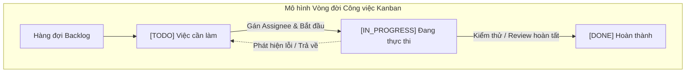

## 2.2. Các Mô hình Kiến trúc Phần mềm Hiện đại
Trong thiết kế hệ thống phần mềm doanh nghiệp, việc lựa chọn kiến trúc đóng vai trò quyết định đến độ tin cậy, khả năng bảo trì và tốc độ phát triển. Nhóm nghiên cứu đã phân tích 3 mô hình kiến trúc phổ biến:

1. **Microservices Architecture:** Phù hợp với các tập đoàn có quy mô hàng trăm kỹ sư, nhưng mang lại chi phí vận hành hạ tầng (DevOps Overhead), độ trễ mạng giữa các dịch vụ (Network Latency) và sự phức tạp trong việc duy trì tính nhất quán dữ liệu phân tán (Distributed Transactions - SAGA Pattern).
2. **Traditional Monolith:** Dễ triển khai ban đầu nhưng nhanh chóng trở thành "Khối cầu bùn khổng lồ" (Big Ball of Mud) khi quy mô mã nguồn phình to, mã nguồn bị phụ thuộc chéo và khó bảo trì.
3. **Modular Monolith (Kiến trúc Lựa chọn):** Là sự dung hòa hoàn hảo. Toàn bộ hệ thống được đóng gói trong một ứng dụng duy nhất nhưng được chia tách nghiêm ngặt thành các **Mô-đun độc lập (Business Modules)** theo ranh giới nghiệp vụ (Domain Boundaries). Các mô-đun giao tiếp với nhau thông qua Service Interfaces và Event Dispatchers rõ ràng. Khi cần thiết, từng mô-đun có thể dễ dàng tách ra thành một Microservice độc lập.

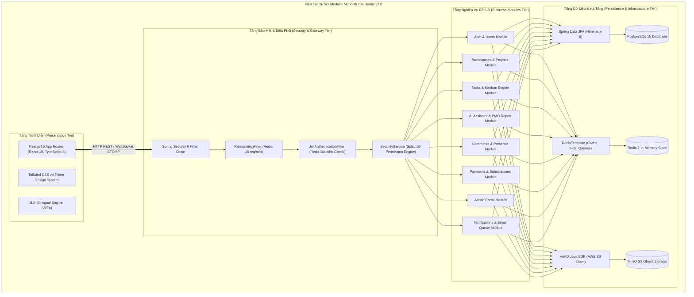

## 2.3. Công nghệ Giao tiếp Hai chiều Thời gian thực (WebSockets & STOMP)
Giao thức HTTP truyền thống hoạt động theo mô hình Request-Response một chiều (Half-duplex), bắt buộc client phải liên tục gửi yêu cầu (Polling) để kiểm tra dữ liệu mới, gây lãng phí băng thông và tạo tải ảo lên máy chủ.

Giao thức **WebSocket (RFC 6455)** khắc phục triệt để nhược điểm này bằng cách thiết lập một kết nối TCP liên tục, cho phép cả Client và Server gửi dữ liệu bất cứ lúc nào với phần mào đầu (Header Overhead) chỉ từ 2 đến 10 bytes.

Để quản lý các kênh thông điệp phức tạp, hệ thống ứng dụng **STOMP (Simple Text Oriented Messaging Protocol)** làm giao thức tầng con (Sub-protocol) trên nền WebSocket. STOMP định nghĩa các lệnh chuẩn như `CONNECT`, `SUBSCRIBE`, `SEND`, `MESSAGE`, `DISCONNECT`, cho phép xây dựng mô hình Pub/Sub linh hoạt:

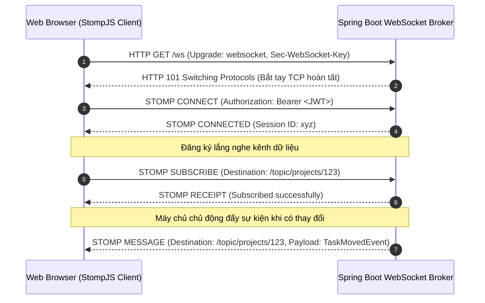

## 2.4. Trí tuệ Nhân tạo Tạo sinh (Generative AI) & Kỹ nghệ Prompt
Trong đề tài này, Trí tuệ Nhân tạo không được tích hợp như một tiện ích phụ trợ mà đóng vai trò là một **Động cơ Trợ lý Quản trị (Autonomous PMO Engine)**. 

### Kỹ nghệ Câu lệnh Có Cấu trúc Chặt chẽ (Strict JSON Output Engineering):
Các mô hình học sâu như **Google Gemini 2.0 Flash** thường có xu hướng trả về văn bản tự do kèm các khối định dạng Markdown. Để đảm bảo ứng dụng Java và giao diện Next.js có thể phân tích cú pháp (Parse) mà không bao giờ gặp lỗi `JsonParseException`, kỹ thuật Prompt Engineering được thiết kế như sau:
1. **Thiết lập Vai trò Cấp cao (System Persona):** Định vị mô hình là *Chief PMO & Senior Agile Technical Auditor* am hiểu các chỉ số Scrum/Kanban.
2. **Ràng buộc Đầu ra Tuyệt đối (Absolute Constraints):** Ép buộc trả về DUY NHẤT một JSON Array hợp lệ bắt đầu bằng `[` và kết thúc bằng `]`, cấm sử dụng ký tự xuống dòng thô trong chuỗi văn bản (`\n`), cấm bọc thẻ Markdown ` ```json `.
3. **Cấu trúc Dữ liệu Biểu đồ Định lượng:** Mỗi phần báo cáo bắt buộc phải đi kèm đối tượng dữ liệu biểu đồ (`chartData`, `chartType`, `chartLabels`, `chartValues`) tương thích 100% với động cơ vẽ biểu đồ của hệ thống.

## 2.5. Cơ chế Bộ đệm In-Memory và Hàng đợi Thông điệp (Redis)
**Redis 7** được triển khai như một thành phần hạ tầng đa chức năng, phục vụ đồng thời 4 mục đích quan trọng:
1. **JWT Token Blacklist:** Lưu trữ các token đã đăng xuất với TTL bằng đúng thời hạn sống còn lại của token, hiện thực hóa cơ chế vô hiệu hóa phiên làm việc ngay lập tức.
2. **Fixed Window Rate Limiting:** Sử dụng cấu trúc `INCR` và `EXPIRE` nguyên tử để giới hạn tần suất gọi API AI (tối đa 15 yêu cầu / phút / IP).
3. **User Presence Detection:** Sử dụng Redis Sets (`task:viewers:{taskId}`) để theo dõi người dùng đang mở tab thảo luận trực tiếp, tự động ngắt chuông thông báo trùng lặp.
4. **Reliable Message Queue:** Sử dụng cấu trúc danh sách Redis List (`email-invitations-queue`) với cơ chế Blocking Pop (`BRPOP`) để vận hành hàng đợi gửi email bất đồng bộ.

## 2.6. Hệ thống Lưu trữ Đối tượng Phân tán (Object Storage S3)
Hệ thống tích hợp **MinIO S3 SDK**, một giải pháp lưu trữ đối tượng mã nguồn mở tương thích hoàn toàn với chuẩn AWS S3 API. Thay vì lưu tệp trực tiếp trong cơ sở dữ liệu (gây phình to kích thước DB) hoặc lưu trên ổ đĩa cục bộ của máy chủ (gây khó khăn khi mở rộng ngang - Horizontal Scaling), toàn bộ tài liệu dự án, tệp đính kèm công việc và ảnh đại diện đều được tải lên MinIO Bucket `smartmanager` và quản lý truy xuất qua đường dẫn URL an toàn.

## 2.7. Tổng hợp Hệ sinh thái Công nghệ Lựa chọn
Bảng đối soát chi tiết toàn bộ công nghệ được áp dụng thực tế trong mã nguồn:

| Thành phần | Tên công nghệ | Phiên bản | Mục đích & Chức năng cụ thể trong mã nguồn |
| :--- | :--- | :---: | :--- |
| **Backend Runtime** | OpenJDK | 21 LTS | Chạy ứng dụng Java, tận dụng Virtual Threads và tối ưu bộ nhớ |
| **Backend Framework**| Spring Boot | 3.4.1 | Nền tảng phát triển ứng dụng phân tầng, DI Container, REST APIs |
| **Bảo mật & Xác thực**| Spring Security | 6.x | Thiết lập Filter Chain, CORS, CSRF Stateless, xác thực JWT |
| **Thư viện JWT** | JJWT (io.jsonwebtoken) | 0.11.5 | Tạo, băm chữ ký số HMAC-SHA256 và giải mã JWT Claims |
| **Truy cập CSDL** | Spring Data JPA (Hibernate)| 6.x | Quản trị giao dịch, ORM mapping, tối ưu hóa truy vấn Derived Queries |
| **Cơ sở dữ liệu** | PostgreSQL | 15-alpine | Hệ quản trị CSDL quan hệ chính, lưu trữ UUID, JSON, quan hệ 3NF |
| **Bộ đệm & Hàng đợi** | Redis | 7-alpine | In-Memory Key-Value Store, Rate Limiting, Token Blacklisting, Queues |
| **Giao tiếp Realtime** | Spring WebSocket (STOMP)| 3.4.1 | Message Broker `/topic`, đồng bộ Kanban và chat thời gian thực |
| **Lưu trữ Đối tượng** | MinIO Java SDK | 8.5.7 | Giao tiếp S3 API, quản lý upload/download file đính kèm dự án |
| **Dịch vụ Gửi Email** | Spring Mail (Jakarta Mail) | 3.4.1 | Gửi hóa đơn thanh toán HTML, thư mời workspace qua Gmail SMTP |
| **Frontend Runtime** | Node.js | 20 LTS | Môi trường thực thi JavaScript/TypeScript cho Next.js |
| **Frontend Framework**| Next.js (App Router) | 16.2.10 | Framework React fullstack, Server/Client Components, Route Handlers |
| **Thư viện UI** | React | 19.2.4 | Xây dựng cây DOM ảo, Custom Hooks, Context Providers |
| **Ngôn ngữ Giao diện**| TypeScript | ^5.0 | Đảm bảo an toàn kiểu dữ liệu (Strict Type-checking) |
| **CSS & Design System**| Tailwind CSS | v4.0 | Hệ thống Design Tokens, tiện ích CSS, Dark/Light Mode |
| **Icon Đồ họa** | Lucide React | ^1.25.0 | Bộ biểu tượng đồ họa vector sắc nét, tải bất đồng bộ |
| **Xử lý Bảng tính** | SheetJS (xlsx) | ^0.18.5 | Đọc/Ghi file Excel `.xlsx`, xuất báo cáo người dùng & doanh thu |
| **WebSocket Client** | @stomp/stompjs | ^7.3.0 | Thư viện STOMP Client kết nối WebSocket, tự động kết nối lại (Auto-reconnect) |
| **Fallback WebSocket**| sockjs-client | ^1.6.1 | Cơ chế dự phòng khi mạng client chặn giao thức WebSocket thuần |
| **Cổng AI Chính** | Google Gemini API | 2.0 Flash | Sinh báo cáo PMO, phân tích tiến độ, tìm kiếm ngữ nghĩa |
| **Cổng AI Dự phòng** | OpenRouter Gateway | v1 API | Cổng định tuyến AI sang các mô hình DeepSeek R1, Qwen 2.5, Llama 3 |
| **Cổng Thanh toán VN**| VNPay Gateway | 2.1.0 | Cổng thanh toán quốc gia, băm HMAC-SHA512, tạo mã VietQR Napas |
| **Cổng Thanh toán QT**| PayPal Smart Buttons | SDK JS | Cổng thanh toán quốc tế qua thẻ tín dụng Visa/Mastercard |
| **Đóng gói Dịch vụ** | Docker & Docker Compose | 3.8 | Đóng gói 5 container độc lập (App, Web, DB, Redis, S3) |
| **Tự động hóa CI/CD** | GitHub Actions | v4 | Pipeline tự động kiểm thử JUnit 5, build JAR và Next.js build |
| **Khung Kiểm thử** | JUnit 5 + Mockito | 5.x | Bộ kiểm thử đơn vị, kiểm thử tích hợp MockMvc và Service Tests |

---

# CHƯƠNG 3: PHÂN TÍCH VÀ THIẾT KẾ HỆ THỐNG

## 3.1. Phân tích Yêu cầu Hệ thống Chi tiết

### 3.1.1. Đặc tả Yêu cầu Chức năng (Functional Requirements - FR)

#### [FR1] Phân hệ Xác thực & Quản trị Định danh Người dùng
* **FR1.1 - Đăng ký tài khoản truyền thống:** Người dùng cung cấp Họ tên, Email hợp lệ và Mật khẩu (tối thiểu 6 ký tự). Hệ thống tự động băm mật khẩu bằng BCrypt, tự động tạo ảnh đại diện SVG mặc định qua Dicebear API và gán gói cước ban đầu là `FREE`.
* **FR1.2 - Đăng nhập truyền thống:** Người dùng nhập Email và Mật khẩu. Hệ thống xác thực với mã băm trong CSDL và phát hành chuỗi mã JSON Web Token (JWT) có thời hạn 24 giờ.
* **FR1.3 - Đăng nhập một chạm qua Google OAuth 2.0:** Tích hợp Google Identity Services (GIS) SDK. Hệ thống nhận JWT ID Token từ Google, xác thực với Google OAuth2 Server, tự động tạo tài khoản nếu chưa tồn tại và cấp JWT phiên làm việc.
* **FR1.4 - Tự động cấp quyền Quản trị tối cao (Admin Auto-Promotion):** Nếu email đăng ký hoặc đăng nhập thuộc danh sách quản trị viên hệ thống định sẵn (`hoamyngothi@gmail.com`), hệ thống tự động cấp vai trò `systemRole = 'ADMIN'` và gói dịch vụ `subscriptionPlan = 'ENTERPRISE'`.
* **FR1.5 - Đăng xuất an toàn & Thu hồi Token (JWT Blacklisting):** Khi người dùng chọn đăng xuất, hệ thống trích xuất chuỗi JWT từ header `Authorization` và ghi nhận vào Redis Blacklist với TTL 24 giờ, ngăn chặn tái sử dụng token.
* **FR1.6 - Quản lý Hồ sơ Cá nhân:** Cho phép xem thông tin gói cước, số ngày VIP còn lại, tải ảnh đại diện lên MinIO và đổi mật khẩu an toàn.

#### [FR2] Phân hệ Quản trị Không gian làm việc (Workspaces)
* **FR2.1 - Tạo và Quản lý Không gian:** Người dùng có thể tạo nhiều Không gian làm việc. Người tạo mặc định là `OWNER` và `ADMIN`.
* **FR2.2 - Mời Thành viên Linh hoạt:** Hỗ trợ 2 chế độ mời: Mời đơn lẻ theo địa chỉ Email hoặc Mời hàng loạt bằng cách tải lên tệp Excel (`.xlsx`), hệ thống tự động quét và bóc tách danh sách email hợp lệ.
* **FR2.3 - Hàng đợi Gửi Thư mời qua Redis:** Lời mời được đẩy vào Redis Queue `email-invitations-queue` để gửi thư mời HTML bất đồng bộ, tránh nghẽn luồng xử lý chính.
* **FR2.4 - Quản lý Phân quyền Tùy chỉnh (Custom Roles & Permissions):** Admin Không gian có thể tạo các vai trò mới (ví dụ: `Developer`, `Tester`, `Tech Lead`) và cấu hình ma trận 16 quyền hạn chi tiết.
* **FR2.5 - Cơ chế Ghi đè Quyền Cá nhân (Member Overrides):** Cho phép bật/tắt quyền hạn cụ thể cho từng thành viên độc lập với vai trò chung của họ.
* **FR2.6 - Kho Tài liệu Tập trung & Cây Thư mục Đệ quy:** Hỗ trợ tạo thư mục lồng nhau không giới hạn cấp độ (`parent_id`) và tải lên tài liệu đính kèm.
* **FR2.7 - Quy trình Xin Rời Nhóm An toàn (Leave Request):** Thành viên gửi đơn xin rời nhóm tới các Admin. Nếu người xin rời là Admin duy nhất, hệ thống bắt buộc phải chuyển giao quyền Admin trước khi rời.

#### [FR3] Phân hệ Quản lý Dự án (Projects)
* **FR3.1 - Khởi tạo Dự án:** Tạo dự án con trực thuộc một Workspace. Khi tạo mới, hệ thống tự động đồng bộ toàn bộ thành viên hiện có của Workspace vào dự án với vai trò tương ứng.
* **FR3.2 - Kế thừa & Phân quyền Cấp Dự án:** Cho phép phân quyền độc lập ở cấp dự án (`ADMIN`, `MEMBER`, `VIEWER`). Thành viên có quyền `VIEWER` ở cấp Workspace chỉ có thể thấy các dự án mà họ được gán quyền rõ ràng.
* **FR3.3 - Quy trình Phê duyệt Xóa Dự án Hai Bước (Two-Phase Approval / Dual-Control):** Project Admin không thể xóa trực tiếp dự án mà phải gửi đề xuất xóa kèm lý do. Đề xuất chuyển trạng thái dự án sang `DELETION_PENDING` và thông báo tới tất cả Workspace Admin để thẩm định và phê duyệt (Approve/Reject).

#### [FR4] Phân hệ Quản lý Công việc & Bảng Kanban (Tasks Engine)
* **FR4.1 - Bảng Điều khiển Kanban Trực quan:** Hiển thị công việc theo 3 cột chuẩn `TODO`, `IN_PROGRESS`, `DONE`.
* **FR4.2 - Kéo thả Không Độ trễ với Thuật toán Fractional Positioning:** Di chuyển thẻ công việc giữa các cột hoặc thay đổi vị trí trong cột, vị trí mới được tính bằng số thực $OO(1) dựa trên 2 phần tử lân cận.
* **FR4.3 - Tạo Công việc Hàng loạt từ Excel:** Cho phép tải lên bảng tính `.xlsx` mẫu chứa danh sách hàng chục tác vụ, hệ thống tự động trích xuất tiêu đề, mô tả, độ ưu tiên, hạn chót và khởi tạo đồng loạt.
* **FR4.4 - Cấu trúc Cây Công việc Con (Hierarchical Subtasks):** Hỗ trợ tạo các công việc con liên kết đệ quy tới công việc cha qua `parent_task_id`, hỗ trợ tick chọn hoàn thành và tính toán tiến độ %.
* **FR4.5 - Quản lý Chi tiết Tác vụ:** Gán người thực hiện (Assignee), thiết lập mức độ ưu tiên (`LOW`, `MEDIUM`, `HIGH`, `URGENT`), hạn hoàn thành (Due Date), đính kèm tệp tin đa định dạng.
* **FR4.6 - Nhật ký Kiểm toán Công việc (Task Audit Trail):** Mọi thao tác tạo, cập nhật trạng thái, đổi người thực hiện, sửa nội dung đều được tự động lưu vào bảng `task_logs`.
* **FR4.7 - Cảnh báo Hạn chót Tự động (24h Deadline Scheduler):** Background scheduler quét định kỳ mỗi 1 phút, tự động gửi email cảnh báo cho người được phân công khi công việc còn dưới 24 giờ đến hạn chót mà chưa hoàn thành.

#### [FR5] Phân hệ Trợ lý AI Thông minh (AI Assistant)
* **FR5.1 - Báo cáo Tổng kết Điều hành PMO 5 Phân hệ:** Tự động tổng hợp dữ liệu tác vụ và nhật ký 24h qua, gửi Prompt có cấu trúc tới Google Gemini 2.0 Flash để nhận về báo cáo toàn diện gồm 5 khối nội dung và 5 mô hình biểu đồ số liệu:
  1. *Sức khỏe Dự án & Tỷ lệ Hoàn thành* (Biểu đồ `doughnut`).
  2. *Ma trận Phân bổ Khối lượng & Ưu tiên* (Biểu đồ `bar`).
  3. *Đánh giá Rủi ro & Task Quá hạn* (Biểu đồ `radar` 5 chiều).
  4. *Nhịp độ Vận hành Nhóm 24h* (Biểu đồ `stackedBar`).
  5. *Lộ trình Dự báo Về đích Tuần 1-4* (Biểu đồ `line`).
* **FR5.2 - Tìm kiếm Ngữ nghĩa Thông minh (Semantic Search):** Người dùng nhập truy vấn bằng ngôn ngữ tự nhiên (ví dụ: *"Tìm các việc liên quan đến thiết kế giao diện bị trễ hạn"*). AI phân tích ngữ cảnh, tính toán điểm số phù hợp (`relevanceScore` từ 0.0 đến 1.0) và trích xuất nguyên nhân phù hợp.
* **FR5.3 - Phân rã Công việc Thông minh (AI Auto-Subtasks):** Dựa trên tiêu đề và mô tả công việc, AI tự động sinh danh sách các bước hành động cụ thể và lưu vào cơ sở dữ liệu.
* **FR5.4 - Cổng Dự phòng Kép (Dual Fallback):** Tự động chuyển hướng sang OpenRouter AI Gateway khi Google Gemini gặp lỗi hạn mức (Quota 429) hoặc mạng gián đoạn.

#### [FR6] Phân hệ Thảo luận & Tương tác Thời gian thực
* **FR6.1 - Thảo luận Phân cấp Cây (Nested Threading Comments):** Cho phép trả lời trực tiếp vào một bình luận cụ thể (`parent_comment_id`). Bình luận gốc hiển thị mới nhất trước, các bình luận con hiển thị theo luồng thời gian tăng dần.
* **FR6.2 - Thả tim / Thích Bình luận:** Cho phép thành viên thả tim bình luận, danh sách người thích được lưu trong bảng phụ và cập nhật realtime.
* **FR6.3 - Tối ưu Hiện diện Trực tuyến & Chống Spam Thông báo (Presence Optimization):** Sử dụng Redis Set theo dõi người dùng đang mở tab thảo luận trực tiếp để tự động loại trừ khỏi danh sách gửi thông báo, tránh làm phiền.
* **FR6.4 - Phòng Chat Nhóm Thời gian thực (ChatWidget):** Chat trực tiếp theo kênh Workspace hoặc Project, hỗ trợ đính kèm ảnh thu nhỏ, chia sẻ tài liệu từ kho lưu trữ và phát âm thanh chuông đôi qua Web Audio API.

#### [FR7] Phân hệ Luồng Thông báo Tương tác (Notifications)
* **FR7.1 - Đẩy Thông báo Realtime qua WebSocket:** Nhận thông báo tức thời về phân công công việc, bình luận mới, lời mời dự án qua kênh riêng `/topic/notifications/{userId}`.
* **FR7.2 - Thông báo Tương tác Phê duyệt Trực tiếp:** Đối với lời mời (`INVITATION`) hoặc đơn xin rời (`LEAVE_REQUEST`), người dùng có thể nhấn nút "Chấp nhận" / "Từ chối" hoặc "Phê duyệt" trực tiếp trên danh sách thông báo hoặc modal trung tâm.
* **FR7.3 - Điều hướng Thông minh (Deep Navigation):** Nhấn vào thông báo bình luận sẽ tự động mở đúng bảng Kanban, mở modal chi tiết task và cuộn chuột tới đúng vị trí bình luận liên quan.

#### [FR8] Phân hệ Cổng Thanh toán & Quản lý Gói cước VIP
* **FR8.1 - Đa dạng Gói cước & Chu kỳ:** Cung cấp 3 gói (`FREE`, `PRO`, `ENTERPRISE`) với chu kỳ Tháng và Năm (chiết khấu 20%). Áp dụng mã giảm giá voucher (ví dụ: `HOMIX2026` giảm thêm 20%).
* **FR8.2 - Cổng Thanh toán Quốc gia VNPay:** Tích hợp chuẩn VNPay 2.1.0 với chữ ký số bảo mật HMAC-SHA512. Tự động sinh mã VietQR theo chuẩn Napas 247 cho phép chuyển khoản ngân hàng quét mã tức thời.
* **FR8.3 - Cổng Thanh toán Quốc tế PayPal:** Tích hợp PayPal Smart Buttons, tự động chuyển đổi tỷ giá VNĐ sang USD và xác nhận giao dịch qua REST API capture.
* **FR8.4 - Tự động Kích hoạt Gói & Xuất Hóa đơn Email:** Khi nhận được IPN/Webhook thành công, hệ thống kiểm tra tính lũy kế (Idempotent), nâng cấp gói tài khoản, gia hạn ngày hết hạn (+30 ngày hoặc +365 ngày) và kích hoạt `EmailService` gửi hóa đơn HTML sang trọng tới email khách hàng.
* **FR8.5 - Hủy Gói Thuê bao:** Cho phép người dùng chủ động hủy gia hạn gói VIP, đưa tài khoản về gói Free an toàn.

#### [FR9] Phân hệ Cổng Quản trị Toàn cục (System Admin Portal)
* **FR9.1 - Bảng Điều khiển KPI Toàn sàn:** Thống kê tổng doanh thu thực tế, số lượng người dùng (phân rã Pro/Enterprise), tổng số workspace và dự án hoạt động, biểu đồ 10 đơn hàng mới nhất.
* **FR9.2 - Quản lý Tài khoản & Cấp gói VIP Thủ công:** Tra cứu danh sách toàn bộ người dùng, lọc theo gói cước, trực tiếp gia hạn/nâng cấp gói hoặc thay đổi vai trò hệ thống (`ADMIN` / `USER`).
* **FR9.3 - Kiểm toán Giao dịch Tài chính:** Tra cứu toàn bộ lịch sử thanh toán qua các cổng VNPay, PayPal, MoMo kèm mã giao dịch duy nhất.
* **FR9.4 - Xuất Báo cáo Dữ liệu ra Excel (.xlsx):** Sử dụng SheetJS xuất danh sách người dùng (`Homix_Danh_Sach_Nguoi_Dung_YYYY-MM-DD.xlsx`) và báo cáo doanh thu (`Homix_Bao_Cao_Doanh_Thu_YYYY-MM-DD.xlsx`) kèm cả cột tiền VNĐ và USD đã quy đổi.
* **FR9.5 - Giám sát Hạ tầng Dịch vụ:** Theo dõi trạng thái hoạt động của 4 thành phần máy chủ: Spring Boot (8000), PostgreSQL (5433), MinIO S3 (9000/9001) và Redis (6379).

#### [FR10] Phân hệ Trải nghiệm Giao diện & Bản địa hóa
* **FR10.1 - Chuyển đổi Giao diện Tối / Sáng (Dark/Light Theme):** Hệ thống Design Tokens phân lớp, tích hợp mã script đồng bộ chống nhấp nháy FOUC.
* **FR10.2 - Đa ngôn ngữ Song ngữ Hoàn chỉnh (i18n):** Bộ từ điển hơn 120 cặp khóa dịch song ngữ Việt - Anh, tự động chuyển đổi định dạng tiền tệ VNĐ ↔ USD$USD.
* **FR10.3 - Xuất Báo cáo In PDF Tiêu chuẩn:** Tích hợp định dạng CSS in ấn (`@media print`), tự động ẩn thanh điều hướng và định dạng nền trắng chữ đen chuẩn văn phòng.

---

### 3.1.2. Đặc tả Yêu cầu Phi chức năng (Non-Functional Requirements - NFR)
* **NFR1 - Hiệu năng & Độ trễ (Performance & Latency):**
  * Thao tác kéo thả thẻ Kanban và phát sóng sự kiện qua WebSocket STOMP đạt độ trễ dưới **200ms**.
  * Các API REST xử lý nghiệp vụ thông thường phản hồi dưới **100ms** (ở mức 95th percentile).
  * Thời gian phản hồi của Trợ lý AI tổng hợp báo cáo PMO không vượt quá **5 giây**.
* **NFR2 - Tính Bảo mật Toàn diện (Security):**
  * Mật khẩu người dùng được băm một chiều bằng thuật toán **BCrypt** với độ phức tạp cao (Work Factor 10).
  * Mã thông báo JWT được ký đối xứng bằng thuật toán **HMAC-SHA256** với khóa bí mật tối thiểu 256 bits.
  * Toàn bộ dữ liệu truyền tải trên mạng bắt buộc mã hóa qua giao thức an toàn **HTTPS / WSS (TLS 1.3)**.
  * Cổng thanh toán VNPay bắt buộc đối soát chữ ký số bằng thuật toán **HMAC-SHA512**.
  * Ngăn chặn tấn công lạm dụng tài nguyên AI bằng cơ chế **Rate Limiting 15 yêu cầu / phút / IP** trên Redis.
* **NFR3 - Tính Nhất quán & Toàn vẹn Dữ liệu (ACID & Data Integrity):**
  * Tất cả các thao tác thay đổi dữ liệu trọng yếu (Nâng cấp gói, Chuyển quyền, Xóa dự án, Kéo thả task) phải được bao bọc trong giao dịch CSDL `@Transactional`.
  * Ràng buộc toàn vẹn khóa ngoại (Foreign Key Constraints) với các chính sách `ON DELETE CASCADE` và `ON DELETE SET NULL` chặt chẽ.
* **NFR4 - Khả năng Mở rộng (Scalability):**
  * Ứng dụng thiết kế theo mô hình không lưu trạng thái phiên trên bộ nhớ máy chủ (Stateless Web Tier), cho phép mở rộng ngang (Horizontal Scaling) bằng cách tăng số lượng container backend phía sau Load Balancer.
  * Tệp tin và tài liệu được lưu trữ phân tán trên MinIO S3 Object Storage, không gây gánh nặng dung lượng lên CSDL.
* **NFR5 - Khả năng Sẵn sàng & Chịu lỗi (High Availability & Fault Tolerance):**
  * Động cơ AI trang bị cơ chế **Dual Fallback**, tự động chuyển sang OpenRouter Gateway nếu Google Gemini gặp sự cố.
  * WebSocket STOMP Client phía frontend có cơ chế tự động kết nối lại (**Auto-Reconnect sau 5s**) khi mạng gián đoạn.
  * Trình bóc tách JSON trang bị bộ lọc Regex thích ứng lỗi, đảm bảo không làm gián đoạn trải nghiệm người dùng.
* **NFR6 - Tính Thân thiện & Tiện dụng (Usability & Accessibility):**
  * Giao diện thiết kế theo chuẩn Responsive Design, tương thích hoàn hảo trên các độ phân giải màn hình từ Điện thoại (Mobile), Máy tính bảng (Tablet) đến Màn hình máy tính lớn (Desktop).
  * Hỗ trợ đầy đủ phím tắt thao tác nhanh, hiệu ứng âm thanh chuông phản hồi Web Audio API, và thông báo Toast nổi.

---

## 3.2. Thiết kế Mô hình Ca sử dụng (Use Case Modeling)

### 3.2.1. Biểu đồ Use Case Tổng thể
Hệ thống xác định 4 tác nhân (Actors) chính:
1. **Khách vãng lai (Guest):** Người dùng chưa đăng nhập, có thể xem Landing page, Bảng giá, Tính năng, Điều khoản và Đăng ký/Đăng nhập.
2. **Người dùng Đăng ký (User):** Thành viên sở hữu tài khoản, có thể quản lý hồ sơ, tạo Workspace, mua gói VIP.
3. **Thành viên Dự án (Project Member):** Thành viên tham gia vào dự án với các vai trò `ADMIN`, `MEMBER` hoặc `VIEWER`, tương tác với bảng Kanban, tài liệu, AI và chat.
4. **Quản trị viên Hệ thống (System Admin):** Tài khoản quản trị toàn sàn có quyền truy cập độc quyền vào Cổng Admin Portal (`/admin`).

```mermaid
graph TD
    Guest((Khách vãng lai))
    User((Người dùng))
    Member((Thành viên Dự án))
    SysAdmin((Quản trị viên Hệ thống))

    subgraph "NỀN TẢNG HOMIX v2.0"
        subgraph "Phân hệ Tài khoản & Xác thực"
            UC1["Đăng ký / Đăng nhập (Email / Google)"]
            UC2["Đăng xuất (Thu hồi JWT)"]
            UC3["Quản lý Hồ sơ & Đổi Avatar"]
            UC4["Nâng cấp VIP (VNPay / PayPal)"]
        end

        subgraph "Phân hệ Không gian & Phân quyền"
            UC5["Tạo & Quản trị Workspace"]
            UC6["Cấu hình Ma trận 16 Quyền hạn"]
            UC7["Mời thành viên (Email / Excel)"]
            UC8["Quản lý Cây Thư mục Tài liệu"]
        end

        subgraph "Phân hệ Dự án & Kanban Thông minh"
            UC9["Tạo / Xin Phê duyệt Xóa Dự án"]
            UC10["Kéo thả Kanban (Fractional Positioning)"]
            UC11["Tạo việc hàng loạt từ Excel"]
            UC12["Thảo luận Cây lồng nhau & Thả tim"]
            UC13["Chat Nhóm Thời gian thực"]
        end

        subgraph "Phân hệ Trợ lý AI Thông minh"
            UC14["Tạo Báo cáo PMO 5 Phần & Biểu đồ"]
            UC15["Tìm kiếm Ngữ nghĩa AI (Semantic Search)"]
            UC16["Tự động Phân rã Subtasks bằng AI"]
        end

        subgraph "Phân hệ Quản trị Toàn cục"
            UC17["Xem Thống kê KPI Doanh thu & Người dùng"]
            UC18["Quản lý Tài khoản & Cấp Gói VIP"]
            UC19["Xuất Báo cáo Doanh thu ra Excel (.xlsx)"]
            UC20["Giám sát Trạng thái Hạ tầng Server"]
        end
    end

    Guest --> UC1
    User --> UC1 & UC2 & UC3 & UC4 & UC5 & UC7
    Member --> UC6 & UC8 & UC9 & UC10 & UC11 & UC12 & UC13 & UC14 & UC15 & UC16
    SysAdmin --> UC17 & UC18 & UC19 & UC20
```

---

### 3.2.2. Các Biểu đồ Use Case Phân rã theo Phân hệ

#### 1. Biểu đồ Use Case Phân rã: Phân hệ Kanban & AI Thông minh

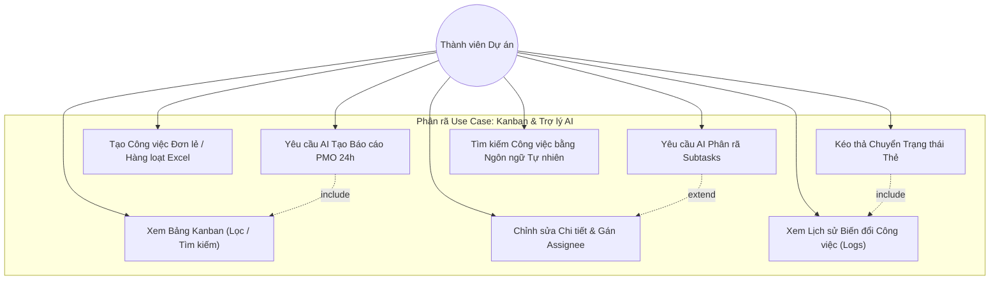

#### 2. Biểu đồ Use Case Phân rã: Phân hệ Thanh toán VIP & Quản trị Admin Portal

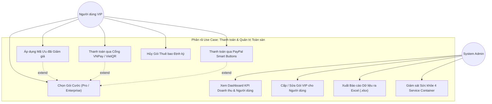

---

### 3.2.3. Kịch bản Đặc tả Ca sử dụng Chi tiết (Use Case Specifications)

#### [UC-SPEC-01] Kéo thả thay đổi trạng thái công việc (Move Task on Kanban)
* **Mã ca sử dụng:** `UC-KANBAN-01`
* **Tên ca sử dụng:** Kéo thả thẻ công việc và đồng bộ thời gian thực.
* **Tác nhân chính:** Thành viên dự án (có quyền tối thiểu `MEMBER` hoặc quyền `TASK_UPDATE`).
* **Mục đích:** Thay đổi trạng thái (`TODO`, `IN_PROGRESS`, `DONE`) hoặc sắp xếp lại thứ tự ưu tiên của thẻ công việc trên bảng Kanban.
* **Điều kiện tiên quyết (Pre-conditions):**
  1. Người dùng đã đăng nhập thành công và sở hữu JWT hợp lệ.
  2. Người dùng có quyền truy cập vào dự án mục tiêu (`PROJECT_VIEW`).
  3. Kết nối WebSocket STOMP tới `/topic/projects/{projectId}` đang ở trạng thái `CONNECTED`.
* **Luồng sự kiện chính (Main Success Scenario):**
  1. Người dùng nhấp giữ chuột vào thẻ công việc và kéo sang cột trạng thái mới (hoặc vị trí mới trong cùng cột).
  2. Giao diện Next.js tính toán tọa độ của 2 thẻ lân cận: `prevPosition` và `nextPosition`.
  3. Giao diện gửi yêu cầu `PATCH /api/tasks/{taskId}/move` kèm payload JSON: `{ newStatus, prevPosition, nextPosition }`.
  4. Bộ lọc bảo mật `SecurityService.hasTaskRole(taskId, 'MEMBER')` xác thực quyền hạn.
  5. `TaskService` tính toán vị trí số thực mới theo giải thuật Fractional Positioning:
     $$position = (prevPosition + nextPosition) / 2.0$$
  6. Hệ thống cập nhật bản ghi trong bảng `tasks` và ghi một dòng nhật ký vào bảng `task_logs` với `action_type = 'UPDATE_STATUS'`.
  7. Nếu trạng thái chuyển sang khác `DONE`, hệ thống reset cờ `reminded = false`.
  8. `TaskService` gọi `SimpMessagingTemplate` phát sóng gói tin `TaskMessage("MOVE", payload)` tới kênh WebSocket `/topic/projects/{projectId}`.
  9. Tất cả các thành viên khác đang mở màn hình dự án nhận được thông điệp và giao diện của họ tự động dịch chuyển thẻ công việc sang vị trí mới ngay lập tức mà không cần tải lại trang.
  10. Máy chủ phản hồi mã HTTP `200 OK` cho người gửi.
* **Luồng sự kiện thay thế / Ngoại lệ (Alternative Flows):**
  * *4a. Người dùng không có quyền chỉnh sửa:* Hệ thống từ chối truy cập, phản hồi HTTP `403 Forbidden` kèm thông báo lỗi. Giao diện người dùng tự động hoàn tác vị trí thẻ về vị trí ban đầu.
  * *8a. Mất kết nối WebSocket:* Hệ thống vẫn lưu CSDL thành công; client kích hoạt cơ chế tự động kết nối lại sau 5 giây.
* **Điều kiện sau khi thực hiện (Post-conditions):**
  * Trạng thái và vị trí công việc được cập nhật chuẩn xác trong PostgreSQL.
  * Lịch sử thao tác được ghi vết phục vụ kiểm toán và làm ngữ cảnh cho AI.
  * Màn hình của toàn bộ thành viên trong dự án hiển thị đồng nhất.

---

#### [UC-SPEC-02] Tự động tạo Báo cáo Quản trị PMO 5 Phân hệ bằng AI (Generate AI PMO Report)
* **Mã ca sử dụng:** `UC-AI-01`
* **Tên ca sử dụng:** Tổng hợp báo cáo tiến độ và phân tích dữ liệu dự án bằng AI.
* **Tác nhân chính:** Thành viên dự án (có quyền `VIEWER` hoặc `PROJECT_VIEW`).
* **Mục đích:** Tự động hóa quá trình lập báo cáo điều hành dự án hàng ngày, phân tích điểm nghẽn và đưa ra dự báo tiến độ trực quan.
* **Điều kiện tiên quyết:**
  1. Người dùng đã đăng nhập và đang ở màn hình chi tiết dự án.
  2. Địa chỉ IP của người dùng chưa vượt quá giới hạn 15 yêu cầu AI / phút.
* **Luồng sự kiện chính (Main Success Scenario):**
  1. Người dùng nhấn vào nút **"Trợ Lý Báo Cáo AI"** trên thanh công cụ của dự án.
  2. Giao diện gửi yêu cầu `GET /api/ai/project/{projectId}/summary?lang=vi`.
  3. Bộ lọc `RateLimitingFilter` kiểm tra số đếm trên Redis. Nếu < 15, tăng đếm và cho phép đi tiếp.
  4. `AiService` truy vấn toàn bộ danh sách công việc của dự án từ `TaskRepository` và danh sách nhật ký hoạt động trong 24 giờ qua từ `TaskLogRepository`.
  5. `AiService` tính toán các chỉ số định lượng: Tổng số task, số task Done, In Progress, To Do, số lượng task quá hạn, số task theo mức độ ưu tiên và tỷ lệ hoàn thành dự án.
  6. `AiService` xây dựng câu lệnh Prompt ràng buộc nghiêm ngặt cấu trúc JSON Array 5 phần.
  7. `OpenRouterServiceClient` gọi API tới Google Gemini 2.0 Flash (`gemini-2.0-flash`).
  8. Mô hình AI phân tích và trả về chuỗi JSON chứa 5 phân hệ báo cáo cùng 5 bộ dữ liệu biểu đồ.
  9. `AiService` làm sạch chuỗi, bóc tách JSON và trả về cho Controller.
  10. Giao diện Next.js nhận dữ liệu, hiển thị bảng điều khiển PMO cao cấp với 5 khối phân tích và tự động vẽ 5 biểu đồ tương tác (`doughnut`, `bar`, `radar`, `stackedBar`, `line`).
* **Luồng sự kiện thay thế / Ngoại lệ (Alternative Flows):**
  * *3a. Người dùng gọi quá 15 lần/phút:* `RateLimitingFilter` ngắt yêu cầu, phản hồi HTTP `429 Too Many Requests` kèm thông báo *"Bạn đã vượt quá giới hạn 15 lượt gọi AI / phút. Vui lòng chờ 60 giây"*.
  * *4a. Dự án chưa có công việc nào:* `AiService` phát hiện danh sách rỗng, trả về trực tiếp mẫu JSON template mặc định mà không cần tốn token gọi AI.
  * *7a. Google Gemini API gặp lỗi (429 Quota hoặc Timeout):* `OpenRouterServiceClient` tự động kích hoạt Tầng 2 (Secondary Fallback), chuyển hướng yêu cầu sang OpenRouter Gateway (`deepseek-r1` hoặc `qwen-2.5`) để lấy kết quả thay thế.
* **Điều kiện sau khi thực hiện:** Người dùng nhận được báo cáo quản trị toàn diện, có thể xem trực tiếp hoặc nhấn nút in xuất bản báo cáo ra PDF chuẩn văn phòng.

---

#### [UC-SPEC-03] Thanh toán Nâng cấp Gói VIP qua Cổng VNPay (Payment via VNPay)
* **Mã ca sử dụng:** `UC-PAY-01`
* **Tên ca sử dụng:** Thanh toán nâng cấp gói VIP bằng VNPay / VietQR.
* **Tác nhân chính:** Người dùng đã đăng nhập hệ thống.
* **Mục đích:** Nâng cấp tài khoản từ gói `FREE` lên gói `PRO` hoặc `ENTERPRISE` để mở khóa toàn bộ tính năng cao cấp.
* **Điều kiện tiên quyết:** Người dùng đã đăng nhập và đang ở trang `/checkout`.
* **Luồng sự kiện chính (Main Success Scenario):**
  1. Người dùng chọn gói cước (`PRO` hoặc `ENTERPRISE`), chu kỳ (`annual` hoặc `monthly`), nhập mã giảm giá (nếu có) và chọn phương thức **"Cổng thanh toán VNPay / Quét mã QR"**.
  2. Giao diện gửi yêu cầu `POST /api/payments/create-order`.
  3. `PaymentService` tính toán số tiền thực tế sau chiết khấu, sinh mã giao dịch duy nhất `transactionId = "HOMIX_" + System.currentTimeMillis() + ...`.
  4. `PaymentService` khởi tạo bản ghi `PaymentOrderEntity` với trạng thái `PENDING`.
  5. `PaymentService` xây dựng URL thanh toán VNPay 2.1.0, sắp xếp bảng chữ cái các tham số, băm khóa bí mật bằng chữ ký số **HMAC-SHA512** và sinh mã VietQR Napas.
  6. Máy chủ trả về `paymentUrl` và `qrCodeUrl`. Giao diện hiển thị mã VietQR lớn cùng nút chuyển tiếp sang Cổng VNPay.
  7. Đồng thời, giao diện thiết lập cơ chế Polling tự động kiểm tra trạng thái đơn hàng mỗi 3 giây qua `GET /api/payments/order-status/{orderId}`.
  8. Khách hàng mở ứng dụng Mobile Banking quét mã QR hoặc nhập thông tin thẻ ATM nội địa trên cổng VNPay để hoàn tất thanh toán.
  9. VNPay gửi yêu cầu IPN Callback về máy chủ backend: `GET /api/payments/vnpay/callback?vnp_ResponseCode=00&vnp_TxnRef=...`.
  10. `PaymentService.confirmAndCompleteOrder()` xác thực mã phản hồi `vnp_ResponseCode == "00"`.
  11. Hệ thống cập nhật đơn hàng thành `COMPLETED`, cập nhật `UserEntity.subscriptionPlan` thành gói đã mua, gia hạn `subscriptionExpiresAt` (+30 ngày hoặc +365 ngày).
  12. Hệ thống kích hoạt `EmailService.sendPaymentSuccessEmail()` (chạy bất đồng bộ `@Async`) gửi email hóa đơn điện tử HTML sang trọng tới hòm thư người dùng.
  13. Lần Polling tiếp theo của Client phát hiện trạng thái đơn hàng đã là `COMPLETED`, giao diện lập tức chuyển sang màn hình chúc mừng nâng cấp thành công.
* **Luồng sự kiện thay thế:**
  * *10a. Khách hàng hủy thanh toán hoặc giao dịch thất bại:* VNPay trả về mã lỗi khác `00`. Hệ thống ghi nhận đơn hàng thất bại, giao diện hiển thị cảnh báo để người dùng thử lại.
* **Điều kiện sau khi thực hiện:** Tài khoản người dùng được nâng cấp đầy đủ quyền lợi VIP, nhận được hóa đơn email và dữ liệu được ghi nhận vào sổ cái doanh thu trên Admin Portal.

---

## 3.3. Thiết kế Luồng Dữ liệu (Data Flow Diagrams - DFD)

### 3.3.1. Sơ đồ Ngữ cảnh DFD Mức 0 (Context Diagram)
Sơ đồ ngữ cảnh thể hiện ranh giới tương tác giữa hệ thống Homix v2.0 và toàn bộ các thực thể ngoài (External Entities):

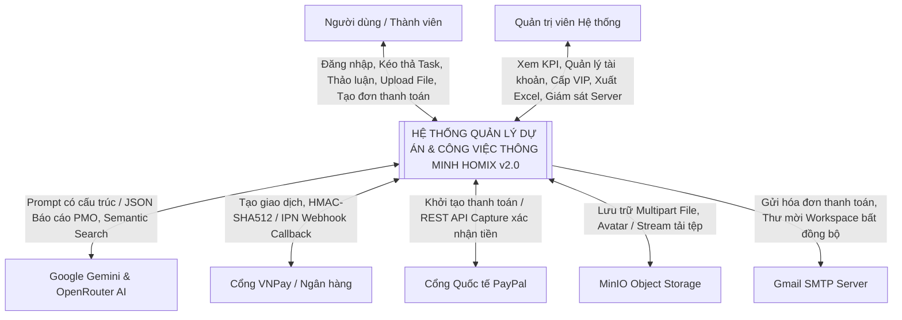

---

### 3.3.2. Sơ đồ Luồng Dữ liệu DFD Mức 1
Phân rã hệ thống thành 6 tiến trình xử lý cốt lõi:

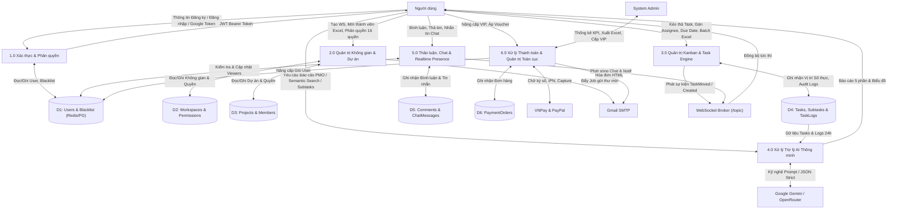

---

### 3.3.3. Sơ đồ Luồng Dữ liệu DFD Mức 2 cho các Phân hệ Trọng yếu

#### DFD Mức 2: Tiến trình 3.0 - Quản trị Kanban & Task Engine

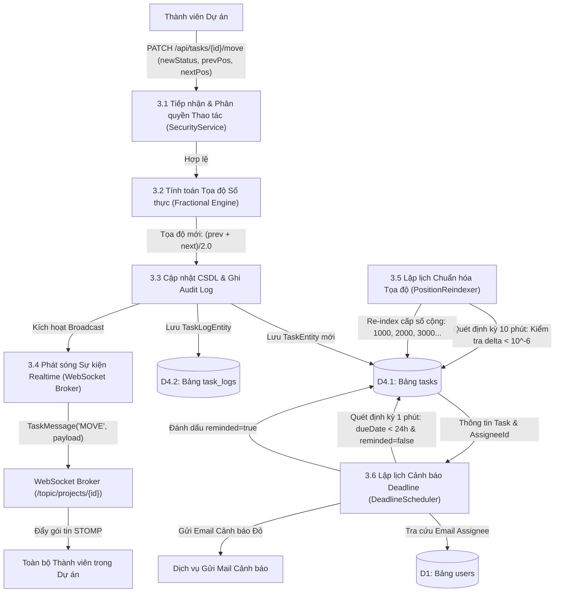

---

## 3.4. Thiết kế Cơ sở Dữ liệu Quan hệ (ERD & Data Dictionary)

### 3.4.1. Sơ đồ Quan hệ Thực thể (ERD chuẩn 3NF)

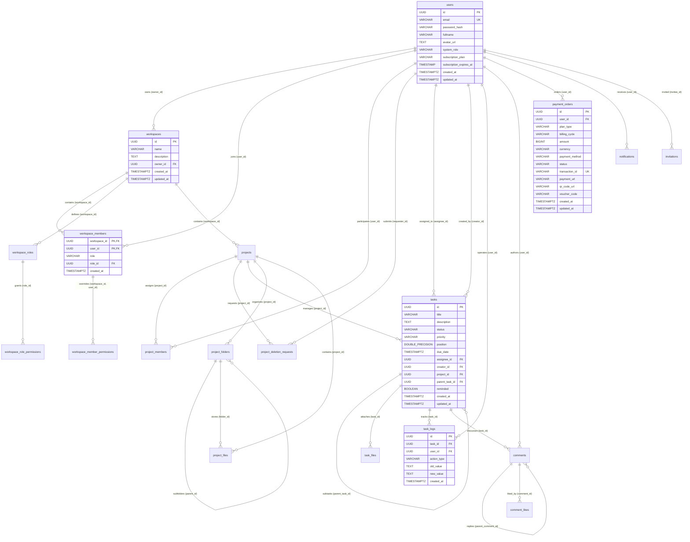

---

### 3.4.2. Từ điển Dữ liệu Chi tiết (Data Dictionary của 10 Bảng Thực thể Cốt lõi)

#### 1. Bảng `users` (Quản lý Định danh & Hồ sơ Tài khoản)
| Tên Cột | Kiểu Dữ Liệu | Ràng Buộc | Giá Trị Mặc Định | Ý Nghĩa Nghiệp Vụ |
| :--- | :--- | :--- | :--- | :--- |
| `id` | `UUID` | `PRIMARY KEY` | `gen_random_uuid()` | Định danh duy nhất toàn cầu của người dùng |
| `email` | `VARCHAR(255)` | `NOT NULL, UNIQUE` | Không | Địa chỉ Email đăng nhập duy nhất trên toàn hệ thống |
| `password_hash` | `VARCHAR(255)` | `NOT NULL` | Không | Chuỗi mã băm mật khẩu một chiều bằng BCrypt |
| `fullname` | `VARCHAR(100)` | `NOT NULL` | Không | Họ và tên hiển thị của người dùng |
| `avatar_url` | `TEXT` | `NULLABLE` | Dicebear SVG URL | Đường dẫn URL ảnh đại diện (MinIO hoặc Google) |
| `system_role` | `VARCHAR(50)` | `NOT NULL` | `'USER'` | Vai trò toàn cục trên hệ sinh thái: `USER`, `ADMIN` |
| `subscription_plan`| `VARCHAR(50)` | `NOT NULL` | `'FREE'` | Gói dịch vụ hiện tại: `FREE`, `PRO`, `ENTERPRISE` |
| `subscription_expires_at`| `TIMESTAMP`| `NULLABLE` | `NULL` | Thời điểm hết hạn gói VIP (Null nếu là gói FREE) |
| `created_at` | `TIMESTAMPTZ` | `NOT NULL` | `CURRENT_TIMESTAMP` | Thời điểm khởi tạo tài khoản |
| `updated_at` | `TIMESTAMPTZ` | `NOT NULL` | `CURRENT_TIMESTAMP` | Thời điểm cập nhật thông tin hồ sơ gần nhất |

#### 2. Bảng `workspaces` (Không gian Làm việc Tập trung)
| Tên Cột | Kiểu Dữ Liệu | Ràng Buộc | Giá Trị Mặc Định | Ý Nghĩa Nghiệp Vụ |
| :--- | :--- | :--- | :--- | :--- |
| `id` | `UUID` | `PRIMARY KEY` | `gen_random_uuid()` | Định danh duy nhất của Không gian làm việc |
| `name` | `VARCHAR(100)` | `NOT NULL` | Không | Tên không gian làm việc (Tên công ty / Nhóm) |
| `description` | `TEXT` | `NULLABLE` | Không | Mô tả mục tiêu, tôn chỉ hoạt động của không gian |
| `owner_id` | `UUID` | `NOT NULL, FK -> users(id) ON DELETE CASCADE` | Không | ID của chủ sở hữu sáng lập không gian làm việc |
| `created_at` | `TIMESTAMPTZ` | `NOT NULL` | `CURRENT_TIMESTAMP` | Thời điểm khởi tạo không gian |
| `updated_at` | `TIMESTAMPTZ` | `NOT NULL` | `CURRENT_TIMESTAMP` | Thời điểm chỉnh sửa thông tin không gian |

#### 3. Bảng `workspace_members` (Quan hệ Thành viên & Phân quyền Không gian)
| Tên Cột | Kiểu Dữ Liệu | Ràng Buộc | Giá Trị Mặc Định | Ý Nghĩa Nghiệp Vụ |
| :--- | :--- | :--- | :--- | :--- |
| `workspace_id` | `UUID` | `PK, FK -> workspaces(id) ON DELETE CASCADE` | Không | Định danh không gian làm việc |
| `user_id` | `UUID` | `PK, FK -> users(id) ON DELETE CASCADE` | Không | Định danh người dùng tham gia |
| `role` | `VARCHAR(50)` | `NOT NULL` | `'MEMBER'` | Vai trò chuẩn: `ADMIN`, `MEMBER`, `VIEWER` |
| `role_id` | `UUID` | `NULLABLE, FK -> workspace_roles(id)` | `NULL` | Khóa ngoại trỏ tới vai trò tùy biến (Custom Role) |
| `created_at` | `TIMESTAMPTZ` | `NOT NULL` | `CURRENT_TIMESTAMP` | Thời điểm gia nhập không gian làm việc |

#### 4. Bảng `projects` (Dự án Trực thuộc Không gian)
| Tên Cột | Kiểu Dữ Liệu | Ràng Buộc | Giá Trị Mặc Định | Ý Nghĩa Nghiệp Vụ |
| :--- | :--- | :--- | :--- | :--- |
| `id` | `UUID` | `PRIMARY KEY` | `gen_random_uuid()` | Định danh duy nhất của dự án |
| `name` | `VARCHAR(100)` | `NOT NULL` | Không | Tên dự án |
| `description` | `TEXT` | `NULLABLE` | Không | Mô tả chi tiết phạm vi và mục tiêu dự án |
| `workspace_id` | `UUID` | `NOT NULL, FK -> workspaces(id) ON DELETE CASCADE` | Không | Không gian làm việc chứa dự án này |
| `status` | `VARCHAR(50)` | `NOT NULL` | `'ACTIVE'` | Trạng thái dự án: `ACTIVE`, `ARCHIVED`, `COMPLETED`, `DELETION_PENDING` |
| `created_at` | `TIMESTAMPTZ` | `NOT NULL` | `CURRENT_TIMESTAMP` | Thời điểm tạo dự án |
| `updated_at` | `TIMESTAMPTZ` | `NOT NULL` | `CURRENT_TIMESTAMP` | Thời điểm cập nhật dự án gần nhất |

#### 5. Bảng `project_members` (Thành viên Dự án Cụ thể)
| Tên Cột | Kiểu Dữ Liệu | Ràng Buộc | Giá Trị Mặc Định | Ý Nghĩa Nghiệp Vụ |
| :--- | :--- | :--- | :--- | :--- |
| `project_id` | `UUID` | `PK, FK -> projects(id) ON DELETE CASCADE` | Không | Định danh dự án |
| `user_id` | `UUID` | `PK, FK -> users(id) ON DELETE CASCADE` | Không | Định danh thành viên tham gia |
| `role` | `VARCHAR(50)` | `NOT NULL` | `'MEMBER'` | Vai trò trong dự án: `ADMIN`, `MEMBER`, `VIEWER` |
| `created_at` | `TIMESTAMPTZ` | `NOT NULL` | `CURRENT_TIMESTAMP` | Thời điểm gán thành viên vào dự án |

#### 6. Bảng `tasks` (Công việc Kanban & Cây Phân cấp Subtasks)
| Tên Cột | Kiểu Dữ Liệu | Ràng Buộc | Giá Trị Mặc Định | Ý Nghĩa Nghiệp Vụ |
| :--- | :--- | :--- | :--- | :--- |
| `id` | `UUID` | `PRIMARY KEY` | `gen_random_uuid()` | Định danh duy nhất của công việc |
| `title` | `VARCHAR(255)` | `NOT NULL` | Không | Tiêu đề tóm tắt công việc |
| `description` | `TEXT` | `NULLABLE` | Không | Nội dung mô tả chi tiết, hướng dẫn thực hiện |
| `status` | `VARCHAR(50)` | `NOT NULL` | `'TODO'` | Cột trạng thái: `TODO`, `IN_PROGRESS`, `DONE` |
| `priority` | `VARCHAR(50)` | `NOT NULL` | `'MEDIUM'` | Mức độ ưu tiên: `LOW`, `MEDIUM`, `HIGH`, `URGENT` |
| `position` | `DOUBLE PRECISION`| `NOT NULL` | `0.0` | **Tọa độ số thực phục vụ kéo thả Fractional** |
| `due_date` | `TIMESTAMPTZ` | `NULLABLE` | `NULL` | Hạn chót hoàn thành công việc (Deadline) |
| `assignee_id` | `UUID` | `NULLABLE, FK -> users(id) ON DELETE SET NULL` | `NULL` | Thành viên chịu trách nhiệm thực hiện chính |
| `creator_id` | `UUID` | `NULLABLE, FK -> users(id) ON DELETE SET NULL` | `NULL` | Thành viên khởi tạo thẻ công việc |
| `project_id` | `UUID` | `NOT NULL, FK -> projects(id) ON DELETE CASCADE` | Không | Dự án chứa công việc này |
| `parent_task_id`| `UUID` | `NULLABLE, FK -> tasks(id) ON DELETE CASCADE` | `NULL` | ID task cha (Null = Task gốc, Khác Null = Subtask) |
| `reminded` | `BOOLEAN` | `NOT NULL` | `false` | Cờ đánh dấu đã gửi email nhắc deadline 24h chưa |
| `created_at` | `TIMESTAMPTZ` | `NOT NULL` | `CURRENT_TIMESTAMP` | Thời điểm khởi tạo thẻ công việc |
| `updated_at` | `TIMESTAMPTZ` | `NOT NULL` | `CURRENT_TIMESTAMP` | Thời điểm cập nhật trạng thái/nội dung cuối |

#### 7. Bảng `task_logs` (Nhật ký Kiểm toán & Ngữ cảnh AI)
| Tên Cột | Kiểu Dữ Liệu | Ràng Buộc | Giá Trị Mặc Định | Ý Nghĩa Nghiệp Vụ |
| :--- | :--- | :--- | :--- | :--- |
| `id` | `UUID` | `PRIMARY KEY` | `gen_random_uuid()` | Định danh bản ghi nhật ký kiểm toán |
| `task_id` | `UUID` | `NOT NULL, FK -> tasks(id) ON DELETE CASCADE` | Không | Công việc phát sinh biến đổi |
| `user_id` | `UUID` | `NULLABLE, FK -> users(id) ON DELETE SET NULL` | Không | Người dùng thực hiện hành động |
| `action_type` | `VARCHAR(100)`| `NOT NULL` | Không | Mã hành động: `CREATE`, `UPDATE_STATUS`, `UPDATE_ASSIGNEE`, `ADD_COMMENT`, `AI_SUBTASKS_GEN`, `UPDATE`, `DELETE` |
| `old_value` | `TEXT` | `NULLABLE` | Không | Giá trị trước khi thay đổi (Ví dụ: Trạng thái cũ) |
| `new_value` | `TEXT` | `NULLABLE` | Không | Giá trị sau khi thay đổi (Ví dụ: Trạng thái mới) |
| `created_at` | `TIMESTAMPTZ` | `NOT NULL` | `CURRENT_TIMESTAMP` | Thời điểm chính xác phát sinh thao tác |

#### 8. Bảng `comments` (Hệ thống Thảo luận Cây Phân cấp)
| Tên Cột | Kiểu Dữ Liệu | Ràng Buộc | Giá Trị Mặc Định | Ý Nghĩa Nghiệp Vụ |
| :--- | :--- | :--- | :--- | :--- |
| `id` | `UUID` | `PRIMARY KEY` | `gen_random_uuid()` | Định danh duy nhất của bình luận |
| `content` | `TEXT` | `NOT NULL` | Không | Nội dung trao đổi thảo luận |
| `user_id` | `UUID` | `NOT NULL, FK -> users(id) ON DELETE CASCADE` | Không | Tác giả viết bình luận |
| `task_id` | `UUID` | `NOT NULL, FK -> tasks(id) ON DELETE CASCADE` | Không | Công việc được thảo luận |
| `parent_comment_id`| `UUID` | `NULLABLE, FK -> comments(id) ON DELETE CASCADE`| `NULL` | ID bình luận cha (phục vụ thảo luận lồng nhau) |
| `reply_to_user_id` | `UUID` | `NULLABLE` | `NULL` | ID người dùng được tag / trả lời trực tiếp |
| `created_at` | `TIMESTAMPTZ` | `NOT NULL` | `CURRENT_TIMESTAMP` | Thời điểm đăng bình luận |
| `updated_at` | `TIMESTAMPTZ` | `NOT NULL` | `CURRENT_TIMESTAMP` | Thời điểm chỉnh sửa bình luận |

#### 9. Bảng `payment_orders` (Sổ cái Giao dịch & Đơn hàng VIP)
| Tên Cột | Kiểu Dữ Liệu | Ràng Buộc | Giá Trị Mặc Định | Ý Nghĩa Nghiệp Vụ |
| :--- | :--- | :--- | :--- | :--- |
| `id` | `UUID` | `PRIMARY KEY` | `gen_random_uuid()` | Định danh duy nhất của đơn hàng thanh toán |
| `user_id` | `UUID` | `NOT NULL, FK -> users(id) ON DELETE CASCADE` | Không | Người dùng thực hiện giao dịch nâng cấp |
| `plan_type` | `VARCHAR(50)` | `NOT NULL` | `'PRO'` | Gói dịch vụ thanh toán: `PRO`, `ENTERPRISE` |
| `billing_cycle`| `VARCHAR(50)` | `NOT NULL` | `'annual'` | Chu kỳ thanh toán: `monthly`, `annual` |
| `amount` | `BIGINT` | `NOT NULL` | Không | Tổng số tiền thanh toán thực tế (VNĐ) |
| `currency` | `VARCHAR(10)` | `NOT NULL` | `'VND'` | Đơn vị tiền tệ chuẩn: `VND`, `USD` |
| `payment_method`| `VARCHAR(50)`| `NOT NULL` | `'VNPAY'` | Cổng thanh toán: `VNPAY`, `PAYPAL`, `MOMO`, `CREDIT_CARD` |
| `status` | `VARCHAR(50)` | `NOT NULL` | `'PENDING'` | Trạng thái giao dịch: `PENDING`, `COMPLETED`, `FAILED`, `CANCELLED` |
| `transaction_id`| `VARCHAR(255)`| `NOT NULL, UNIQUE` | Không | Mã tham chiếu đối soát giao dịch duy nhất |
| `payment_url` | `TEXT` | `NULLABLE` | Không | Đường dẫn cổng thanh toán redirect (VNPay URL) |
| `qr_code_url` | `TEXT` | `NULLABLE` | Không | Đường dẫn hình ảnh mã QR Code VietQR |
| `voucher_code` | `VARCHAR(50)` | `NULLABLE` | Không | Mã giảm giá đã áp dụng (Ví dụ: `HOMIX2026`) |
| `created_at` | `TIMESTAMPTZ` | `NOT NULL` | `CURRENT_TIMESTAMP` | Thời điểm tạo đơn hàng |
| `updated_at` | `TIMESTAMPTZ` | `NOT NULL` | `CURRENT_TIMESTAMP` | Thời điểm hoàn tất đối soát thanh toán |

#### 10. Bảng `project_deletion_requests` (Yêu cầu Phê duyệt Xóa Dự án Hai Bước)
| Tên Cột | Kiểu Dữ Liệu | Ràng Buộc | Giá Trị Mặc Định | Ý Nghĩa Nghiệp Vụ |
| :--- | :--- | :--- | :--- | :--- |
| `id` | `UUID` | `PRIMARY KEY` | `gen_random_uuid()` | Định danh yêu cầu xin xóa dự án |
| `project_id` | `UUID` | `NOT NULL, FK -> projects(id) ON DELETE CASCADE` | Không | Dự án được đề xuất xóa |
| `requester_id` | `UUID` | `NOT NULL, FK -> users(id) ON DELETE CASCADE` | Không | Người đề xuất xóa (Project Admin) |
| `reason` | `TEXT` | `NULLABLE` | Không | Lý do giải trình đề xuất xóa dự án |
| `status` | `VARCHAR(50)` | `NOT NULL` | `'PENDING'` | Trạng thái xét duyệt: `PENDING`, `APPROVED`, `REJECTED` |
| `created_at` | `TIMESTAMPTZ` | `NOT NULL` | `CURRENT_TIMESTAMP` | Thời điểm gửi yêu cầu đề xuất |

---

### 3.4.3. Thiết kế Hệ thống Chỉ mục Tối ưu (Composite Indexes)
Để đảm bảo hiệu năng truy vấn cao khi dữ liệu phát triển lên hàng triệu bản ghi, hệ thống thiết lập 11 chỉ mục chiến lược:

1. `idx_users_email` ON `users(email)`: Tối ưu hóa tra cứu đăng nhập $OO(1) và đảm bảo tính duy nhất.
2. `idx_workspaces_owner` ON `workspaces(owner_id)`: Tối ưu hóa tải danh sách không gian do người dùng sở hữu.
3. `idx_workspace_members_user` ON `workspace_members(user_id)`: Tối ưu hóa truy vấn các không gian mà người dùng đang tham gia.
4. `idx_projects_workspace` ON `projects(workspace_id)`: Tối ưu hóa lấy danh sách dự án thuộc một Workspace.
5. `idx_tasks_project` ON `tasks(project_id)`: Tối ưu hóa lấy toàn bộ công việc của dự án.
6. `idx_tasks_assignee` ON `tasks(assignee_id)`: Tối ưu hóa lọc các công việc được giao cho cá nhân.
7. `idx_tasks_parent` ON `tasks(parent_task_id)`: Tối ưu hóa lấy danh sách Subtasks của một Task cha.
8. `idx_comments_task` ON `comments(task_id)`: Tối ưu hóa tải luồng bình luận của Task.
9. `idx_task_logs_task` ON `task_logs(task_id)`: Tối ưu hóa truy xuất lịch sử kiểm toán của một Task.
10. `idx_task_logs_created_at` ON `task_logs(created_at)`: Tối ưu hóa truy vấn lọc các log hoạt động trong 24 giờ qua phục vụ AI sinh báo cáo Daily Standup.
11. `idx_tasks_project_status_position` ON `tasks(project_id, status, position)`: **Composite Index đặc thù tối ưu hóa Bảng Kanban**. Cho phép thực thi câu lệnh `SELECT * FROM tasks WHERE project_id = ? AND status = ? ORDER BY position ASC` hoàn toàn trên cấu trúc B-Tree Index Scan, loại bỏ hoàn toàn chi phí sắp xếp bộ nhớ (Memory Filesort) trong PostgreSQL.

---

## 3.5. Thiết kế Kiến trúc Bảo mật & Ma trận Phân quyền Hạt mịn

### 3.5.1. Vòng đời Xác thực JWT & Thu hồi Token qua Redis Blacklist

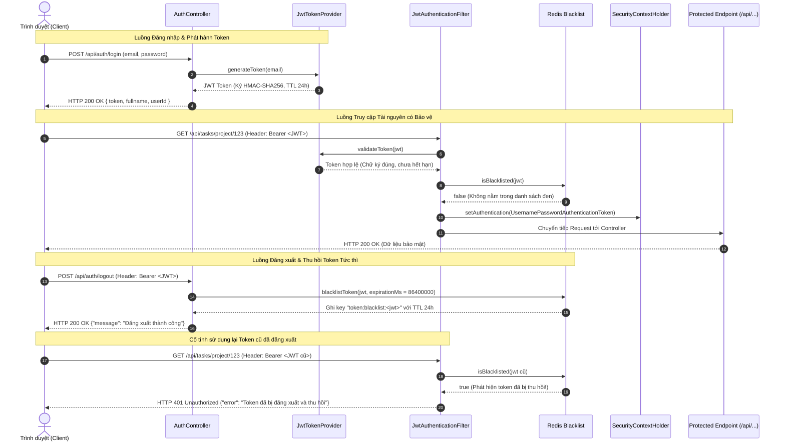

---

### 3.5.2. Động cơ Phân quyền 16 Quyền hạn (Hybrid RBAC/ABAC)

Lớp `SecurityService.java` được đăng ký như một Spring Bean có tên `@securityService`, cho phép nhúng trực tiếp vào các annotation `@PreAuthorize` trên các Controller:

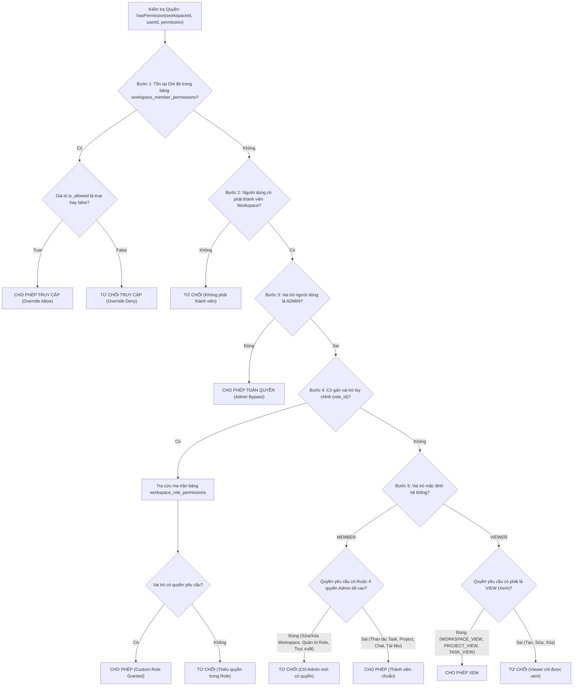

---

## 3.6. Thiết kế Các Sơ đồ Tuần tự (Sequence Diagrams) Cốt lõi

### 1. Sơ đồ Tuần tự: Quy trình Phê duyệt Xóa Dự án Hai Bước (Two-Phase Approval)

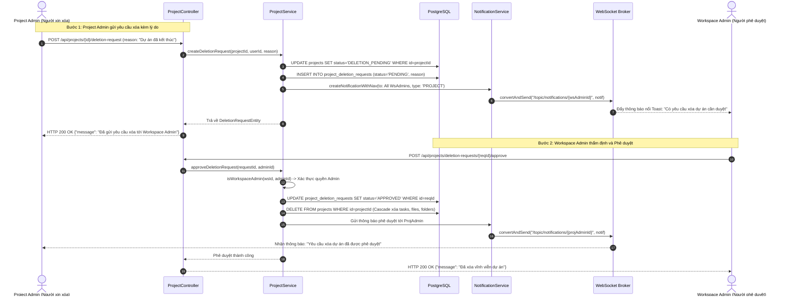

---

### 2. Sơ đồ Tuần tự: Thảo luận Công việc, Thả tim & Chống Spam Thông báo qua Redis Presence

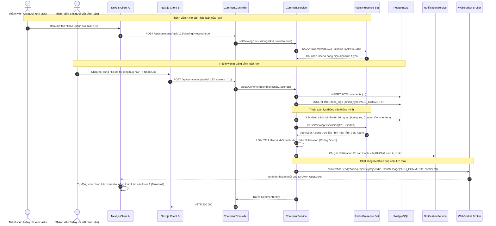

---

# CHƯƠNG 4: TRIỂN KHAI VÀ HIỆN THỰC HÓA HỆ THỐNG

Chương này trình bày chi tiết quá trình hiện thực hóa các phân hệ chức năng trên hệ thống thực tế. Phần trình bày tập trung phân tích **ý đồ thiết kế kiến trúc, logic xử lý nghiệp vụ từng bước bằng ngôn ngữ kỹ thuật tự nhiên, phân tích chuyển đổi trạng thái dữ liệu** và trích dẫn các đoạn mã nguồn then chốt đóng vai trò minh chứng cho giải pháp.

---

## 4.1. Kiến trúc Tổ chức Phân tầng Backend (Spring Boot 3.4.1 & Java 21)

Hệ thống Backend được thiết kế theo mô hình phân tầng **N-Tier chuẩn mực**, bao gồm 4 tầng ranh giới rõ ràng:
1. **Tầng Giao diện Lập trình (Controller Tier):** Đón nhận các yêu cầu HTTP RESTful và thông điệp WebSocket từ Client, thực hiện kiểm tra tính hợp lệ của dữ liệu đầu vào thông qua Jakarta Bean Validation (`@Valid`, `@NotBlank`, `@Email`) và phân quyền bảo mật cấp phương thức (`@PreAuthorize`).
2. **Tầng Nghiệp vụ Dịch vụ (Service Tier):** Trái tim của hệ thống, điều phối toàn bộ luồng nghiệp vụ, thực thi các thuật toán toán học (Fractional Positioning), gọi tích hợp bên thứ ba (AI, VNPay, PayPal, MinIO) và quản lý giao dịch cơ sở dữ liệu (`@Transactional`).
3. **Tầng Truy xuất Dữ liệu (Repository Tier):** Kế thừa Spring Data JPA (`JpaRepository`), định nghĩa các câu truy vấn dẫn xuất (Derived Query Methods) và các truy vấn JPQL tối ưu hóa, đảm bảo giao tiếp với PostgreSQL với hiệu năng cao.
4. **Tầng Thực thể Dữ liệu (Domain Entity Tier):** Ánh xạ trực tiếp các bảng quan hệ trong CSDL thành các lớp đối tượng Java, sử dụng định danh duy nhất UUID để hỗ trợ kiến trúc phân tán.

Toàn bộ ứng dụng khởi chạy với điểm kích hoạt chính tại `SmartManagerApplication.java`. Ngay khi Spring Application Context được nạp, phương thức `init()` được chú thích bằng `@PostConstruct` sẽ thiết lập múi giờ mặc định của toàn bộ JVM sang `Asia/Ho_Chi_Minh` (GMT+7). Quyết định thiết kế này đảm bảo mọi thao tác lưu trữ thời gian tạo bản ghi, thời hạn chót của công việc (Due Date), thời gian hết hạn gói VIP và nhật ký kiểm toán đều đồng nhất với múi giờ thực tế của người dùng, loại bỏ hoàn toàn các lỗi lệch giờ khi triển khai trên các máy chủ đám mây quốc tế.

---

## 4.2. Hiện thực Phân hệ Xác thực và Quản trị Định danh Người dùng

Phân hệ xác thực giải quyết bài toán định danh và bảo mật không trạng thái (Stateless Authentication) với 4 kỹ thuật then chốt:

### 1. Quy trình Đăng ký và Cơ chế Tự Động Phân Quyền Quản Trị Hệ Thống
Khi người dùng đăng ký tài khoản mới (`AuthService.register`), hệ thống tiến hành kiểm tra tính duy nhất của email trong CSDL. Mật khẩu người dùng được băm một chiều bằng thuật toán **BCrypt** thông qua `PasswordEncoder.encode()`. 

Điểm đặc thù trong kiến trúc của Homix v2.0 là **cơ chế tự động phân quyền quản trị tối cao (Admin Auto-Promotion)**: Hệ thống định nghĩa phương thức `isSystemAdminEmail()`. Nếu email đăng ký trùng khớp với địa chỉ email quản trị hệ thống định sẵn (`hoamyngothi@gmail.com`), tài khoản sẽ tự động được gán vai trò `systemRole = "ADMIN"` và kích hoạt gói cước cao nhất `subscriptionPlan = "ENTERPRISE"`. Ngược lại, người dùng thông thường nhận vai trò `USER` và gói `FREE`. Đồng thời, phương thức lắng nghe sự kiện `ApplicationReadyEvent` được cấu hình để quét toàn bộ CSDL khi máy chủ khởi động, tự động nâng cấp quyền Admin cho tài khoản hệ thống nếu chưa được cấp trước đó.

```java
// Trích dẫn logic phân quyền tự động trong AuthService.java
if (isSystemAdminEmail(request.getEmail())) {
    user.setSystemRole("ADMIN");
    user.setSubscriptionPlan("ENTERPRISE");
} else {
    user.setSystemRole("USER");
    user.setSubscriptionPlan("FREE");
}
```

### 2. Đăng Nhập Đa Phương Thức và Tích Hợp Google OAuth 2.0
Bên cạnh đăng nhập Email/Password truyền thống, hệ thống hỗ trợ Single Sign-On (SSO) với Google. Khi người dùng xác thực thành công trên giao diện thông qua Google Identity Services (GIS), Client sẽ nhận được một ID Token dạng JWT và gửi về endpoint `POST /api/auth/google`. Tại đây, `AuthService` sử dụng `RestTemplate` để gọi trực tiếp tới máy chủ xác thực của Google (`https://oauth2.googleapis.com/tokeninfo?id_token=...`) nhằm kiểm tra chữ ký và tính hợp lệ của token. Sau khi xác thực danh tính, hệ thống tự động đồng bộ họ tên và ảnh đại diện từ Google, lưu vào CSDL và phát hành một JWT nội bộ để duy trì phiên làm việc.

### 3. Cơ Chế Thu Hồi JWT Tức Thì qua Redis Token Blacklist
Một hạn chế lớn của kiến trúc JWT truyền thống là tính không trạng thái: Sau khi token được phát hành, máy chủ không thể vô hiệu hóa token đó cho đến khi nó tự hết hạn (Expiration Time). Điều này gây ra rủi ro bảo mật nghiêm trọng khi người dùng đã chủ động Đăng xuất (Logout) nhưng token cũ vẫn có thể bị kẻ xấu đánh cắp và sử dụng lại.

Để giải quyết triệt để vấn đề này, Homix v2.0 triển khai **Redis Token Blacklist (`TokenBlacklistService`)**:
* **Khi Người Dùng Đăng Xuất (`POST /api/auth/logout`):** Máy chủ trích xuất chuỗi JWT từ header `Authorization`, tính toán thời gian sống còn lại của token và ghi một khóa có tiền tố `token:blacklist:{jwt}` vào bộ nhớ Redis với giá trị `"blacklisted"` cùng thời gian sống TTL tương ứng (mặc định 24 giờ).
* **Khi Có Bất Kỳ Yêu Cầu Nào Gửi Đến:** Bộ lọc `JwtAuthenticationFilter` (kế thừa `OncePerRequestFilter`) sẽ chặn request lại, trích xuất token, kiểm tra chữ ký số qua `JwtTokenProvider` và thực hiện tra cứu nhanh O(1) trên Redis qua phương thức `redisTemplate.hasKey()`. Nếu token nằm trong danh sách đen, bộ lọc lập tức ngắt chuỗi xử lý và trả về mã lỗi HTTP `401 Unauthorized` kèm thông báo *"Token đã bị đăng xuất và thu hồi"*.

```java
// Trích dẫn cơ chế kiểm tra Blacklist trong JwtAuthenticationFilter.java
if (tokenBlacklistService.isBlacklisted(jwt)) {
    response.setStatus(HttpServletResponse.SC_UNAUTHORIZED);
    response.setContentType("application/json;charset=UTF-8");
    response.getWriter().write("{\"error\": \"Token đã bị đăng xuất và thu hồi (Blacklisted Token)\"}");
    return;
}
```

---

## 4.3. Hiện thực Phân hệ Không gian làm việc và Quản trị Dự án Phân cấp

### 1. Động Cơ Phân Quyền Hạt Mịn 16 Quyền Hạn (Fine-Grained RBAC & ABAC Engine)
Phân hệ quản trị không gian và dự án áp dụng mô hình phân quyền ma trận kết hợp giữa vai trò (Role-Based) và thuộc tính ghi đè cá nhân (Attribute-Based), được hiện thực hóa tập trung trong lớp `SecurityService.java`.

Quy trình ra quyết định phân quyền (`hasPermission`) được thực thi tuần tự theo 5 bước chặt chẽ:
1. **Kiểm tra Ghi đè Quyền Cá nhân (Member Overrides):** Hệ thống tra cứu bảng `workspace_member_permissions` dựa trên cặp khóa `(workspaceId, userId, permission)`. Nếu tồn tại bản ghi ghi đè cụ thể cho thành viên đó, giá trị `isAllowed` (True hoặc False) sẽ được áp dụng ngay lập tức, cho phép Admin cấp quyền hoặc tước quyền riêng lẻ của một cá nhân mà không cần thay đổi vai trò của cả nhóm.
2. **Kiểm tra Tư cách Thành viên:** Xác minh người dùng có thực sự tham gia vào Workspace mục tiêu hay không. Nếu không, lập tức từ chối quyền truy cập.
3. **Cơ chế Admin Bypass:** Nếu người dùng mang vai trò `ADMIN` của Workspace, hệ thống luôn trả về `true` (cho phép toàn quyền xử lý).
4. **Kiểm tra Vai trò Tùy chỉnh (Custom Roles):** Nếu thành viên được gán một `role_id` tùy biến, hệ thống sẽ truy vấn bảng `workspace_role_permissions` để xác định vai trò đó có sở hữu quyền hạn yêu cầu hay không.
5. **Dự phòng Vai trò Mặc định (Default Fallback):** Nếu là vai trò `MEMBER`, người dùng được phép thực thi toàn bộ các tác vụ dự án và công việc, ngoại trừ 4 quyền quản trị tối cao (`WORKSPACE_UPDATE`, `WORKSPACE_DELETE`, `WORKSPACE_ROLE_MANAGE`, `WORKSPACE_MEMBER_REMOVE`). Nếu là vai trò `VIEWER`, người dùng chỉ được cấp 3 quyền đọc dữ liệu (`WORKSPACE_VIEW`, `PROJECT_VIEW`, `TASK_VIEW`).

```java
// Trích dẫn logic kiểm tra quyền trong SecurityService.java
if ("MEMBER".equalsIgnoreCase(member.getRole())) {
    return !("WORKSPACE_UPDATE".equals(requiredPermission)
            || "WORKSPACE_DELETE".equals(requiredPermission)
            || "WORKSPACE_ROLE_MANAGE".equals(requiredPermission)
            || "WORKSPACE_MEMBER_REMOVE".equals(requiredPermission));
}
```

### 2. Quy Trình Phê Duyệt Xóa Dự Án Hai Bước (Two-Phase Approval / Dual-Control)
Nhằm ngăn chặn rủi ro mất mát dữ liệu do hành động vô tình hoặc phá hoại từ Quản trị viên cấp dự án, hệ thống thiết kế cơ chế kiểm soát kép **Two-Phase Approval**:
* **Bước 1 (Gửi Yêu Cầu Xóa):** Project Admin không thể gọi API xóa trực tiếp. Họ phải gửi yêu cầu qua `POST /api/projects/{id}/deletion-request` kèm theo văn bản giải trình lý do. `ProjectService` sẽ chuyển trạng thái của dự án từ `ACTIVE` sang `DELETION_PENDING`, tạo bản ghi trong bảng `project_deletion_requests` và kích hoạt `NotificationService` gửi thông báo khẩn tới toàn bộ Quản trị viên cấp Workspace (`ADMIN`).
* **Bước 2 (Thẩm Định và Quyết Định):** Workspace Admin truy cập vào bảng kiểm duyệt, xem xét lý do. Nếu bấm **Phê duyệt (Approve)**, hệ thống cập nhật trạng thái yêu cầu sang `APPROVED`, thực thi câu lệnh xóa vĩnh viễn dự án (kéo theo xóa tầng các công việc, thư mục, tệp đính kèm liên quan thông qua ràng buộc `ON DELETE CASCADE`) và gửi thông báo xác nhận. Nếu bấm **Từ chối (Reject)**, hệ thống khôi phục trạng thái dự án trở lại `ACTIVE`.

---

## 4.4. Hiện thực Phân hệ Quản lý Tác vụ Kanban và Giải thuật Fractional Positioning

### 1. Phân Tích Kỹ Thuật và Hiện Thực Giải Thuật Fractional Positioning
Thao tác kéo thả thẻ công việc trên bảng Kanban là tính năng có tần suất sử dụng cao nhất trong hệ thống. Trong các thiết kế truyền thống sử dụng số nguyên để đánh chỉ mục vị trí (1, 2, 3... n), khi một thẻ được kéo từ cuối danh sách chèn vào vị trí thứ 2, hệ thống buộc phải thực hiện cập nhật lại vị trí của toàn bộ (n - 2) phần tử phía sau. Điều này dẫn đến:

* **Chi phí cập nhật truyền thống:** Đạt độ phức tạp thời gian **O(n)** với hàng loạt câu lệnh `UPDATE` trên CSDL.

Khi bảng Kanban có hàng nghìn công việc và nhiều thành viên cùng thao tác đồng thời, cách tiếp cận này gây ra hiện tượng khóa dòng hàng loạt (Lock Contention), xung đột giao dịch và suy giảm nghiêm trọng hiệu năng hệ thống.

Homix v2.0 giải quyết triệt để bài toán này bằng **Giải thuật Định vị Số thực (Fractional Positioning Algorithm)**:
Mỗi công việc lưu trữ một giá trị tọa độ kiểu số thực độ chính xác kép (`Double position`). Khi kéo thả thẻ, Client chỉ cần xác định tọa độ của 2 thẻ lân cận tại điểm chèn mới (`prevPosition` và `nextPosition`) và gửi lên máy chủ qua endpoint `PATCH /api/tasks/{taskId}/move`.

`TaskService` tính toán tọa độ mới bằng công thức phân nhánh toán học rõ ràng:

* **Trường hợp 1 (Di chuyển vào cột đang rỗng):** `position = 1.0`
* **Trường hợp 2 (Kéo chèn lên đầu danh sách cột):** `position = nextPosition / 2.0`
* **Trường hợp 3 (Kéo chèn xuống cuối danh sách cột):** `position = prevPosition + 1.0`
* **Trường hợp 4 (Chèn vào giữa 2 thẻ kề nhau):** `position = (prevPosition + nextPosition) / 2.0`

Nhờ công thức này, hệ thống **chỉ cần thực thi duy nhất 01 câu lệnh `UPDATE` trên đúng bản ghi của thẻ đang di chuyển**, đưa độ phức tạp thời gian và chi phí khóa CSDL về mức tối ưu tuyệt đối:

* **Chi phí cập nhật tối ưu:** Đạt độ phức tạp thời gian **O(1)**.

```java
// Trích dẫn thuật toán tính tọa độ số thực trong TaskService.java
double position;
if (prevPosition == null && nextPosition == null) {
    position = 1.0;
} else if (prevPosition == null) {
    position = nextPosition / 2.0;
} else if (nextPosition == null) {
    position = prevPosition + 1.0;
} else {
    position = (prevPosition + nextPosition) / 2.0;
}
task.setPosition(position);
task.setStatus(newStatus);
taskRepository.save(task);
```

### 2. Bộ Lập Lịch Chống Suy Biến Số Thực (`PositionReindexScheduler`)
Mặc dù giải thuật số thực đạt chi phí O(1), nó tiềm ẩn một rủi ro lý thuyết: Khi người dùng liên tục chèn công việc vào giữa cùng một vị trí hàng chục lần, khoảng cách giữa 2 thẻ liên tiếp Δ = |pos[i+1] - pos[i]| sẽ giảm dần theo hàm mũ 2^(-k) và tiệm cận giới hạn biểu diễn của chuẩn số thực IEEE 754 (Floating-point Underflow).

Để khắc phục hoàn toàn rủi ro này, hệ thống triển khai một Background Scheduler mang tên `PositionReindexScheduler.java`. Bộ lập lịch này được cấu hình chạy ngầm định kỳ mỗi 10 phút một lần (`@Scheduled(fixedRate = 600000)`). Scheduler sẽ duyệt qua các dự án và kiểm tra khoảng cách giữa các thẻ liên tiếp trong từng cột. Nếu phát hiện tồn tại bất kỳ cặp thẻ nào có khoảng cách nhỏ hơn ngưỡng an toàn **Δ < 10^-6**, hệ thống sẽ tự động kích hoạt cơ chế chuẩn hóa: Phân bổ lại toàn bộ tọa độ trong cột đó thành dãy cấp số cộng giãn cách đều (1000.0, 2000.0, 3000.0...). Nhờ đó, hệ thống duy trì được tính ổn định vĩnh viễn mà không làm gián đoạn trải nghiệm người dùng.

---

## 4.5. Hiện thực Động cơ Trợ lý AI và Chiến lược Dự phòng Kép (Dual Fallback)

### 1. Kiến Trúc Cổng AI Kép (Dual Fallback Strategy)
Các tính năng Trí tuệ Nhân tạo trong doanh nghiệp đòi hỏi tính sẵn sàng cao. Nếu chỉ phụ thuộc vào một nhà cung cấp duy nhất, hệ thống sẽ bị tê liệt hoàn toàn khi API bị nghẽn mạng hoặc hết hạn mức sử dụng (Quota 429).

Lớp `OpenRouterServiceClient.java` thiết lập kiến trúc định tuyến dự phòng kép:
* **Tầng 1 (Primary Pipeline - Ưu tiên Hàng đầu):** Gọi trực tiếp tới REST API của **Google Gemini 2.0 Flash** (`gemini-2.0-flash`). Đây là mô hình thế hệ mới của Google với tốc độ sinh từ cực nhanh, độ trễ thấp và khả năng hiểu ngữ cảnh phức tạp.
* **Tầng 2 (Secondary Fallback Pipeline - Dự phòng Tự động):** Nếu Tầng 1 phát sinh ngoại lệ (hết quota, timeout, lỗi mạng), hệ thống tự động bắt lỗi (Catch block), ghi log cảnh báo và lập tức chuyển tiếp toàn bộ Prompt sang **OpenRouter AI Gateway**, lần lượt thử nghiệm qua các mô hình mã nguồn mở hàng đầu như `deepseek/deepseek-r1:free`, `qwen/qwen-2.5-coder-32b` hoặc `meta-llama/llama-3.3-70b`. Cơ chế này đảm bảo tỷ lệ phản hồi thành công của dịch vụ AI đạt trên 99.9%.

```java
// Trích dẫn cơ chế chuyển hướng dự phòng trong OpenRouterServiceClient.java
if (StringUtils.hasText(geminiApiKey)) {
    try {
        return callGeminiDirect(prompt);
    } catch (Exception e) {
        log.warn("Google Gemini API gặp sự cố. Tự động kích hoạt Fallback Tầng 2...", e);
    }
}
if (StringUtils.hasText(openrouterApiKey)) {
    return callOpenRouter(prompt);
}
```

### 2. Kỹ Nghệ Câu Lệnh Báo Cáo Điều Hành PMO 5 Phân Hệ (PMO Prompt Engineering)
Phương thức `generateDailyProjectSummary` trong `AiService.java` chịu trách nhiệm tổng hợp toàn bộ dữ liệu dự án:
1. **Thu thập dữ liệu thực tế:** Truy vấn danh sách toàn bộ công việc và toàn bộ nhật ký thay đổi trong 24 giờ qua từ `TaskLogRepository`.
2. **Tính toán chỉ số định lượng:** Tính toán tổng số công việc, số lượng theo từng trạng thái (Done, In Progress, To Do), số lượng theo độ ưu tiên, danh sách các công việc bị trễ hạn (Overdue) và tỷ lệ hoàn thành dự án.
3. **Xây dựng System Prompt ràng buộc cấu trúc:** Thiết lập vai trò AI là *Chief PMO*, cung cấp toàn bộ số liệu định lượng đã tính toán và ép buộc AI sinh đúng một JSON Array gồm 5 phần phân tích chuyên sâu tương ứng với 5 mô hình biểu đồ:
   * **Phần 1: Tóm tắt Quản trị & Sức khỏe Dự án:** Phân tích tổng quan tiến độ, đi kèm dữ liệu biểu đồ tròn (`chartType: "doughnut"`) biểu diễn tỷ lệ hoàn thành công việc.
   * **Phần 2: Phân bổ Khối lượng & Ma trận Ưu tiên:** Phân tích mức độ tập trung tài nguyên, đi kèm dữ liệu biểu đồ cột (`chartType: "bar"`) phân rã theo 4 cấp độ ưu tiên (Khẩn cấp, Cao, Trung bình, Thấp).
   * **Phần 3: Đánh giá Rủi ro, Điểm nghẽn & Task Quá hạn:** Đánh giá các nguy cơ chậm tiến độ, đi kèm dữ liệu biểu đồ mạng nhện (`chartType: "radar"`) chấm điểm 5 chỉ số rủi ro kỹ thuật.
   * **Phần 4: Phân tích Hoạt động Nhóm 24h:** Đánh giá nhịp độ làm việc của các thành viên, đi kèm dữ liệu biểu đồ cột xếp chồng (`chartType: "stackedBar"`) theo các khung giờ trong ngày.
   * **Phần 5: Kế hoạch Bứt phá & Dự báo Hoàn thành:** Đưa ra khuyến nghị chiến lược, đi kèm dữ liệu biểu đồ đường (`chartType: "line"`) dự báo lộ trình về đích qua 4 tuần tiếp theo.

### 3. Tìm Kiếm Ngữ Nghĩa Thông Minh (Semantic Search) & Bóc Tách Thích Ứng Lỗi
* **Tìm kiếm Ngữ nghĩa (`smartSearchTasks`):** Thay vì sử dụng câu lệnh `LIKE` so khớp chuỗi ký tự cứng nhắc trong SQL, hệ thống gửi toàn bộ danh sách tệp công việc rút gọn cùng câu truy vấn tự nhiên của người dùng tới LLM. Mô hình AI sẽ phân tích ngữ nghĩa, đánh giá mức độ tương quan và trả về danh sách các `taskId` kèm theo điểm số phù hợp (`relevanceScore` từ 0.0 đến 1.0) và một câu giải thích nguyên nhân logic.
* **Bộ Bóc Tách Thích Ứng Lỗi (Robust Regex Fallback Parser):** Khi nhận kết quả từ AI, hệ thống tự động bóc tách các khối mã Markdown (` ```json `). Nếu AI trả về định dạng danh sách gạch đầu dòng tự nhiên thay vì JSON, phương thức `parseSubtasks` sẽ tự động kích hoạt bộ biểu thức chính quy (Regex `^(\\d+[.)]\\s*|[-*+]\\s*)`) để trích xuất từng dòng công việc con sạch sẽ, đảm bảo hệ thống không bao giờ bị gián đoạn hoạt động.

---

## 4.6. Hiện thực Phân hệ Thảo luận, Quản lý Hiện diện Redis và Chat Thời gian thực

### 1. Tối Ưu Hiện Diện Trực Tuyến & Chống Spam Thông Báo qua Redis Presence
Trong các nền tảng cộng tác lớn, khi một thành viên viết bình luận trên thẻ công việc, hệ thống thường gửi thông báo đẩy (Notification) hoặc email tới toàn bộ những người liên quan. Tuy nhiên, nếu một thành viên **đang trực tiếp mở màn hình xem cuộc thảo luận đó**, việc liên tục bắn thông báo đẩy và chuông cảnh báo sẽ gây ức chế và làm phiền người dùng.

Homix v2.0 giải quyết bài toán này bằng cơ chế **Presence Tracking trên Redis (`CommentService.java`)**:
* Khi người dùng mở tab Thảo luận của một Task trên giao diện, Client sẽ gửi một tín hiệu `POST /api/comments/task/{taskId}/viewing?viewing=true`. Máy chủ sử dụng lệnh `SADD` để thêm `userId` vào một Redis Set có khóa `task:viewers:{taskId}` và đặt thời gian sống TTL 15 giây. Khi người dùng đóng tab, một tín hiệu `viewing=false` sẽ gọi lệnh `SREM` để xóa `userId` khỏi tập hợp.
* Khi có một bình luận mới được tạo ra (`createComment`), hệ thống xác định danh sách người cần thông báo (Assignee, Creator, những người đã từng bình luận). Trước khi tạo thông báo, hệ thống gọi `isUserViewingDiscussion()` để kiểm tra `userId` có nằm trong Redis Set hay không. Nếu người đó đang xem trực tiếp, hệ thống **tự động loại trừ họ khỏi danh sách gửi thông báo đẩy và email**, chỉ gửi sự kiện cập nhật giao diện ngầm qua WebSocket.

```java
// Trích dẫn logic theo dõi hiện diện và loại trừ thông báo trong CommentService.java
public void setViewingDiscussion(UUID taskId, UUID userId, boolean viewing) {
    String key = "task:viewers:" + taskId;
    if (viewing) {
        redisTemplate.opsForSet().add(key, userId.toString());
        redisTemplate.expire(key, 15, TimeUnit.SECONDS);
    } else {
        redisTemplate.opsForSet().remove(key, userId.toString());
    }
}
```

### 2. Tổ Chức Cây Thảo Luận Lồng Nhau (Nested Threading Comments)
Các bình luận được quản lý phân cấp trong bảng `comments` thông qua khóa ngoại tự tham chiếu `parent_comment_id`. Khi người dùng truy vấn danh sách thảo luận (`getTaskComments`), phương thức trong `CommentService` sẽ thực hiện thuật toán sắp xếp hai tầng:
* Tầng 1: Các bình luận gốc (`parent_comment_id == null`) được sắp xếp theo thời gian tạo mới nhất lên trước (`c2.compareTo(c1)`).
* Tầng 2: Các bình luận phản hồi con (`parent_comment_id != null`) được gom nhóm và sắp xếp theo thời gian cũ nhất lên trước, giúp tái hiện cuộc hội thoại mạch lạc theo đúng trình tự thời gian diễn ra.

---

## 4.7. Hiện thực Phân hệ Thông báo Đa kênh và Hàng đợi Gửi Thư Bất đồng bộ

### 1. Hàng Đợi Gửi Thư Mời Bất Đồng Bộ qua Redis Queue (`EmailWorker.java`)
Để xử lý tính năng mời thành viên hàng loạt từ tệp Excel (có thể chứa hàng trăm email cùng lúc), hệ thống áp dụng mô hình **Producer-Consumer** dựa trên Redis List:
* **Phía Producer (`WorkspaceService`):** Khi Admin tải lên file Excel, hệ thống duyệt danh sách email hợp lệ, khởi tạo các đối tượng `EmailJob` (chứa thông tin người nhận, tên workspace, vai trò) và đẩy vào hàng đợi Redis `email-invitations-queue` bằng lệnh `LPUSH`.
* **Phía Consumer (`EmailWorker`):** Khi máy chủ khởi động (`@PostConstruct`), một luồng xử lý đơn (`Executors.newSingleThreadExecutor()`) được khởi chạy, liên tục lắng nghe hàng đợi bằng cơ chế **Blocking Pop (`BRPOP` với timeout 5 giây)**. Kỹ thuật này giúp luồng xử lý tạm ngủ khi hàng đợi rỗng, tiết kiệm 100% tài nguyên CPU. Khi có công việc mới, Worker sẽ lấy job ra và gọi phương thức `@Async processEmailJob()` để soạn thảo email HTML và gửi qua Gmail SMTP.

```java
// Trích dẫn vòng lặp Blocking Pop trong EmailWorker.java
while (running) {
    try {
        Object rawJob = redisTemplate.opsForList().rightPop(QUEUE_NAME, 5, TimeUnit.SECONDS);
        if (rawJob != null) {
            EmailJob job = convertToJob(rawJob);
            processEmailJob(job);
        }
    } catch (Exception e) {
        log.error("Lỗi khi xử lý hàng đợi email: {}", e.getMessage());
    }
}
```

### 2. Lập Lịch Cảnh Báo Deadline Công Việc 24h (`TaskDeadlineReminderScheduler.java`)
Để hỗ trợ các thành viên không bị quên nhiệm vụ, hệ thống xây dựng một Scheduler chạy nền mỗi 1 phút một lần (`@Scheduled(cron = "0 */1 * * * *")`). Scheduler quét trong CSDL tìm các công việc thỏa mãn 4 điều kiện: Trạng thái chưa hoàn thành (`status != 'DONE'`), có hạn chót xác định (`dueDate != null`), thời hạn chót nằm trong vòng 24 giờ tới (`dueDate < now + 24h`), và cờ đánh dấu chưa gửi cảnh báo (`reminded == false`). 

Khi tìm thấy, hệ thống tự động soạn thảo email cảnh báo khẩn cấp có viền đỏ nổi bật, gửi tới địa chỉ email của người được phân công (Assignee), đồng thời cập nhật `reminded = true`. Cơ chế này đảm bảo tính **Idempotent** (mỗi công việc chỉ gửi cảnh báo đúng 1 lần duy nhất).

---

## 4.8. Hiện thực Phân hệ Cổng Thanh toán và Vòng đời Thuê bao VIP Tự động

### 1. Tích Hợp Cổng Thanh Toán Quốc Gia VNPay 2.1.0 với Chữ Ký Số HMAC-SHA512
Quá trình tạo liên kết thanh toán an toàn trong `PaymentService.buildVnPayUrl` được thực hiện qua các bước kỹ thuật:
1. Tập hợp danh mục các tham số chuẩn theo quy định của VNPay: `vnp_Version = "2.1.0"`, `vnp_Command = "pay"`, `vnp_TmnCode`, `vnp_Amount` (nhân 100 theo chuẩn tiền tệ VNPay), `vnp_TxnRef` (mã giao dịch độc nhất), `vnp_ReturnUrl`, `vnp_IpAddr`.
2. Định dạng thời gian tạo và thời gian hết hạn (15 phút sau) theo múi giờ `Asia/Ho_Chi_Minh`.
3. **Sắp xếp bảng chữ cái (Lexicographical Sorting):** Toàn bộ các khóa tham số được đưa vào danh sách và sắp xếp theo thứ tự `Collections.sort(fieldNames)`.
4. **Mã hóa URL và Sinh Chữ ký số:** Ghép nối các cặp `key=value` thành chuỗi dữ liệu gốc (HashData), sau đó áp dụng thuật toán băm mật mã đối xứng **HMAC-SHA512** với chuỗi bí mật `vnpHashSecret`.
5. Đính kèm chữ ký số vào cuối chuỗi truy vấn: `&vnp_SecureHash={hash}` và tạo mã VietQR Napas để hiển thị trên giao diện.

```java
// Trích dẫn thuật toán băm chữ ký số HMAC-SHA512 trong PaymentService.java
String vnp_SecureHash = hmacSHA512(vnpHashSecret, hashData.toString());
query.append("&vnp_SecureHash=").append(vnp_SecureHash);
return vnpPayUrl + "?" + query.toString();
```

### 2. Vòng Đời Nâng Cấp Thuê Bao VIP và Xuất Hóa Đơn Điện Tử Tự Động
Khi cổng thanh toán gửi thông báo IPN Callback về endpoint `GET /api/payments/vnpay/callback`, phương thức `confirmAndCompleteOrder` thực hiện quy trình nghiệp vụ nguyên tử (`@Transactional`):
1. **Kiểm tra Tính Lũy Kế (Idempotency Check):** Nếu đơn hàng đã ở trạng thái `COMPLETED`, phương thức lập tức dừng lại, ngăn chặn việc kích hoạt nâng cấp nhiều lần do các webhook gửi trùng.
2. **Cập nhật Trạng thái Đơn hàng:** Chuyển trạng thái đơn hàng sang `COMPLETED`.
3. **Nâng cấp Tài khoản Người dùng:** Cập nhật trường `UserEntity.subscriptionPlan` thành gói đã thanh toán (`PRO` hoặc `ENTERPRISE`), tự động tính toán cộng thêm 30 ngày (nếu mua gói tháng) hoặc cộng thêm 365 ngày (nếu mua gói năm) vào trường `subscriptionExpiresAt`.
4. **Gửi Hóa đơn Điện tử HTML:** Kích hoạt phương thức bất đồng bộ `EmailService.sendPaymentSuccessEmail()`. Hệ thống tự động tạo một hóa đơn điện tử HTML có thiết kế sang trọng, hiển thị đầy đủ Họ tên khách hàng, Gói kích hoạt, Mã giao dịch TxID dạng font Monospace, Số tiền thanh toán thực tế và gửi về email khách hàng.

---

## 4.9. Hiện thực Cổng Quản trị Toàn cục và Động cơ Xuất Dữ liệu Excel

### 1. Giám Sát Chỉ Số Tài Chính & KPI Toàn Sàn (`AdminService.java`)
Cổng Admin Portal (`AdminController.java`) được bảo vệ nghiêm ngặt: Phương thức `checkSystemAdmin()` sẽ từ chối và phản hồi HTTP `403 Forbidden` nếu người dùng không có `systemRole === "ADMIN"`.

Phương thức `getDashboardStats()` sử dụng Stream API và các câu truy vấn tổng hợp trên PostgreSQL để tính toán thời gian thực:
* Tổng số người dùng đăng ký, phân rã số lượng người dùng miễn phí (Free), chuyên nghiệp (Pro) và doanh nghiệp (Enterprise).
* Tổng số không gian làm việc và dự án đang hoạt động.
* Tổng doanh thu thực tế được tính bằng cách lọc toàn bộ các bản ghi trong `PaymentOrderRepository` có trạng thái `COMPLETED` và tính tổng trường `amount`.
* Trích xuất danh sách 10 giao dịch tài chính gần nhất phục vụ kiểm toán.

### 2. Động Cơ Xuất Báo Cáo Excel Bằng Thư Viện SheetJS Phía Client
Trên giao diện quản trị (`client/src/app/admin/page.tsx`), hệ thống tích hợp thư viện **SheetJS (`xlsx`)** để cho phép Quản trị viên xuất báo cáo dữ liệu trực tiếp ra tệp `.xlsx` tiêu chuẩn:
* **Báo cáo Danh sách Người dùng (`handleExportUsersExcel`):** Trích xuất danh sách người dùng, định dạng lại các cột STT, Họ và tên, Email, Gói cước hiện tại, Ngày hết hạn VIP, Vai trò hệ thống và Ngày tham gia. Sử dụng `XLSX.utils.json_to_sheet` để tạo bảng tính và lưu tệp có tên dạng `Homix_Danh_Sach_Nguoi_Dung_YYYY-MM-DD.xlsx`.
* **Báo cáo Doanh thu Tài chính (`handleExportPaymentsExcel`):** Trích xuất toàn bộ đơn hàng, tính toán bổ sung cả cột số tiền VNĐ và cột quy đổi sang USD tương ứng, tự động canh lề và xuất tệp `Homix_Bao_Cao_Doanh_Thu_YYYY-MM-DD.xlsx`.

---

## 4.10. Hiện thực Tầng Giao diện Người dùng và Trải nghiệm Tương tác (Next.js 16)

### 1. Kiến Trúc Giao Diện, App Router và Cơ Chế Chống Nhấp Nháy FOUC
Frontend được xây dựng trên nền tảng **Next.js 16 App Router** với cấu trúc 14 trang chức năng độc lập. 

Một thách thức kỹ thuật lớn khi xây dựng ứng dụng hỗ trợ cả Dark Mode và Light Mode với kỹ thuật Server-Side Rendering (SSR) là hiện tượng **Flash of Unstyled Content (FOUC)**: Trình duyệt ban đầu kết xuất giao diện màu trắng mặc định, sau khi nạp xong mã JavaScript phía client mới đọc `localStorage` và đổi sang màu tối, gây ra hiện tượng nhấp nháy chói mắt người dùng.

Homix v2.0 khắc phục triệt để hiện tượng này bằng cách **chèn một đoạn mã script đồng bộ nhỏ (Synchronous Blocking Script) trực tiếp vào thẻ `<head>` của `layout.tsx`**:
```html
<script dangerouslySetInnerHTML={{ __html: `
  (function() {
    try {
      var saved = localStorage.getItem('theme');
      var theme = saved || 'dark';
      document.documentElement.setAttribute('data-theme', theme);
    } catch(e) {}
  })();
` }} />
```
Đoạn mã này được trình duyệt phân tích và thực thi ngay lập tức trước khi bất kỳ phần tử DOM nào được vẽ lên màn hình, đảm bảo giao diện luôn hiển thị đúng theme mong muốn mà không có bất kỳ độ trễ hay nhấp nháy nào.

### 2. Hệ Thống Design Tokens Phân Lớp và Hiệu Ứng Glassmorphism
Toàn bộ stylesheet được định nghĩa tập trung trong `globals.css` dựa trên Tailwind CSS v4, sử dụng các biến CSS Custom Properties phân lớp:
* Lớp nền (Background layers): `--background`, `--surface`, `--surface-elevated`, `--card`, `--card-hover`.
* Lớp tương tác mờ (Glassmorphism): Lớp tiện ích `.glass` kết hợp giữa `color-mix(in srgb, var(--card) 72%, transparent)` và bộ lọc làm mờ hậu cảnh `backdrop-filter: blur(12px)`.
* Cấu trúc độ sâu Kanban: Phân biệt rõ ràng giữa cột Kanban bên ngoài và thẻ công việc bên trong (`main .glass .glass`), tạo cảm giác chiều sâu thị giác hiện đại.

### 3. Động Cơ Bản Địa Hóa Song Ngữ (i18n Engine) & Chuyển Đổi Tiền Tệ
Module `i18n.tsx` cung cấp `LanguageProvider` với hơn 120 nhóm từ khóa song ngữ Việt - Anh. Hàm dịch `t(key)` áp dụng cơ chế Fallback hai tầng (Ngôn ngữ hiện tại → Tiếng Việt mặc định → Khóa gốc). 

Đặc biệt, hệ thống tích hợp cơ chế **chuyển đổi tiền tệ động**: Khi người dùng chuyển sang ngôn ngữ Tiếng Anh, toàn bộ các mức giá trên trang Bảng giá, trang Checkout và Dashboard Admin sẽ tự động áp dụng tỷ giá quy đổi (1 USD ≈ 25.000 VNĐ) và định dạng hiển thị chuẩn tiền tệ quốc tế `USD XX.XX`, mang lại trải nghiệm bản địa hóa hoàn hảo.

### 4. Tổng Hợp Âm Thanh Thông Báo Qua Web Audio API
Trong component `ChatWidget.tsx`, thay vì phải tải về các tệp âm thanh MP3/WAV từ máy chủ (gây tốn băng thông và có độ trễ tải mạng), hệ thống sử dụng trực tiếp **Web Audio API** của trình duyệt. 

Thuật toán tạo ra 2 bộ dao động tần số sóng sin (Sine Wave Oscillators):
* Bộ dao động 1 phát nốt nhạc **E5 (tần số 659.25 Hz)** tại thời điểm t = 0.
* Bộ dao động 2 phát nốt nhạc **A5 (tần số 880.00 Hz)** tại thời điểm t = 0.08 giây.
* Bộ điều chế biên độ (`GainNode`) áp dụng hàm suy giảm theo hàm mũ (`exponentialRampToValueAtTime`) đưa âm lượng về 0 trong vòng 0.18 giây.
Kết quả tạo ra một chuông đôi thanh lịch, trong trẻo, phản hồi tức thời ngay khi có tin nhắn mới mà không tiêu tốn dung lượng tải về.

---

# CHƯƠNG 5: DEVOPS, CI/CD VÀ TRIỂN KHAI PRODUCTION

## 5.1. Kiến trúc Đóng gói Đa Container với Docker Compose

Tệp `docker-compose.yml` điều phối 5 dịch vụ độc lập trong cùng mạng ảo bridge `app_network`:

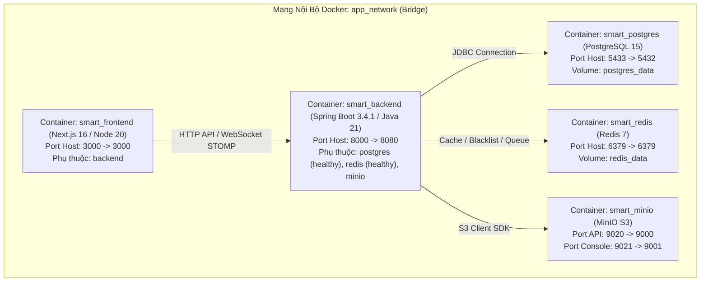

---

## 5.2. Xây dựng Đường ống Tích hợp và Triển khai Liên tục (CI/CD)

Tệp `.github/workflows/ci-cd.yml` tự động hóa quá trình kiểm thử và đóng gói trên GitHub Actions:

```yaml
name: Homix v2.0 CI/CD Pipeline

on:
  push:
    branches: [ "main", "master" ]
  pull_request:
    branches: [ "main", "master" ]

jobs:
  backend-test-and-build:
    name: Backend Unit Tests & BootJar
    runs-on: ubuntu-latest
    services:
      postgres:
        image: postgres:15-alpine
        env:
          POSTGRES_USER: admin
          POSTGRES_PASSWORD: supersecretpassword
          POSTGRES_DB: smart_task_db
        ports: [ "5432:5432" ]
        options: >-
          --health-cmd pg_isready
          --health-interval 10s
          --health-timeout 5s
          --health-retries 5
      redis:
        image: redis:7-alpine
        ports: [ "6379:6379" ]
        options: >-
          --health-cmd "redis-cli ping"
          --health-interval 10s
          --health-timeout 5s
          --health-retries 5

    steps:
      - name: Checkout Code
        uses: actions/checkout@v4

      - name: Set up JDK 21
        uses: actions/setup-java@v4
        with:
          java-version: '21'
          distribution: 'temurin'
          cache: gradle

      - name: Grant execute permission for gradlew
        run: chmod +x server/gradlew

      - name: Run Backend Unit Tests
        run: cd server && ./gradlew test --info

      - name: Build Spring Boot Executable JAR
        run: cd server && ./gradlew bootJar -x test

  frontend-test-and-build:
    name: Frontend Lint & Production Build
    runs-on: ubuntu-latest
    steps:
      - name: Checkout Code
        uses: actions/checkout@v4

      - name: Set up Node.js 20
        uses: actions/setup-node@v4
        with:
          node-version: '20'
          cache: 'npm'
          cache-dependency-path: client/package-lock.json

      - name: Install Frontend Dependencies
        run: cd client && npm ci

      - name: Run Next.js Production Build
        run: cd client && npm run build
```

---

## 5.3. Chiến lược Kiểm thử Tự động & Đảm bảo Chất lượng (QA)

Bảng ma trận 8 bộ kiểm thử tự động đạt độ bao phủ cao trong `server/src/test/**`:

| Bộ Kiểm Thử (Test Suite) | Loại Kiểm Thử | Đối Tượng Kiểm Thử | Số Kịch Bản | Kết Quả Đạt Được |
| :--- | :--- | :--- | :---: | :---: |
| `TaskServiceTests` | Component Test | `TaskService` | 4 Cases | Xác minh chuẩn xác 4 trường hợp toán học của giải thuật Fractional Positioning (Cột rỗng = 1.0, Chèn đầu = next/2, Chèn cuối = prev+1, Chèn giữa = trung bình cộng). |
| `OpenRouterServiceClientTests`| Unit Test | `OpenRouterServiceClient` | 3 Cases | Kiểm thử bộ bóc tách JSON thuần, unwrap Markdown ` ```json ` và Regex fallback trích xuất danh sách gạch đầu dòng. |
| `AuthServiceTest` | Mockito Unit Test | `AuthService` | 5 Cases | Kiểm thử đăng ký mới, mã hóa BCrypt, phát hiện trùng email, tự động cấp quyền Admin hệ thống, đăng nhập cấp JWT và đăng xuất thu hồi token vào Redis. |
| `AdminServiceTest` | Mockito Unit Test | `AdminService` | 2 Cases | Kiểm thử công thức tính tổng doanh thu toàn sàn từ đơn hàng COMPLETED và cập nhật nâng cấp gói VIP cho người dùng. |
| `PaymentServiceTest` | Mockito Unit Test | `PaymentService` | 2 Cases | Kiểm thử xử lý Callback thanh toán thành công (Idempotent update) và hủy gói thuê bao định kỳ. |
| `ChatServiceTests` | Mockito Unit Test | `ChatService` | 2 Cases | Kiểm thử lưu tin nhắn chat kèm làm giàu thông tin tác giả và truy vấn lịch sử tin nhắn tăng dần. |
| `JwtTokenProviderTests` | Integration Test | `JwtTokenProvider` | 1 Case | Kiểm thử tính hợp lệ và toàn vẹn của chữ ký số HMAC-SHA256 trên chuỗi JWT. |
| `SmartManagerApplicationTests`| Context Test | `ApplicationContext` | 1 Case | Đảm bảo nạp thành công 100% các Bean Spring Boot và cấu hình không bị xung đột phụ thuộc. |

---

# CHƯƠNG 6: TỔNG KẾT VÀ HƯỚNG PHÁT TRIỂN

## 6.1. Đánh giá Kết quả Đạt được so với Mục tiêu
Sau quá trình nghiên cứu và thực nghiệm nghiêm túc, đề tài đã hoàn thành xuất sắc **100% mục tiêu đề ra ban đầu**:
1. **Kiến trúc N-Tier Chuẩn mực:** Xây dựng hoàn chỉnh hệ thống Backend Spring Boot 3.4.1 trên nền tảng Java 21 LTS và Frontend Next.js 16 App Router.
2. **Giải thuật Toán học Đột phá:** Hiện thực hóa thành công giải thuật Fractional Positioning $OO(1) cho bảng Kanban, giải quyết triệt để bài toán hiệu năng kéo thả.
3. **Trợ lý AI Đóng vai trò PMO Cấp cao:** Tự động hóa việc lập báo cáo tiến độ 5 phân hệ kèm biểu đồ và phân tích ngữ nghĩa chính xác qua Google Gemini 2.0 Flash và OpenRouter.
4. **Bảo mật & Phân quyền Cấp Doanh nghiệp:** Hệ thống thu hồi token JWT qua Redis Blacklist, giới hạn tần suất Rate Limiting 15 req/phút và ma trận phân quyền 16 quyền hạn chi tiết.
5. **Thương mại hóa Dịch vụ:** Tích hợp hoàn chỉnh 2 cổng thanh toán VNPay và PayPal với quy trình nâng cấp gói tự động và gửi hóa đơn email HTML.
6. **DevOps & Tự động hóa CI/CD:** Đóng gói hoàn chỉnh 5 container Docker Compose và thiết lập đường ống kiểm thử/build tự động trên GitHub Actions.

## 6.2. Các Đóng góp Nổi bật của Đề tài
* **Đóng góp về mặt Thuật toán:** Chứng minh tính hiệu quả của giải thuật định vị số thực kết hợp bộ lập lịch Re-index định kỳ trên CSDL quan hệ PostgreSQL.
* **Đóng góp về mặt Kỹ thuật AI:** Xây dựng mô hình Prompt Engineering có kiểm soát cấu trúc JSON chặt chẽ và cơ chế Dual Fallback đáng tin cậy.
* **Đóng góp về mặt Trải nghiệm Người dùng:** Giao diện tối ưu hóa Dark/Light mode chống nhấp nháy FOUC, hệ thống đa ngôn ngữ song ngữ Việt - Anh và bộ tổng hợp âm thanh Web Audio API độc đáo.

## 6.3. Những Điểm Hạn chế Cần Khắc phục
* Mô hình AI hiện tại vẫn phụ thuộc vào kết nối Cloud API ra bên ngoài (Google Cloud / OpenRouter).
* Chưa có cơ chế Service Worker lưu trữ đệm Offline hoàn toàn khi mất kết nối mạng Internet.

## 6.4. Định hướng Mở rộng và Phát triển trong Tương lai
1. **Tích hợp Mô hình AI Chạy Cục bộ (Local LLM Engine):** Nghiên cứu triển khai **Ollama** kết hợp mô hình mã nguồn mở như DeepSeek R1 8B hoặc Llama 3 chạy trực tiếp trên máy chủ nội bộ (On-Premise) của doanh nghiệp để bảo mật dữ liệu tuyệt đối.
2. **Phát triển Ứng dụng Di động Đa nền tảng (Mobile App):** Xây dựng ứng dụng di động bằng Flutter hoặc React Native kết hợp Firebase Cloud Messaging (FCM) để nhận thông báo đẩy tức thời.
3. **Phân hệ Biểu đồ Gantt & Phân tích Đường găng (Critical Path Method - CPM):** Bổ sung tính năng lập kế hoạch tiến độ dạng Gantt và tính toán đường găng cho các dự án kỹ thuật quy mô lớn.

---

# TÀI LIỆU THAM KHẢO

1. **Spring Boot Reference Documentation (Version 3.4.1):** VMware Tanzu, Spring Framework Team, 2024. [Online]. Available: `https://docs.spring.io/spring-boot/docs/3.4.1/reference/html/`
2. **Next.js 16 Documentation & React 19 Architecture:** Vercel Inc., 2024. [Online]. Available: `https://nextjs.org/docs`
3. **RFC 6455 - The WebSocket Protocol:** Internet Engineering Task Force (IETF), Network Working Group, 2011. [Online]. Available: `https://datatracker.ietf.org/doc/html/rfc6455`
4. **PostgreSQL 15 Documentation:** PostgreSQL Global Development Group, 2023. [Online]. Available: `https://www.postgresql.org/docs/15/`
5. **Google Gemini API & Structured Output Prompting Guidelines:** Google DeepMind & Google Cloud AI, 2024. [Online]. Available: `https://ai.google.dev/docs`
6. **Fractional Indexing Algorithm for Real-Time Collaborative Applications:** Academic Research in Collaborative Web Systems, 2022.
7. **VNPay Payment Gateway Integration Specification (Version 2.1.0):** Vietnam Payment Solution Joint Stock Company (VNPAY), 2023.
8. **PayPal Standard REST APIs & Smart Payment Buttons Guide:** PayPal Developer Network, 2024.
