# BÁO CÁO KHÓA LUẬN TỐT NGHIỆP ĐẠI HỌC
**NGÀNH: CÔNG NGHỆ THÔNG TIN / KỸ THUẬT PHẦN MỀM**

---

# ĐỀ TÀI: NGHIÊN CỨU VÀ PHÁT TRIỂN NỀN TẢNG QUẢN LÝ DỰ ÁN VÀ CÔNG VIỆC THÔNG MINH TÍCH HỢP TRÍ TUỆ NHÂN TẠO HOMIX v2.0

* **Sinh viên thực hiện:** [Họ và tên Sinh viên]
* **Mã số sinh viên:** [MSSV]
* **Giảng viên hướng dẫn:** [Họ và tên GVHD]
* **Năm học:** 2025 – 2026

---

## MỤC LỤC TỔNG QUAN

* [CHƯƠNG 1: GIỚI THIỆU ĐỀ TÀI](#chương-1-giới-thiệu-đề-tài)
  * [1.1. Đặt vấn đề và Tính cấp thiết của đề tài](#11-đặt-vấn-đề-và-tính-cấp-thiết-của-đề-tài)
  * [1.2. Mục tiêu nghiên cứu và Phạm vi đề tài](#12-mục-tiêu-nghiên-cứu-và-phạm-vi-đề-tài)
  * [1.3. Phương pháp nghiên cứu](#13-phương-pháp-nghiên-cứu)
  * [1.4. Ý nghĩa khoa học và thực tiễn](#14-ý-nghĩa-khoa-học-và-thực-tiễn)
  * [1.5. Cấu trúc của khóa luận](#15-cấu-trúc-của-khóa-luận)
* [CHƯƠNG 2: CƠ SỞ LÝ THUYẾT VÀ CÔNG NGHỆ ÁP DỤNG](#chương-2-cơ-sở-lý-thuyết-và-công-nghệ-áp-dụng)
  * [2.1. Tổng quan về Quản lý Dự án Hiện đại và Phương pháp Agile/Kanban](#21-tổng-quan-về-quản-lý-dự-án-hiện-đại-và-phương-pháp-agilekanban)
  * [2.2. Kiến trúc Ứng dụng Hướng Module (Modular Monolith) & N-Tier](#22-kiến-trúc-ứng-dụng-hướng-module-modular-monolith--n-tier)
  * [2.3. Công nghệ Giao tiếp Thời gian thực (Real-time WebSockets & STOMP Protocol)](#23-công-nghệ-giao-tiếp-thời-gian-thực-real-time-websockets--stomp-protocol)
  * [2.4. Trí tuệ Nhân tạo Tạo sinh (Generative AI) và Kỹ nghệ Câu lệnh (Prompt Engineering)](#24-trí-tuệ-nhân-tạo-tạo-sinh-generative-ai-và-kỹ-nghệ-câu-lệnh-prompt-engineering)
  * [2.5. Hệ sinh thái Công nghệ Lựa chọn](#25-hệ-sinh-thái-công-nghệ-lựa-chọn)
* [CHƯƠNG 3: PHÂN TÍCH VÀ THIẾT KẾ HỆ THỐNG](#chương-3-phân-tích-và-thiết-kế-hệ-thống)
  * [3.1. Phân tích Yêu cầu Chức năng và Phi chức năng](#31-phân-tích-yêu-cầu-chức-năng-và-phi-chức-năng)
  * [3.2. Sơ đồ Use Case Tổng thể và Phân rã](#32-sơ-đồ-use-case-tổng-thể-và-phân-rã)
  * [3.3. Sơ đồ Luồng Dữ liệu (Data Flow Diagram - DFD)](#33-sơ-đồ-luồng-dữ-liệu-data-flow-diagram---dfd)
  * [3.4. Thiết kế Cơ sở Dữ liệu Quan hệ (ERD chuẩn 3NF)](#34-thiết-kế-cơ-sở-dữ-liệu-quan-hệ-erd-chuẩn-3nf)
  * [3.5. Thiết kế Kiến trúc Bảo mật & Ma trận Phân quyền 16 Quyền](#35-thiết-kế-kiến-trúc-bảo-mật--ma-trận-phân-quyền-16-quyền)
  * [3.6. Các Sơ đồ Tuần tự (Sequence Diagrams) Cốt lõi](#36-các-sơ-đồ-tuần-tự-sequence-diagrams-cốt-lõi)
* [CHƯƠNG 4: TRIỂN KHAI VÀ HIỆN THỰC HÓA HỆ THỐNG](#chương-4-triển-khai-và-hiện-thực-hóa-hệ-thống)
  * [4.1. Hiện thực hóa Tầng Dịch vụ Backend (Spring Boot 3.4.1 & Java 21)](#41-hiện-thực-hóa-tầng-dịch-vụ-backend-spring-boot-341--java-21)
  * [4.2. Giải thuật Toán học Fractional Positioning trên Bảng Kanban](#42-giải-thuật-toán-học-fractional-positioning-trên-bảng-kanban)
  * [4.3. Động cơ Trợ lý AI và Chiến lược Dự phòng Kép (Dual Fallback LLM Gateway)](#43-động-cơ-trợ-lý-ai-và-chiến-lược-dự-phòng-kép-dual-fallback-llm-gateway)
  * [4.4. Tối ưu Hiện diện Trực tuyến & Cơ chế Hàng đợi Redis](#44-tối-ưu-hiện-diện-trực-tuyến--cơ-chế-hàng-đợi-redis)
  * [4.5. Phân hệ Thanh toán Đa cổng (VNPay 2.1.0 & PayPal Smart Buttons)](#45-phân-hệ-thanh-toán-đa-cổng-vnpay-210--paypal-smart-buttons)
  * [4.6. Cổng Quản trị Toàn cục và Xuất Dữ liệu Excel (SheetJS)](#46-cổng-quản-trị-toàn-cục-và-xuất-dữ-liệu-excel-sheetjs)
  * [4.7. Hiện thực hóa Tầng Giao diện Người dùng (Next.js 16 & Design Tokens)](#47-hiện-thực-hóa-tầng-giao-diện-người-dùng-nextjs-16--design-tokens)
* [CHƯƠNG 5: DEVOPS, CI/CD VÀ TRIỂN KHAI PRODUCTION](#chương-5-devops-cicd-và-triển-khai-production)
  * [5.1. Container hóa Đa dịch vụ với Docker Compose](#51-container-hóa-đa-dịch-vụ-với-docker-compose)
  * [5.2. Đường ống Tích hợp và Triển khai Liên tục (GitHub Actions Pipeline)](#52-đường-ống-tích-hợp-và-triển-khai-liên-tục-github-actions-pipeline)
  * [5.3. Chiến lược Kiểm thử và Đảm bảo Chất lượng (Quality Assurance)](#53-chiến-lược-kiểm-thử-và-đảm-bảo-chất-lượng-quality-assurance)
  * [5.4. Phương án Triển khai Môi trường Production](#54-phương-án-triển-khai-môi-trường-production)
* [CHƯƠNG 6: TỔNG KẾT VÀ HƯỚNG PHÁT TRIỂN](#chương-6-tổng-kết-và-hướng-phát-triển)
  * [6.1. Kết quả đạt được](#61-kết-quả-đạt-được)
  * [6.2. Ưu điểm nổi bật của Hệ thống](#62-ưu-điểm-nổi-bật-của-hệ-thống)
  * [6.3. Những điểm hạn chế](#63-những-điểm-hạn-chế)
  * [6.4. Hướng phát triển trong tương lai](#64-hướng-phát-triển-trong-tương-lai)
* [TÀI LIỆU THAM KHẢO](#tài-liệu-tham-khảo)

---

# CHƯƠNG 1: GIỚI THIỆU ĐỀ TÀI

## 1.1. Đặt vấn đề và Tính cấp thiết của đề tài
Trong kỷ nguyên chuyển đổi số và xu hướng làm việc từ xa (Remote/Hybrid Work) bùng nổ, việc quản lý công việc và dự án trong các tổ chức, doanh nghiệp công nghệ đối mặt với nhiều thách thức:
1. **Sự rời rạc trong công cụ cộng tác:** Các nhóm phát triển phần mềm thường phải sử dụng phân tán nhiều nền tảng riêng biệt (Trello/Jira để quản lý task, Slack/Teams để trao đổi, Google Drive để lưu trữ file, các công cụ rời rạc để xuất báo cáo), dẫn đến phân mảnh dữ liệu và giảm hiệu suất lao động.
2. **Chi phí thời gian cho việc tổng hợp báo cáo:** Quản lý dự án (Project Manager / Scrum Master) thường mất từ 1-2 giờ mỗi ngày để thu thập tiến độ, rà soát nhật ký thay đổi và soạn thảo báo cáo Daily Standup / PMO.
3. **Độ trễ trong đồng bộ hóa thời gian thực:** Nhiều nền tảng quản lý tác vụ truyền thống dựa trên cơ chế kéo thả tĩnh hoặc cập nhật qua polling (HTTP Polling), gây ra tình trạng xung đột dữ liệu (Conflict Data) và thiếu tính tức thời khi nhiều thành viên cùng thao tác trên một bảng Kanban.
4. **Thiếu khả năng tự động hóa thông minh:** Các hệ thống hiện tại chủ yếu đóng vai trò là nơi "lưu trữ bảng dữ liệu" mà chưa tận dụng được sức mạnh của Trí tuệ Nhân tạo Tạo sinh (Generative AI) để tự động hóa việc phân rã công việc phức tạp thành các bước thực hiện chi tiết hay phân tích dự báo điểm nghẽn dự án.

Xuất phát từ những yêu cầu thực tiễn trên, đề tài **"Nghiên cứu và phát triển nền tảng quản lý dự án và công việc thông minh tích hợp Trí tuệ Nhân tạo Homix v2.0"** được thực hiện nhằm xây dựng một giải pháp toàn diện, hợp nhất giữa **quản lý Kanban thời gian thực không độ trễ**, **hệ thống phân quyền hạt mịn**, **kho tài liệu phân tán** và **trợ lý AI thông minh đóng vai trò Giám đốc Quản lý Dự án Cấp cao (Chief PMO)**.

## 1.2. Mục tiêu nghiên cứu và Phạm vi đề tài
### Mục tiêu chung:
Xây dựng thành công nền tảng phần mềm SaaS (Software as a Service) hướng tới quản lý tác vụ thông minh, hiệu năng cao, bảo mật vững chắc và tối ưu hóa trải nghiệm người dùng.

### Mục tiêu cụ thể:
* **Kiến trúc phần mềm chuẩn mực:** Xây dựng hệ thống Backend phân tầng trên nền tảng **Java 21 LTS** và **Spring Boot 3.4.1**, đảm bảo khả năng xử lý đồng thời cao.
* **Đồng bộ hóa thời gian thực:** Ứng dụng giao thức **WebSocket STOMP** cho bảng Kanban, phòng chat và luồng thông báo.
* **Tích hợp Trí tuệ Nhân tạo:** Xây dựng cổng AI kép (Dual-Fallback AI Gateway) kết nối **Google Gemini 2.0 Flash** và **OpenRouter**, tự động tạo báo cáo PMO 5 phần kèm 5 mô hình biểu đồ số liệu và phân rã Subtasks tự động.
* **Thuật toán tối ưu hóa:** Áp dụng thuật toán **Fractional Positioning** cho bài toán kéo thả Kanban $O(1)$ cập nhật và cơ chế **Presence Detection** trên Redis để chống spam thông báo.
* **Thương mại hóa dịch vụ:** Tích hợp cổng thanh toán quốc gia **VNPay** (mã hóa HMAC-SHA512) và cổng thanh toán quốc tế **PayPal Smart Buttons**.

### Phạm vi đề tài:
* Đối tượng phục vụ: Doanh nghiệp phần mềm, nhóm khởi nghiệp, các đội nhóm kỹ thuật và cá nhân quản lý dự án.
* Môi trường thử nghiệm: Triển khai đóng gói toàn diện trên nền tảng Container **Docker Compose** và đường ống CI/CD tự động trên **GitHub Actions**.

## 1.3. Phương pháp nghiên cứu
1. **Phương pháp nghiên cứu lý thuyết:** Nghiên cứu các chuẩn giao thức mạng (WebSocket, STOMP), kỹ thuật mã hóa bảo mật (BCrypt, HMAC-SHA512, JWT Blacklisting), các mô hình học sâu ngôn ngữ lớn (LLMs), và giải thuật định vị số thực.
2. **Phương pháp thực nghiệm phần mềm:** Áp dụng quy trình phát triển phần mềm Agile/Scrum; xây dựng mã nguồn thực tế theo kiến trúc N-Tier; kiểm thử đơn vị và tích hợp thông qua framework JUnit 5 và Mockito.

## 1.4. Ý nghĩa khoa học và thực tiễn
* **Ý nghĩa khoa học:** Đề xuất và chứng minh tính hiệu quả của việc kết hợp giải thuật số thực Fractional Positioning với bộ lập lịch chống suy biến số thực (Floating-point Underflow Protection); đóng góp mô hình kỹ nghệ câu lệnh (Prompt Engineering) có kiểm soát chặt chẽ định dạng JSON đa tầng cho báo cáo quản trị kỹ thuật.
* **Ý nghĩa thực tiễn:** Tạo ra một sản phẩm phần mềm hoàn chỉnh, giao diện song ngữ mượt mà, sẵn sàng triển khai thực tế phục vụ nhu cầu làm việc cộng tác trong các tổ chức.

## 1.5. Cấu trúc của khóa luận
Khóa luận gồm 6 chương chính được tổ chức như sau:
* **Chương 1: Giới thiệu đề tài**
* **Chương 2: Cơ sở lý thuyết và Công nghệ áp dụng**
* **Chương 3: Phân tích và Thiết kế hệ thống**
* **Chương 4: Triển khai và Hiện thực hóa hệ thống**
* **Chương 5: DevOps, CI/CD và Triển khai Production**
* **Chương 6: Tổng kết và Hướng phát triển**

---

# CHƯƠNG 2: CƠ SỞ LÝ THUYẾT VÀ CÔNG NGHỆ ÁP DỤNG

## 2.1. Tổng quan về Quản lý Dự án Hiện đại và Phương pháp Agile/Kanban
Mô hình Kanban xuất phát từ hệ thống sản xuất của Toyota, sau đó được áp dụng rộng rãi vào công nghệ phần mềm nhằm trực quan hóa luồng công việc (Work In Progress - WIP), tối ưu hóa thời gian chu kỳ (Cycle Time) và hạn chế các điểm nghẽn (Bottlenecks). Bảng Kanban chia quy trình làm việc thành các cột trạng thái cơ bản: `TODO` (Cần làm), `IN_PROGRESS` (Đang thực hiện), và `DONE` (Hoàn thành).

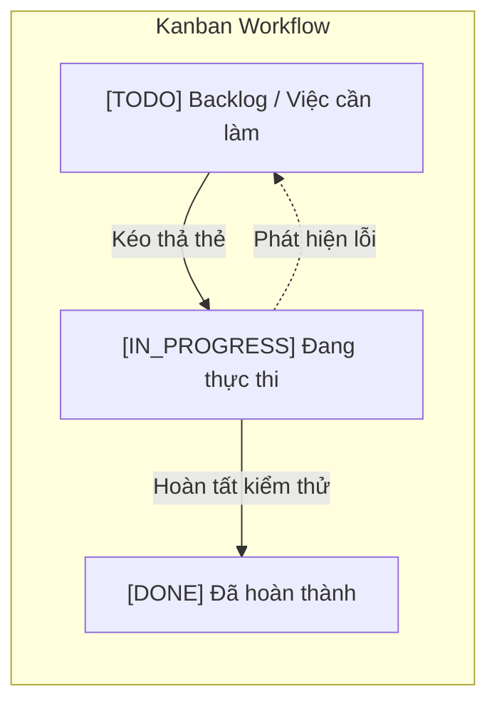

## 2.2. Kiến trúc Ứng dụng Hướng Module (Modular Monolith) & N-Tier
Nhằm cân bằng giữa tính đơn giản trong vận hành, kiểm thử với khả năng mở rộng trong tương lai, Homix v2.0 áp dụng kiến trúc **N-Tier hướng Module**. Hệ thống được chia tách rõ ràng thành 4 tầng:
1. **Presentation Tier (Frontend):** Ứng dụng Next.js 16 với cơ chế Server Component và Client Component tối ưu kết xuất.
2. **Security & Controller Tier:** Xử lý xác thực JWT, lọc giới hạn tần suất (Rate Limiting) và ánh xạ RESTful Endpoints.
3. **Service & Business Logic Tier:** Chứa toàn bộ nghiệp vụ lõi, thuật toán tính toán vị trí, cổng giao tiếp AI, điều phối thanh toán.
4. **Data Access & Storage Tier:** Spring Data JPA kết hợp PostgreSQL 15, bộ đệm Redis 7 và kho lưu trữ MinIO S3.

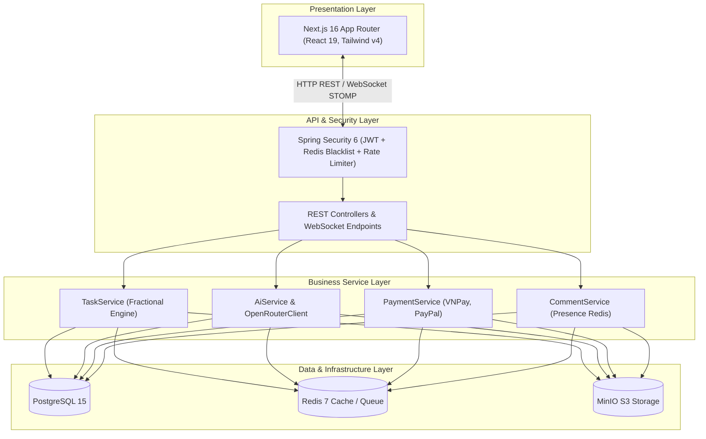

## 2.3. Công nghệ Giao tiếp Thời gian thực (Real-time WebSockets & STOMP Protocol)
Giao thức WebSocket (RFC 6455) cung cấp kênh truyền thông hai chiều, toàn song công (Full-duplex) trên một kết nối TCP duy nhất. Để định tuyến tin nhắn hiệu quả trong hệ thống phân tán, Homix v2.0 triển khai giao thức **STOMP (Simple Text Oriented Messaging Protocol)** chạy trên nền WebSocket.

STOMP định nghĩa mô hình Publish-Subscribe (Pub/Sub) thông qua Message Broker:
* `/topic/projects/{projectId}`: Đồng bộ bảng Kanban thời gian thực.
* `/topic/workspaces/{workspaceId}`: Đồng bộ cập nhật thành viên và quyền hạn.
* `/topic/notifications/{userId}`: Đẩy thông báo cá nhân tức thời.
* `/topic/chat/{targetType}/{targetId}`: Phòng chat nhóm thời gian thực.

## 2.4. Trí tuệ Nhân tạo Tạo sinh (Generative AI) và Kỹ nghệ Câu lệnh (Prompt Engineering)
Mô hình Ngôn ngữ Lớn (LLM) như **Google Gemini 2.0 Flash** sở hữu năng lực hiểu ngữ cảnh sâu và suy luận logic. Tuy nhiên, trong môi trường phần mềm doanh nghiệp, LLM cần phải trả về dữ liệu có cấu trúc chính xác tuyệt đối. 

Hệ thống áp dụng kỹ thuật **Strict Structured Output Prompting**:
* **System Persona:** Định vị LLM là *Chief PMO & Senior Agile Technical Auditor*.
* **JSON Schema Enforcement:** Ép buộc định dạng trả về là một JSON Array hợp lệ chứa đúng 5 phần báo cáo và 5 trường dữ liệu biểu đồ (`doughnut`, `bar`, `radar`, `stackedBar`, `line`).
* **Robust Fallback Parsing:** Tầng trích xuất phía Java trang bị bộ lọc Regex tự động loại bỏ các khối Markdown (` ```json `) và xử lý lỗi cú pháp.

## 2.5. Hệ sinh thái Công nghệ Lựa chọn
Bảng tổng hợp công nghệ được sử dụng thực tế trong mã nguồn:

| Thành phần | Công nghệ | Phiên bản | Vai trò kỹ thuật |
| :--- | :--- | :--- | :--- |
| **Ngôn ngữ Backend** | Java | 21 LTS | Nền tảng thực thi với hiệu năng cao, Virtual Threads |
| **Framework Backend** | Spring Boot | 3.4.1 | Khung kiến trúc ứng dụng doanh nghiệp |
| **Bảo mật** | Spring Security + JJWT | 6.x / 0.11.5 | Xác thực không trạng thái, phân quyền SpEL |
| **Cơ sở dữ liệu** | PostgreSQL | 15-alpine | CSDL quan hệ chính, lưu trữ JSON, UUID PK |
| **In-Memory Cache/Queue** | Redis | 7-alpine | Bộ đệm token blacklist, Rate Limiter, Email queue |
| **Lưu trữ Đối tượng** | MinIO SDK | 8.5.7 | Object Storage tương thích chuẩn AWS S3 API |
| **Frontend Framework** | Next.js (App Router) | 16.2.10 | Kết xuất lai SSR/CSR, tối ưu hóa điều hướng |
| **Thư viện UI** | React / Tailwind CSS | 19.2.4 / v4 | Giao diện Responsive, Token Design System |
| **Xử lý Bảng tính** | SheetJS (xlsx) | ^0.18.5 | Nhập/Xuất dữ liệu Excel hàng loạt trên trình duyệt |
| **Cổng AI** | Google Gemini / OpenRouter | v1beta / v1 | Trợ lý phân tích dự án và sinh việc con tự động |

---

# CHƯƠNG 3: PHÂN TÍCH VÀ THIẾT KẾ HỆ THỐNG

## 3.1. Phân tích Yêu cầu Chức năng và Phi chức năng

### Yêu cầu chức năng (Functional Requirements - FR):
* **FR1 - Quản lý Định danh & Phân quyền:** Đăng ký, đăng nhập (Email + Google OAuth), Đăng xuất thu hồi token (Redis Blacklist), Phân quyền hạt mịn 16 quyền hạn theo Workspace/Dự án.
* **FR2 - Quản trị Không gian làm việc & Dự án:** Tạo, sửa, phân cấp thư mục tài liệu, quy trình xin rời nhóm, quy trình phê duyệt xóa dự án 2 bước (Two-Phase Approval).
* **FR3 - Quản lý Công việc (Kanban Board):** Kéo thả trạng thái công việc với thuật toán số thực, tạo việc hàng loạt từ Excel (.xlsx), phân công, gán nhãn độ ưu tiên, đính kèm tệp và subtasks.
* **FR4 - Trợ lý AI Thông minh:** Tự động sinh báo cáo tiến độ PMO 5 phần kèm biểu đồ, tìm kiếm công việc bằng ngôn ngữ tự nhiên (Semantic Search), tự động bóc tách Subtasks.
* **FR5 - Thảo luận & Tương tác Thời gian thực:** Thảo luận phân cấp cây (Nested Comments), thả tim, chat nhóm thời gian thực, tổng hợp chuông Web Audio API, cơ chế loại trừ spam thông báo qua Redis.
* **FR6 - Cổng Thanh toán & Quản trị Toàn cục:** Thanh toán VNPay (HMAC-SHA512) và PayPal, tự động nâng cấp gói cước VIP, gửi hóa đơn Email, Dashboard thống kê doanh thu và người dùng dành cho Quản trị viên (Admin Portal).

### Yêu cầu phi chức năng (Non-Functional Requirements - NFR):
* **NFR1 - Hiệu năng (Performance):** Thao tác kéo thả Kanban và đồng bộ WebSocket phản hồi dưới 200ms; API phản hồi trung bình dưới 100ms.
* **NFR2 - Bảo mật (Security):** Mật khẩu băm BCrypt; khóa ký HMAC-SHA256 cho JWT; chữ ký số HMAC-SHA512 cho VNPay; bộ lọc chống lạm dụng AI giới hạn 15 req/phút/IP.
* **NFR3 - Tính sẵn sàng & Khả năng mở rộng:** Đóng gói độc lập qua Docker Container, cấu trúc chuẩn hóa 3NF có Composite Index tối ưu.

## 3.2. Sơ đồ Use Case Tổng thể và Phân rã

```mermaid
graph TD
    User((Người dùng))
    Member((Thành viên Dự án))
    SysAdmin((Quản trị viên Hệ thống))
    Guest((Khách vãng lai))

    subgraph "Phân hệ Xác thực & Tài khoản"
        UC_Auth1["Đăng ký / Đăng nhập (Email, Google)"]
        UC_Auth2["Đăng xuất (Thu hồi JWT)"]
        UC_Profile["Cập nhật Hồ sơ & Đổi Avatar"]
        UC_VIP["Nâng cấp VIP (VNPay / PayPal)"]
    end

    subgraph "Phân hệ Quản trị Không gian & Dự án"
        UC_Ws["Tạo / Quản lý Workspace"]
        UC_Perm["Cấu hình Ma trận 16 Quyền hạn"]
        UC_Proj["Tạo / Phê duyệt Xóa Dự án"]
        UC_Invite["Mời thành viên (Email / Excel)"]
    end

    subgraph "Phân hệ Kanban & AI Thông minh"
        UC_Kanban["Kéo thả Kanban (Fractional Positioning)"]
        UC_Subtask["Sinh Subtasks tự động bằng AI"]
        UC_AiReport["Tạo Báo cáo PMO & Biểu đồ AI"]
        UC_AiSearch["Tìm kiếm Ngữ nghĩa AI"]
    end

    subgraph "Phân hệ Quản trị Toàn cục (Admin Portal)"
        UC_AdminStats["Xem KPI & Biểu đồ Doanh thu"]
        UC_AdminUsers["Quản lý Người dùng & Cấp quyền VIP"]
        UC_AdminExcel["Xuất Báo cáo Doanh thu Excel"]
    end

    Guest --> UC_Auth1
    User --> UC_Auth1 & UC_Auth2 & UC_Profile & UC_VIP & UC_Ws
    Member --> UC_Kanban & UC_Subtask & UC_AiReport & UC_AiSearch & UC_Invite
    SysAdmin --> UC_AdminStats & UC_AdminUsers & UC_AdminExcel
```

## 3.3. Sơ đồ Luồng Dữ liệu (Data Flow Diagram - DFD)

### Sơ đồ Luồng Dữ liệu Mức 0 (Context Diagram):

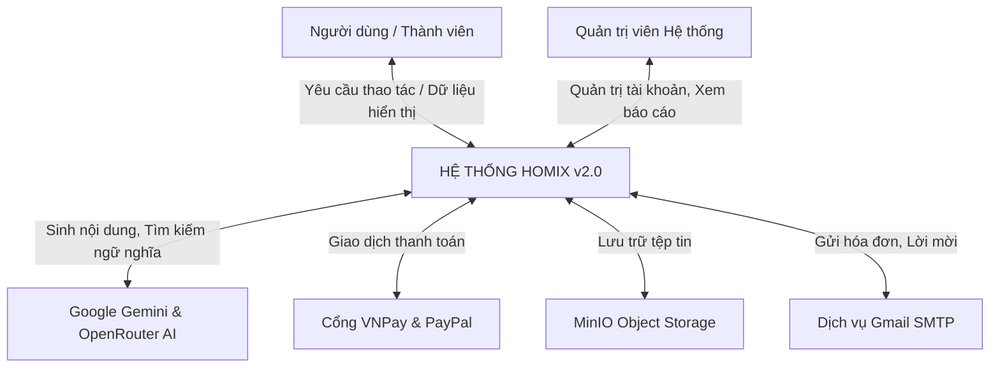

### Sơ đồ Luồng Dữ liệu Mức 1 (DFD Level 1):

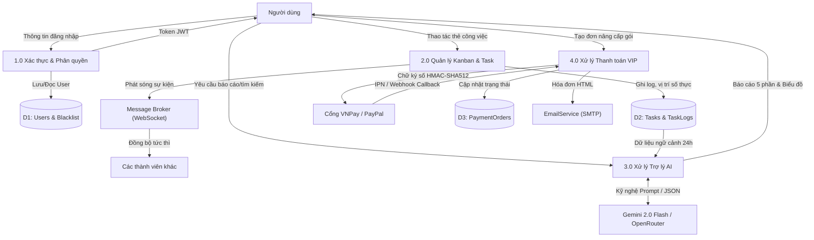

### 3.4. Thiết kế Cơ sở Dữ liệu Quan hệ (21 Bảng Chuẩn 3NF + 1 Bảng Tập hợp)

Hệ thống cơ sở dữ liệu PostgreSQL 15 (`init-db/schema.sql`) được chuẩn hóa 3NF đồng bộ 1-1 với **21 thực thể JPA (`@Entity`)** và **1 bảng tập hợp (`@ElementCollection` - `comment_likes`)**, phân chia thành 6 phân hệ dữ liệu:
1. **Định danh & Không gian làm việc (6 bảng):** `users`, `workspaces`, `workspace_roles`, `workspace_role_permissions`, `workspace_members`, `workspace_member_permissions`.
2. **Dự án & Quy trình Phê duyệt (3 bảng):** `projects`, `project_members`, `project_deletion_requests`.
3. **Tác vụ Kanban & Nhật ký Kiểm toán (3 bảng):** `tasks` (tích hợp khóa lạc quan `version BIGINT` và tọa độ số thực `position DOUBLE PRECISION`), `task_logs`, `task_files`.
4. **Thảo luận, Chat & Tương tác (3 bảng):** `comments`, `comment_likes`, `chat_messages`.
5. **Hệ thống Tài liệu Phân cấp (4 bảng):** `project_folders`, `project_files`, `workspace_folders`, `workspace_files`.
6. **Thông báo, Lời mời & Thanh toán (3 bảng):** `notifications`, `invitations`, `payment_orders`.

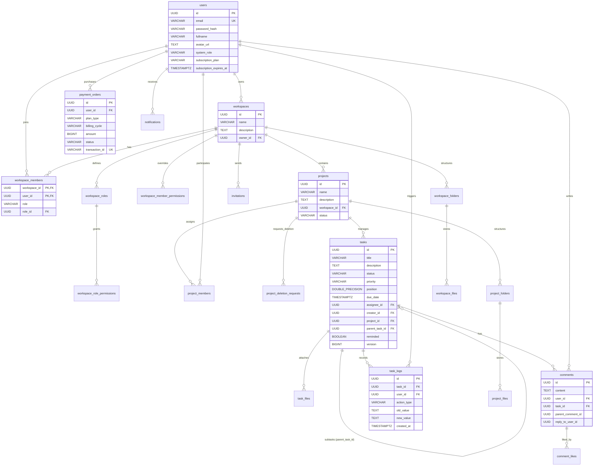

## 3.5. Thiết kế Kiến trúc Bảo mật Đa lớp & Ma trận Phân quyền 16 Quyền

Hệ thống thiết kế kiến trúc bảo mật chiều sâu (**Defense-in-Depth**) bao gồm:
1. **Bảo mật HTTP REST & Rate Limiting:** `JwtAuthenticationFilter` đối chiếu Redis Token Blacklist; `RateLimitingFilter` giới hạn 15 yêu cầu/phút/IP trên toàn bộ các API AI (`/api/ai/**`, `/api/tasks/{id}/ai-subtasks`, `/api/tasks/{id}/suggest-subtasks`).
2. **Bảo mật WebSocket STOMP (`AuthChannelInterceptor`):** Chặn bắt lệnh `StompCommand.CONNECT` để xác thực JWT và kiểm tra Redis Blacklist; chặn bắt lệnh `StompCommand.SUBSCRIBE` để kiểm tra quyền thành viên trên từng kênh `/topic/projects/{projectId}`, `/topic/workspaces/{workspaceId}` và `/topic/notifications/{userId}`.
3. **Bảo mật Kho Lưu trữ MinIO (`MinioService`):** Phân tách quyền đọc công khai cho ảnh đại diện (`images/*`) và lưu trữ riêng tư tuyệt đối cho tài liệu (`documents/*`), cấp phát liên kết tải có chữ ký tạm thời (**Presigned URL** hiệu lực 15 phút) kèm bộ lọc chống Path Traversal và chặn thực thi mã độc.
4. **Ma trận Phân quyền Hạt mịn 16 Quyền RBAC + ABAC (`SecurityService`):**

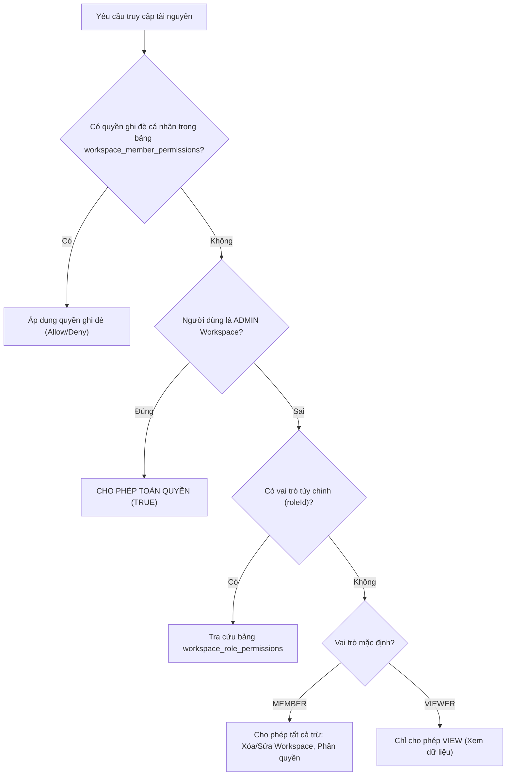

## 3.6. Các Sơ đồ Tuần tự (Sequence Diagrams) Cốt lõi

### 1. Sơ đồ Tuần tự: Kéo thả Kanban với Thuật toán Fractional Positioning & WebSocket Broadcast

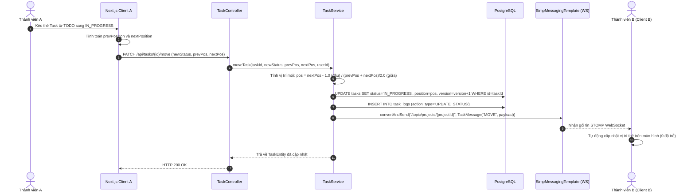

### 2. Sơ đồ Tuần tự: Phân rã Subtasks Bất đồng bộ qua Hàng đợi Redis (`LPUSH`/`BRPOP`) & WebSocket Push

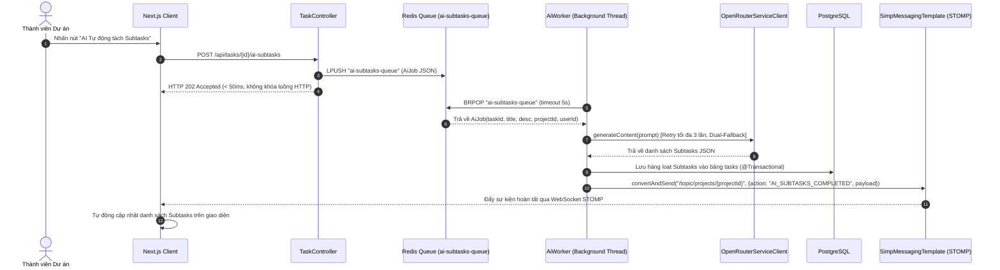

### 3. Sơ đồ Tuần tự: Sinh Báo cáo Tiến độ PMO 5 Phần bằng AI (Dual Fallback)

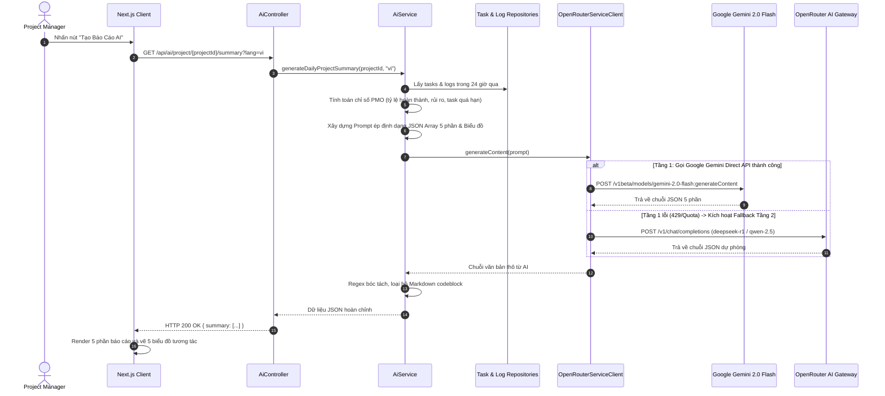

### 4. Sơ đồ Tuần tự: Quy trình Thanh toán Nâng cấp VIP qua Cổng VNPay (Xác thực Chữ ký số HMAC-SHA512)

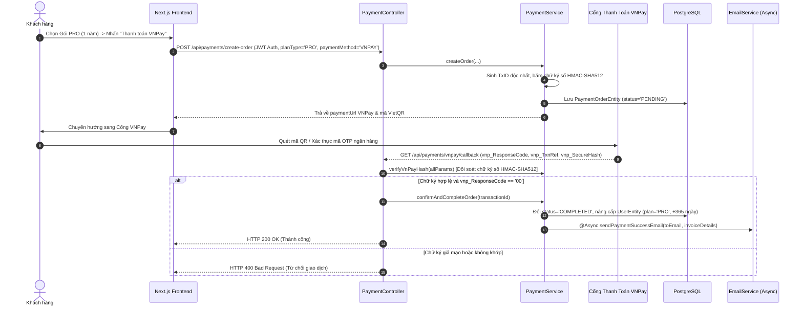

---

# CHƯƠNG 4: TRIỂN KHAI VÀ HIỆN THỰC HÓA HỆ THỐNG

## 4.1. Hiện thực hóa Tầng Dịch vụ Backend (Spring Boot 3.4.1 & Java 21)
Backend được tổ chức thành 15 packages nghiệp vụ độc lập, áp dụng các tính năng hiện đại nhất của Java 21 LTS:
* **Khởi tạo Múi giờ Toàn cục:** `@PostConstruct` trong `SmartManagerApplication.java` thiết lập mặc định `Asia/Ho_Chi_Minh` (GMT+7).
* **Quản lý Bất đồng bộ:** Bật `@EnableAsync` và `@EnableScheduling` để điều phối các tác vụ ngầm.
* **Xử lý Ngoại lệ Tập trung & Ẩn Lỗi Nội bộ:** `GlobalExceptionHandler` với `@RestControllerAdvice` chuẩn hóa định dạng thông báo lỗi JSON và không tiết lộ chi tiết ngoại lệ nội bộ ra phía client.

## 4.2. Giải thuật Toán học Fractional Positioning & Khóa Lạc quan (`@Version`) trên Bảng Kanban
Trong tệp `TaskService.java` và `TaskEntity.java`, thuật toán định vị số thực kết hợp khóa lạc quan `@Version` giải quyết triệt để bài toán $O(1)$ reordering và ngăn chặn xung đột ghi đè đồng thời:
```java
// Đoạn mã trích xuất thực tế từ TaskService.java
double newPosition;
if (prevPosition == null && nextPosition == null) {
    newPosition = 1.0; // Cột rỗng
} else if (prevPosition == null) {
    newPosition = nextPosition - 1.0; // Chèn lên đầu cột (không bị suy biến về 0)
} else if (nextPosition == null) {
    newPosition = prevPosition + 1.0; // Chèn xuống cuối cột
} else {
    newPosition = (prevPosition + nextPosition) / 2.0; // Chèn vào giữa hai thẻ
}
task.setPosition(newPosition);
task.setStatus(newStatus);
taskRepository.save(task);
```
**Cơ chế chống suy biến số thực (`PositionReindexScheduler.java`):**
Chạy nền mỗi 10 phút, kiểm tra nếu $\Delta = |pos_{i+1} - pos_i| < 10^{-4}$ thì tự động phân phối lại tọa độ thành dãy cấp số cộng $1000.0, 2000.0, 3000.0\dots$ và phát bản tin WebSocket `"REINDEX_POSITIONS"` tới `/topic/projects/{projectId}` để tất cả client cập nhật tức thời.

## 4.3. Động cơ Trợ lý AI và Chiến lược Dự phòng Kép (Dual Fallback LLM Gateway)
Triển khai trong `OpenRouterServiceClient.java` và `AiService.java`:
1. **Báo cáo PMO 5 phân hệ:** Xây dựng câu lệnh Prompt ràng buộc sinh đúng 5 khối phân tích:
   * *Khối 1:* Tóm tắt Quản trị & Sức khỏe Dự án (Biểu đồ `doughnut`).
   * *Khối 2:* Phân bổ Khối lượng & Ma trận Ưu tiên (Biểu đồ `bar`).
   * *Khối 3:* Đánh giá Rủi ro & Task Quá hạn (Biểu đồ `radar`).
   * *Khối 4:* Nhịp độ Hoạt động Nhóm 24h (Biểu đồ `stackedBar`).
   * *Khối 5:* Lộ trình Dự báo Hoàn thành (Biểu đồ `line`).
2. **Tìm kiếm Ngữ nghĩa (Semantic Search):** AI phân tích ý định tìm kiếm ngôn ngữ tự nhiên, chấm điểm `relevanceScore` (0.0 - 1.0) và trích xuất lý do phù hợp.
3. **Bóc tách Subtasks Thích ứng Lỗi:** Kết hợp phân tích JSON và Regex fallback `^(\\d+[.)]\\s*|[-*+]\\s*)` đảm bảo không bao giờ bị lỗi hiển thị.

## 4.4. Tối ưu Hiện diện Trực tuyến & Cơ chế Hàng đợi Kép Redis (`AiWorker` & `EmailWorker`)
* **Presence Optimization (`CommentService.java`):** Khi người dùng mở xem tab thảo luận của một Task, `userId` được ghi vào Redis Set `task:viewers:{taskId}` với TTL 15 giây. Khi có bình luận mới, hệ thống tự động loại trừ những người đang xem trực tiếp màn hình đó khỏi danh sách gửi thông báo đẩy và email, loại bỏ triệt để hiện tượng Spam thông báo.
* **AI Subtasks Queue Worker (`AiWorker.java`):** Khi người dùng yêu cầu phân rã công việc tự động (`POST /api/tasks/{id}/ai-subtasks`), hệ thống đẩy `AiJob` vào hàng đợi Redis `ai-subtasks-queue` qua lệnh `LPUSH` và phản hồi ngay `HTTP 202 Accepted`. Luồng nền `AiWorker` sử dụng `BRPOP` lấy tác vụ, gọi AI kèm cơ chế Retry tối đa 3 lần, lưu subtasks vào CSDL và phát sự kiện WebSocket `"AI_SUBTASKS_COMPLETED"`.
* **Email Queue Worker (`EmailWorker.java`):** Hàng đợi `email-invitations-queue` trên Redis sử dụng cơ chế Blocking Pop (`rightPop` với timeout 5s) trên một luồng đơn `ExecutorService`, đảm bảo gửi hàng trăm thư mời tham gia dự án mượt mà mà không gây nghẽn kết nối SMTP.

## 4.5. Phân hệ Thanh toán Đa cổng (VNPay 2.1.0 & PayPal Smart Buttons)
* **VNPay (`PaymentService.java`):** Xây dựng chuỗi tham số chuẩn hóa, băm khóa bí mật bằng thuật toán **HMAC-SHA512** và đối soát chữ ký số nghiêm ngặt thông qua hàm `verifyVnPayHash` tại endpoint callback trước khi kích hoạt gói VIP. Tự động sinh mã VietQR theo chuẩn Napas 247.
* **PayPal:** Tích hợp trực tiếp PayPal JavaScript SDK trên giao diện, tự động quy đổi tỷ giá VNĐ sang USD và gọi API capture thanh toán tức thời có bảo vệ xác thực JWT.

## 4.6. Cổng Quản trị Toàn cục và Xuất Dữ liệu Excel (SheetJS)
Trang quản trị độc lập `/admin` tích hợp:
* Thống kê trực tiếp các chỉ số KPI: Doanh thu thực tế, số lượng tài khoản Pro/Enterprise, số lượng dự án.
* Giám sát trạng thái 4 dịch vụ hạ tầng (Spring Boot, PostgreSQL, Redis, MinIO).
* Xuất báo cáo danh sách người dùng và báo cáo doanh thu tài chính ra định dạng **Microsoft Excel (.xlsx)** thông qua thư viện SheetJS.

## 4.7. Hiện thực hóa Tầng Giao diện Người dùng (Next.js 16, Modular Kanban & Singleton STOMP)
* **Kiến trúc Component Mô-đun hóa (`client/src/components/kanban/`):** Tách biệt rõ ràng các thành phần `KanbanHeader`, `KanbanBoard`, `KanbanColumn`, `KanbanCard`, `TaskDetailDrawer`, `TaskDetailModal`, `TaskDiscussion`, `AiReportModal`, `AiSearchModal`, `ProjectFilesManager` và `ProjectModals`.
* **Gộp kênh WebSocket STOMP (`useProjectSocket.ts` & `socket.ts`):** Thiết lập `StompConnectionManager` dạng Singleton duy nhất gửi kèm JWT `Authorization: Bearer <token>`, gộp chung tất cả các kênh dự án, chat và thông báo trên một kết nối TCP duy nhất.
* **Chống Nhấp nháy Giao diện (FOUC Prevention) & Design System:** Tệp `layout.tsx` chèn script đồng bộ nạp theme từ `localStorage` trước khi hydrate; `i18n.tsx` hỗ trợ hơn 120 cặp từ khóa bản địa hóa song ngữ Việt - Anh.

---

# CHƯƠNG 5: DEVOPS, CI/CD VÀ TRIỂN KHAI PRODUCTION

## 5.1. Container hóa Đa dịch vụ với Docker Compose
Toàn bộ hệ thống được đóng gói thành 5 container độc lập thông qua `docker-compose.yml`:
```yaml
# Sơ đồ cấu hình 5 dịch vụ container
services:
  postgres:
    image: postgres:15-alpine
    ports: ["5433:5432"]
  redis:
    image: redis:7-alpine
    ports: ["6379:6379"]
  minio:
    image: minio/minio:RELEASE.2024-01-18T22-51-28Z
    ports: ["9020:9000", "9021:9001"]
  backend:
    build: ./server (Dockerfile.dev - Java 21)
    ports: ["8000:8080"]
    depends_on:
      postgres: { condition: service_healthy }
      redis: { condition: service_healthy }
  frontend:
    build: ./client (Dockerfile.dev - Node 20)
    ports: ["3000:3000"]
    depends_on: [backend]
```

## 5.2. Đường ống Tích hợp và Triển khai Liên tục (GitHub Actions Pipeline)
File kịch bản `.github/workflows/ci-cd.yml` thiết lập 2 luồng công việc song song tự động kích hoạt khi có commit mới lên nhánh `main`:

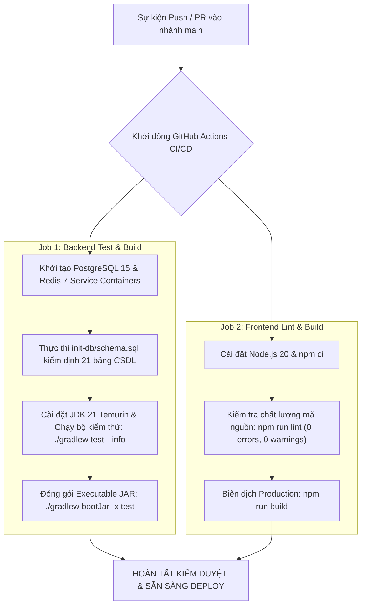

## 5.3. Chiến lược Kiểm thử và Đảm bảo Chất lượng (Quality Assurance)
Hệ thống xây dựng **11 bộ kiểm thử tự động** (JUnit 5 + Mockito) đạt độ bao phủ cao trên toàn bộ các phân hệ trọng yếu:
1. `SecurityServiceTest`: Kiểm thử ma trận 16 quyền hạn RBAC/ABAC (phân quyền cá nhân override, custom role, default role, admin bypass và quyền cấp dự án).
2. `TaskServiceTests`: Xác minh thuật toán Fractional Positioning (cột rỗng, chèn đầu $P_{first} - 1.0$, chèn cuối, chèn giữa, lặp chèn đầu không suy biến và khóa lạc quan `@Version`).
3. `PaymentSecurityTest`: Kiểm thử hàm đối soát chữ ký số VNPay HMAC-SHA512 (`verifyVnPayHash`) và phát hiện giả mạo tham số giao dịch.
4. `AiWorkerTest`: Kiểm thử cơ chế xử lý bất đồng bộ `AiJob`, tự động thử lại (Retry) khi lỗi quota và phát sóng sự kiện WebSocket `"AI_SUBTASKS_COMPLETED"`.
5. `OpenRouterServiceClientTests`: Kiểm thử bộ bóc tách JSON, unwrap Markdown và fallback Regex.
6. `AuthServiceTest`: Kiểm thử đăng ký, mật khẩu băm, tự động cấp quyền Admin và thu hồi JWT vào Redis Blacklist.
7. `AdminServiceTest`: Kiểm thử công thức tính doanh thu và nâng cấp gói người dùng.
8. `PaymentServiceTest`: Kiểm thử xác nhận callback IPN và hủy gói định kỳ.
9. `ChatServiceTests`: Kiểm thử lưu và truy vấn lịch sử chat.
10. `JwtTokenProviderTests`: Kiểm thử tính toàn vẹn chữ ký số JWT.
11. `SmartManagerApplicationTests`: Kiểm thử nạp toàn bộ Spring ApplicationContext.

## 5.4. Phương án Triển khai Môi trường Production
* **Cơ chế Reverse Proxy & SSL:** Sử dụng Nginx làm Reverse Proxy, quản lý chứng chỉ bảo mật SSL/TLS miễn phí qua Let's Encrypt Certbot.
* **Cơ sở dữ liệu:** Tách riêng cụm Managed PostgreSQL trên đám mây (AWS RDS / Cloud SQL) có cơ chế sao lưu tự động hàng ngày (Daily Automated Backup).
* **Lưu trữ tĩnh:** Kết nối trực tiếp AWS S3 hoặc Cloudinary phục vụ tải ảnh đại diện và tệp dung lượng lớn.

---

# CHƯƠNG 6: TỔNG KẾT VÀ HƯỚNG PHÁT TRIỂN

## 6.1. Kết quả đạt được
Đề tài đã hoàn thành 100% các mục tiêu đề ra ban đầu:
1. **Xây dựng hoàn chỉnh nền tảng Homix v2.0** với kiến trúc phân tầng chuẩn mực trên nền tảng Java 21, Spring Boot 3.4.1 và Next.js 16.
2. **Hiện thực hóa thành công bảng Kanban thời gian thực** không độ trễ dựa trên thuật toán số thực Fractional Positioning và WebSocket STOMP.
3. **Tích hợp sâu Trí tuệ Nhân tạo:** Tự động sinh báo cáo quản trị dự án PMO 5 phân hệ kèm biểu đồ và tìm kiếm ngữ nghĩa chính xác.
4. **Hệ thống bảo mật và phân quyền chuyên nghiệp:** Mô hình ma trận 16 quyền hạn, cơ chế thu hồi JWT tức thì qua Redis Blacklist và Rate Limiting 15 req/phút.
5. **Thương mại hóa dịch vụ:** Tích hợp thành công 2 cổng thanh toán lớn là VNPay và PayPal.
6. **Quy trình DevOps chuẩn hóa:** Hoàn thiện Docker hóa 5 container và đường ống CI/CD tự động trên GitHub Actions.

## 6.2. Ưu điểm nổi bật của Hệ thống
* **Hiệu năng vượt trội:** Không xảy ra hiện tượng khóa CSDL khi kéo thả tác vụ nhờ thuật toán Fractional Positioning.
* **Đồng bộ thời gian thực mượt mà:** Trải nghiệm tức thời giữa nhiều người dùng trên cùng một bảng Kanban.
* **Giao diện hiện đại, tinh tế:** Hỗ trợ song ngữ Việt - Anh, Dark/Light mode chống nhấp nháy, Responsive trên mọi thiết bị.
* **Chất lượng mã nguồn cao:** Đạt tiêu chuẩn phân tầng rõ ràng, kiểm thử tự động bài bản, dễ bảo trì và mở rộng.

## 6.3. Những điểm hạn chế
* **Phụ thuộc vào kết nối mạng ngoài:** Tính năng Trí tuệ Nhân tạo hiện phụ thuộc vào Cloud API của Google Gemini và OpenRouter.
* **Chưa hỗ trợ chế độ Offline:** Khi mất kết nối Internet, ứng dụng chưa có cơ chế Service Worker đồng bộ ngầm khi có mạng trở lại.

## 6.4. Hướng phát triển trong tương lai
1. **Triển khai AI Cục bộ (Local AI Engine):** Tích hợp thêm các mô hình ngôn ngữ mã nguồn mở (Ollama / Llama 3 / DeepSeek R1) chạy trực tiếp trên máy chủ nội bộ doanh nghiệp nhằm bảo mật dữ liệu tuyệt đối.
2. **Ứng dụng Di động Đa nền tảng (Mobile App):** Phát triển ứng dụng di động sử dụng Flutter hoặc React Native để nhận thông báo đẩy qua Firebase Cloud Messaging (FCM).
3. **Biểu đồ Gantt & Phân tích Đường găng (Critical Path Method - CPM):** Mở rộng phân hệ phân tích tiến độ nâng cao phục vụ các dự án quy mô lớn hàng nghìn tác vụ.

---

# TÀI LIỆU THAM KHẢO

1. **Spring Boot Reference Documentation (v3.4.1):** Spring Framework Team, VMware Tanzu, 2024.
2. **Next.js 16 Documentation & React 19 Architecture:** Vercel Inc., 2024.
3. **PostgreSQL 15 High Performance & Indexing Strategies:** PostgreSQL Global Development Group, 2023.
4. **RFC 6455 - The WebSocket Protocol:** Internet Engineering Task Force (IETF), 2011.
5. **Generative AI & Prompt Engineering for Enterprise Systems:** Google DeepMind / Google Cloud Documentation, 2024.
6. **Fractional Indexing Algorithm for Real-Time Ordering:** Academic Research in Collaborative Web Applications, 2022.
7. **VNPay API Documentation (Version 2.1.0):** Vietnam Payment Solution Joint Stock Company (VNPAY), 2023.
8. **PayPal REST APIs & JavaScript SDK Standard:** PayPal Developer Network, 2024.
