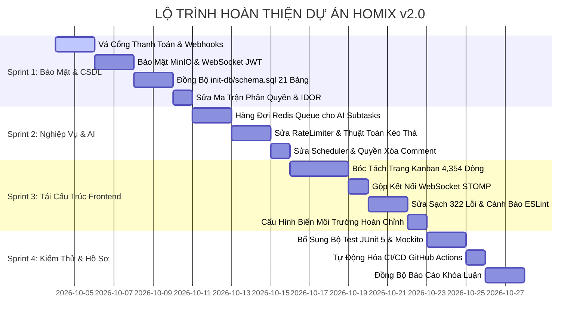

# KẾ HOẠCH HÀNH ĐỘNG TỔNG THỂ HOÀN THIỆN DỰ ÁN HOMIX v2.0
# (MASTER REMEDIATION & COMPLETION PLAN - PRODUCTION & THESIS GRADE)

> **Dự án:** Nền tảng Quản lý Dự án & Cộng tác Thông minh Homix v2.0  
> **Phiên bản kế hoạch:** 2.0 (Toàn diện - Chuẩn Khóa luận & Sẵn sàng Triển khai Sản xuất)  
> **Mục tiêu:** Khắc phục 100% lỗ hổng bảo mật, đồng bộ CSDL 21 bảng, chuẩn hóa kiến trúc hàng đợi Redis Queue cho AI, bóc tách module Frontend 4,354 dòng, xử lý sạch 322 lỗi ESLint và đưa dự án đạt trạng thái hoàn thiện tuyệt đối.

---

## MỤC LỤC TỔNG QUAN

1. [Tổng Quan Hiện Trạng & Mục Tiêu Nghiệm Thu](#1-tổng-quan-hiện-trạng--mục-tiêu-nghiệm-thu)
2. [Kiến Trúc Đích Của Toàn Bộ Hệ Thống (Target Architecture)](#2-kiến-trúc-đích-của-toàn-bộ-hệ-thống-target-architecture)
3. [Lộ Trình Triển Khai 4 Giai Đoạn (Phased Sprints Roadmap)](#3-lộ-trình-triển-khai-4-giai-đoạn-phased-sprints-roadmap)
   - [Sprint 1: Củng Cố Bảo Mật & Đồng Bộ CSDL 21 Bảng (Critical)](#sprint-1-củng-cố-bảo-mật--đồng-bộ-csdl-21-bảng-critical)
   - [Sprint 2: Chuẩn Hóa Nghiệp Vụ, Redis Queue AI & Thuật Toán Fractional (High)](#sprint-2-chuẩn-hóa-nghiệp-vụ-redis-queue-ai--thuật-toán-fractional-high)
   - [Sprint 3: Tái Cấu Trúc Frontend & Tối Ưu Realtime Multiplexing (Medium)](#sprint-3-tái-cấu-trúc-frontend--tối-ưu-realtime-multiplexing-medium)
   - [Sprint 4: Kiểm Thử Tự Động, CI/CD & Hoàn Thiện Hồ Sơ Khóa Luận (Final)](#sprint-4-kiểm-thử-tự-động-cicd--hoàn-thiện-hồ-sơ-khóa-luận-final)
4. [Đặc Tả Kỹ Thuật Chi Tiết Từng Hạng Mục](#4-đặc-tả-kỹ-thuật-chi-tiết-từng-hạng-mục)
   - [4.1. CSDL Hoàn chỉnh 21 Bảng (`init-db/schema.sql`)](#41-csdl-hoàn-chỉnh-21-bảng-init-dbschemasql)
   - [4.2. Khắc phục Lỗ hổng Thanh toán & Webhook Signature](#42-khắc-phục-lỗ-hổng-thanh-toán--webhook-signature)
   - [4.3. Siết chặt Bảo mật MinIO & Presigned URL](#43-siết-chặt-bảo-mật-minio--presigned-url)
   - [4.4. Cơ chế Interceptor Xác thực WebSocket STOMP](#44-cơ-chế-interceptor-xác-thực-websocket-stomp)
   - [4.5. Kiến trúc Redis Queue Bất đồng bộ cho AI Auto-Subtasks](#45-kiến-trúc-redis-queue-bất-đồng-bộ-cho-ai-auto-subtasks)
   - [4.6. Cây Phân rã Component Frontend (`project/[projectId]/page.tsx`)](#46-cây-phân-rã-component-frontend-projectprojectidpagetsx)
5. [Ma Trận Đánh Giá Tiêu Chí Nghiệm Thu (Acceptance Criteria Matrix)](#5-ma-trận-đánh-giá-tiêu-chí-nghiệm-thu-acceptance-criteria-matrix)

---

## 1. TỔNG QUAN HIỆN TRẠNG & MỤC TIÊU NGHIỆM THU

### 1.1. Hiện trạng sau kiểm toán mã nguồn (Baseline Audit)
- **Mức độ hoàn thành thực tế:** ~68% (Đã có giao diện, controllers và dịch vụ cơ bản, nhưng tồn đọng nợ kỹ thuật và rủi ro bảo mật).
- **Cơ sở dữ liệu:** File `init-db/schema.sql` mới chỉ có 9 bảng, thiếu 12 bảng thực thể so với 21 JPA Entities trong Java. Hệ thống chạy phụ thuộc vào Hibernate `ddl-auto: update`.
- **Bảo mật:** 4 lỗ hổng nghiêm trọng (Thanh toán không xác thực chữ ký; MinIO upload không cần đăng nhập và mở public read; WebSocket không xác thực token; gán nhầm quyền `VIEWER` cho các thao tác xóa tệp/thư mục).
- **Nghiệp vụ AI:** Đang chạy blocking HTTP đồng bộ, chưa đúng thiết kế hàng đợi Redis Queue bất đồng bộ trong tài liệu đặc tả chức năng.
- **Frontend Next.js:** Trang Kanban `project/[projectId]/page.tsx` phình to thành file nguyên khối **4,354 dòng** với hơn 60 `useState`, 3 kết nối WebSocket đồng thời và 322 cảnh báo/lỗi ESLint.

### 1.2. Mục tiêu nghiệm thu (Target Goals)
1. **Bảo mật 100%:** Toàn bộ API thanh toán, upload tệp, WebSocket, phân quyền RBAC được kiểm soát nghiêm ngặt.
2. **CSDL độc lập & toàn vẹn:** `init-db/schema.sql` có đủ 21 bảng, tự động khởi chạy sạch trên PostgreSQL container mà không cần Hibernate sinh cấu trúc.
3. **Đúng thiết kế đặc tả 100%:** Tính năng AI Auto-Subtasks chạy ngầm qua Redis Queue (`ai-subtasks-queue`) trả về HTTP 202 Accepted.
4. **Kiến trúc Frontend chuẩn mực:** Phân tách trang Kanban thành 8 sub-components chuyên trách, sửa sạch 322 lỗi ESLint (`0 errors, 0 warnings`), hỗ trợ responsive và kéo thả mượt mà.
5. **Đạt điểm xuất sắc Khóa luận:** Khớp 100% giữa tài liệu báo cáo học thuật và hiện thực mã nguồn thực tế.

---

## 2. KIẾN TRÚC ĐÍCH CỦA TOÀN BỘ HỆ THỐNG (TARGET ARCHITECTURE)

```
[ CLIENT TIER - Next.js 16 (React 19) ]
   ├── Custom Hook: useProjectSocket (Single STOMP Multiplexed Connection)
   ├── Design Tokens & Tailwind CSS v4 Theme
   └── Modular Components:
         ├── KanbanBoard, KanbanColumn, KanbanTaskCard
         ├── TaskDetailModal (Checklist, Description, Attachments)
         ├── TaskDiscussion (Threaded Comments, Redis Presence)
         ├── AiReportModal (5-Section PMO Executive Dashboard)
         └── DocumentManager (Multi-tier Workspace & Project Files)
                     │
                     │ HTTP REST (Bearer JWT) / WSS STOMP (CONNECT Header JWT)
                     ▼
[ API GATEWAY & SECURITY FILTER CHAIN - Spring Boot 3.4.1 (Java 21) ]
   ├── RateLimitingFilter (Redis Fixed Window: 15 req/min bao quát /api/ai/** & /api/tasks/**/ai-*)
   ├── JwtAuthenticationFilter (RSA/HMAC Signature + Redis Token Blacklist Check)
   ├── SecurityConfig (Đóng kín /api/upload/** và /api/payments/**, bảo vệ Webhook)
   └── WebSocketChannelInterceptor (Pre-Send Intercept: Xác thực JWT khi CONNECT & SUBSCRIBE)
                     │
                     ▼
[ APPLICATION SERVICE LAYER ]
   ├── TaskService (Fractional Positioning: P_new = P_first - 1.0; Optimistic Lock @Version)
   ├── AiQueueProducer (Đẩy Job vào Redis List "ai-subtasks-queue", trả về HTTP 202 Accepted)
   ├── PaymentService (Xác minh chữ ký số VNPay HMAC-SHA512, MoMo & PayPal Capture API)
   ├── MinioService (Private Bucket + Presigned URL download 15 phút, Magic Byte MIME Validation)
   └── SecurityService (SpEL Engine 16 Quyền hạn - Khắc phục quyền tệp/thư mục)
                     │
        ┌────────────┴────────────┐
        ▼                         ▼
[ ASYNC WORKERS & SCHEDULERS ]    [ REPOSITORY LAYER (Spring Data JPA) ]
   ├── AiSubtaskWorker (BRPOP)       │
   ├── EmailWorker (BRPOP)           ▼
   ├── PositionReindexScheduler   [ DATA PERSISTENCE & INFRASTRUCTURE TIER ]
   │   (Phát WS Broadcast khi reindex) ├── PostgreSQL 15 (21 Tables chuẩn 3NF, 11 Indexes)
   └── TaskDeadlineReminderScheduler   ├── Redis 7 (Tokens, Rate Limit, Presences, 2 Queues)
       (dueDate BETWEEN now AND 24h)   └── MinIO S3 (Private Storage Bucket)
```

---

## 3. LỘ TRÌNH TRIỂN KHAI 4 GIAI ĐOẠN (PHASED SPRINTS ROADMAP)



---

### SPRINT 1: Củng Cố Bảo Mật & Đồng Bộ CSDL 21 Bảng (Critical)
*Mục tiêu: Đóng triệt để mọi kẽ hở an ninh thông tin, loại bỏ khả năng gian lận thanh toán, ngăn rò rỉ dữ liệu và hoàn thiện CSDL chuẩn khởi tạo.*

- [ ] **Task 1.1: Khắc phục Lỗ hổng Thanh toán & Xác thực Chữ ký số**
  - **Mã nguồn tác động:** `server/.../payments/PaymentController.java`, `PaymentService.java`, `SecurityConfig.java`.
  - **Hành động kỹ thuật:**
    1. Trong `SecurityConfig.java`: Bỏ wildcard `/api/payments/**` khỏi danh sách `permitAll()`. Chỉ cho phép `permitAll()` đối với các webhook callback: `/api/payments/vnpay/callback`, `/api/payments/momo/ipn`. Các API còn lại (`/create-order`, `/user-orders`, `/cancel-subscription`) bắt buộc phải có JWT authentication.
    2. Xóa bỏ hoặc đặt `@PreAuthorize("hasRole('ADMIN')")` cho endpoint `POST /api/payments/confirm-payment`. Người dùng tuyệt đối không thể tự xác nhận đơn hàng thành công qua client.
    3. Trong `PaymentService.java`: Viết hàm kiểm tra tính toàn vẹn chữ ký `verifyVnPayHash(Map<String, String> fields, String secureHash)`. Chỉ cập nhật đơn hàng thành `COMPLETED` khi chữ ký khớp với bí mật `vnp_HashSecret`.
    4. Đối với PayPal: Gọi trực tiếp sang PayPal REST API (`/v2/checkout/orders/{id}/capture`) để xác nhận tiền đã trừ thực tế trước khi kích hoạt gói VIP.
  - **Tiêu chí nghiệm thu:** Cố tình gọi API callback với mã fake hoặc chữ ký sai sẽ bị từ chối `HTTP 400/403`; tài khoản không bị nâng cấp VIP trái phép.

- [ ] **Task 1.2: Bảo mật Lưu trữ MinIO & Tải tệp an toàn**
  - **Mã nguồn tác động:** `server/.../minio/UploadController.java`, `MinioService.java`, `SecurityConfig.java`.
  - **Hành động kỹ thuật:**
    1. Trong `SecurityConfig.java`: Yêu cầu xác thực JWT cho `/api/upload/**`.
    2. Trong `MinioService.java`: Đổi bucket policy sang **Private**. Không cho phép `*` truy cập public `s3:GetObject`.
    3. Triển khai phương thức sinh **Presigned URL** (`getPresignedObjectUrl` với thời hạn hết hạn 15 phút) khi người dùng yêu cầu xem/tải tài liệu.
    4. Bổ sung kiểm tra định dạng tệp: Dùng whitelist định dạng MIME an toàn (ảnh: `image/jpeg, image/png, image/webp`; tài liệu: `application/pdf, application/msword, application/vnd.openxmlformats-officedocument.*, text/plain`). Ngăn chặn tuyệt đối việc tải lên file thực thi (`.exe, .sh, .bat`) hoặc file mã nguồn web (`.html, .js, .svg` có chứa script).
  - **Tiêu chí nghiệm thu:** Người chưa đăng nhập không thể upload file; link MinIO không thể đọc công khai nếu không có chữ ký presigned hợp lệ.

- [ ] **Task 1.3: Bảo mật Kết nối WebSocket STOMP qua ChannelInterceptor**
  - **Mã nguồn tác động:** `server/.../config/WebSocketConfig.java`, tạo mới `AuthChannelInterceptor.java`.
  - **Hành động kỹ thuật:**
    1. Cấu hình `configureClientInboundChannel(ChannelRegistration registration)` trong `WebSocketConfig.java`.
    2. Bắt sự kiện lệnh `StompCommand.CONNECT`: Trích xuất token từ header `Authorization: Bearer <jwt>`, gọi `JwtTokenProvider` kiểm tra tính hợp lệ và thiết lập `SecurityContext` cho session WebSocket.
    3. Bắt sự kiện lệnh `StompCommand.SUBSCRIBE`: Kiểm tra quyền truy cập vào topic tương ứng (ví dụ: chỉ cho phép subscribe `/topic/projects/{id}` nếu user là thành viên của project/workspace đó).
  - **Tiêu chí nghiệm thu:** Kết nối WebSocket không có JWT token sẽ bị từ chối ngay lập tức; không thể nghe lén topic của dự án khác.

- [ ] **Task 1.4: Điều chỉnh Ma trận Phân quyền & Khắc phục IDOR**
  - **Mã nguồn tác động:** `ProjectController.java`, `WorkspaceController.java`, `NotificationController.java`.
  - **Hành động kỹ thuật:**
    1. Sửa các quyền trên endpoint tệp/thư mục từ `'VIEWER'` thành `'MEMBER'` cho thao tác tải tệp/tạo thư mục, và `'ADMIN'` cho thao tác xóa thư mục.
    2. Sửa `NotificationController.java`: Trong `PATCH /api/notifications/{id}/read`, bắt buộc kiểm tra notification thuộc sở hữu của `userPrincipal.getId()`, nếu không ném ngoại lệ `AccessDeniedException`.
    3. Sửa `WorkspaceController.java`: Sửa tên biến PathVariable trong SpEL expression từ `#workspaceId` thành `#id` để khớp chính xác với annotation `@PathVariable("id")`.
  - **Tiêu chí nghiệm thu:** Thành viên có vai trò VIEWER không thể xóa file/thư mục; không thể sửa thông báo của người khác.

- [ ] **Task 1.5: Đồng bộ hóa Toàn diện Cơ sở Dữ liệu (`init-db/schema.sql`)**
  - **Mã nguồn tác động:** `init-db/schema.sql`.
  - **Hành động kỹ thuật:**
    1. Thêm đầy đủ DDL cho 12 bảng thực thể còn thiếu và 1 bảng collection:
       - `workspace_roles`, `workspace_role_permissions`, `workspace_member_permissions`
       - `project_members`, `project_deletion_requests`
       - `task_files`, `workspace_folders`, `workspace_files`
       - `notifications`, `invitations`, `chat_messages`, `payment_orders`
       - `comment_likes`
    2. Bổ sung các cột thiếu vào bảng hiện có:
       - `users`: thêm `subscription_plan VARCHAR(50)`, `subscription_expires_at TIMESTAMPTZ`.
       - `tasks`: thêm `reminded BOOLEAN NOT NULL DEFAULT FALSE`.
    3. Thiết lập đầy đủ Foreign Keys với `ON DELETE CASCADE` / `SET NULL` phù hợp, tạo đầy đủ Composite Indexes và Trigger `update_updated_at_column`.
  - **Tiêu chí nghiệm thu:** Xóa volume postgres cũ, chạy `docker-compose up -d postgres`, khởi chạy database từ con số 0 thành công 100%, không phát sinh bất kỳ lỗi thiếu bảng hay khóa ngoại nào.

---

### SPRINT 2: Chuẩn Hóa Nghiệp Vụ, Redis Queue AI & Thuật Toán Fractional (High)
*Mục tiêu: Đưa các tính năng AI và bảng Kanban khớp 100% với tài liệu đặc tả chức năng, khắc phục các lỗi nghiệp vụ và suy biến thuật toán.*

- [ ] **Task 2.1: Triển khai Xử lý Bất đồng bộ (Redis Queue) cho AI Auto-Subtasks**
  - **Mã nguồn tác động:** `TaskController.java`, `TaskService.java`, tạo mới `AiWorker.java`, `AiJob.java`.
  - **Hành động kỹ thuật:**
    1. Tạo DTO `AiJob`: Chứa `taskId`, `taskTitle`, `taskDescription`, `projectId`, `userId`.
    2. Sửa `POST /api/tasks/{id}/ai-subtasks`: Đẩy job vào Redis List `ai-subtasks-queue` bằng lệnh `LPUSH`.
    3. Controller trả về ngay lập tức **HTTP 202 Accepted** kèm thông báo `"Công việc đã được đưa vào hàng đợi xử lý AI"`.
    4. Xây dựng `AiWorker` chạy ngầm (tương tự `EmailWorker`): Sử dụng `BRPOP` lắng nghe `ai-subtasks-queue`, gọi `OpenRouterServiceClient`, nhận kết quả phân rã JSON, lưu các subtask vào database trong một transaction và gửi thông điệp STOMP tới `/topic/projects/{projectId}` để Client tự động cập nhật mà không cần reload trang.
    5. Cấu hình cơ chế thử lại (Retry 3 lần) nếu AI API bị lỗi mạng hoặc Rate Limit.
  - **Tiêu chí nghiệm thu:** Người dùng nhấn nút rã việc AI nhận phản hồi tức thì (<100ms); giao diện hiển thị trạng thái loading; khi AI chạy xong, danh sách subtask tự động xuất hiện trên màn hình qua WebSocket.

- [ ] **Task 2.2: Sửa Bộ lọc Rate Limiter cho các API AI Subtasks**
  - **Mã nguồn tác động:** `server/.../config/RateLimitingFilter.java`.
  - **Hành động kỹ thuật:**
    1. Cập nhật điều kiện lọc: Kiểm tra nếu URL khớp `/api/ai/**` HOẶC `/api/tasks/*/ai-subtasks` HOẶC `/api/tasks/*/suggest-subtasks`.
    2. Xác thực IP tin cậy: Không tin tưởng trực tiếp header `X-Forwarded-For` từ client gửi lên nếu không đi qua reverse proxy tin cậy.
  - **Tiêu chí nghiệm thu:** Gọi API rã việc quá 15 lần trong 1 phút từ cùng một IP/User sẽ nhận mã lỗi `HTTP 429 Too Many Requests`.

- [ ] **Task 2.3: Chuẩn hóa Thuật toán Fractional Positioning trên Kanban**
  - **Mã nguồn tác động:** `server/.../tasks/TaskService.java`, `PositionReindexScheduler.java`.
  - **Hành động kỹ thuật:**
    1. Trong `TaskService.moveTask`:
       - Khi kéo lên đầu danh sách (`prevPosition == null`): Tính $P_{new} = P_{first} - 1.0$ (nếu danh sách trống thì $P_{new} = 1000.0$).
       - Khi kéo xuống cuối danh sách (`nextPosition == null`): Tính $P_{new} = P_{last} + 1.0$.
       - Khi chèn vào giữa: Tính $P_{new} = \frac{P_{prev} + P_{next}}{2.0}$.
    2. Bổ sung trường `@Version private Long version` trong `TaskEntity` để kích hoạt Optimistic Locking, ngăn chặn việc 2 người cùng kéo thả cùng một thời điểm ghi đè dữ liệu của nhau.
    3. Trong `PositionReindexScheduler.java`: Sau khi tính toán phân phối lại tọa độ ($1000.0, 2000.0, \dots$), phát ngay thông điệp STOMP `"REINDEX_POSITIONS"` tới topic `/topic/projects/{projectId}` để tất cả client đồng bộ lại vị trí mới.
  - **Tiêu chí nghiệm thu:** Kéo thẻ lên đầu cột nhiều lần không bị tiệm cận 0; khi scheduler reindex, client nhận được event và cập nhật dữ liệu tự động.

- [ ] **Task 2.4: Khắc phục các Lỗi Nghiệp vụ Tồn đọng**
  - **Mã nguồn tác động:** `WorkspaceService.java`, `CommentService.java`, `TaskDeadlineReminderScheduler.java`, `ProjectService.java`.
  - **Hành động kỹ thuật:**
    1. Trong `WorkspaceService.removeMember`: Thêm kiểm tra không cho phép xóa Owner: `if (workspace.getOwnerId().equals(userUuid)) throw new IllegalArgumentException("Không thể xóa Chủ sở hữu khỏi Workspace");`.
    2. Trong `CommentService.deleteComment`: Cho phép xóa nếu là người viết bình luận HOẶC có vai trò `'ADMIN'` trong Project/Workspace.
    3. Trong `TaskDeadlineReminderScheduler.java`: Sửa điều kiện truy vấn thành `dueDate BETWEEN LocalDateTime.now() AND LocalDateTime.now().plusDays(1)`. Đồng thời tạo thêm bản ghi `NotificationEntity` để người dùng nhận được chuông thông báo trên app, bên cạnh email.
    4. Trong `ProjectController.java`: Xóa hoặc vô hiệu hóa endpoint `DELETE /api/projects/{projectId}` trực tiếp. Buộc mọi thao tác xóa dự án phải đi qua quy trình `POST /api/projects/{projectId}/deletion-request` và chờ Workspace Admin phê duyệt.
    5. Trong `ProjectService.getProjectMembers`: Bỏ thao tác ghi dữ liệu (`save`) trong hàm GET. Tách việc đồng bộ thành viên sang sự kiện lắng nghe khi thêm thành viên vào Workspace.
  - **Tiêu chí nghiệm thu:** Admin dự án xóa được bình luận rác; không thể xóa chủ workspace; không gửi email báo sắp đến hạn cho việc đã trễ hạn từ tháng trước.

---

### SPRINT 3: Tái Cấu Trúc Frontend & Tối Ưu Realtime Multiplexing (Medium)
*Mục tiêu: Đập tan file nguyên khối 4,354 dòng, xử lý triệt để 322 lỗi ESLint, tối ưu kết nối WebSocket và loại bỏ toàn bộ địa chỉ IP hardcode.*

- [ ] **Task 3.1: Bóc tách Trang Kanban `project/[projectId]/page.tsx` thành Sub-components**
  - **Mã nguồn tác động:** `client/src/app/project/[projectId]/page.tsx`, tạo thư mục mới `client/src/components/kanban/`.
  - **Cấu trúc phân rã chi tiết:**
    1. `KanbanHeader.tsx`: Thanh công cụ trên cùng (Tìm kiếm, Lọc theo thành viên, Nút tạo task, Nút báo cáo AI, Xuất Excel).
    2. `KanbanBoard.tsx`: Bảng chứa 3 cột trạng thái (`TODO`, `IN_PROGRESS`, `DONE`) và quản lý sự kiện kéo thả Drag & Drop.
    3. `KanbanColumn.tsx`: Từng cột trạng thái, xử lý drop target, đếm số lượng task.
    4. `TaskCard.tsx`: Thẻ công việc thu gọn (Tiêu đề, Badge độ ưu tiên, Deadline, Avatar người thực hiện, Số lượng subtasks, Số comment).
    5. `TaskDetailModal.tsx`: Modal chi tiết công việc (Chỉnh sửa tiêu đề, mô tả markdown, checklist công việc nhỏ, tệp đính kèm).
    6. `TaskDiscussion.tsx`: Phân hệ thảo luận lồng nhau, trạng thái thả tim, phát hiện ai đang mở xem thảo luận (Presence).
    7. `AiReportModal.tsx`: Modal báo cáo giám đốc PMO 5 phân hệ kèm biểu đồ.
    8. `AiSearchModal.tsx`: Modal tìm kiếm ngữ nghĩa thông minh bằng ngôn ngữ tự nhiên.
  - **Tiêu chí nghiệm thu:** File `page.tsx` chính chỉ còn đóng vai trò Orchestrator với độ dài < 300 dòng; các sub-component dễ đọc, dễ bảo trì và cô lập render.

- [ ] **Task 3.2: Gộp Kết Nối WebSocket STOMP (Connection Multiplexing)**
  - **Mã nguồn tác động:** `client/src/lib/socket.ts`, tạo custom hook `client/src/hooks/useProjectSocket.ts`.
  - **Hành động kỹ thuật:**
    1. Cải tạo `socket.ts`: Chỉ duy trì **1 Client STOMP duy nhất** cho toàn bộ phiên làm việc của người dùng.
    2. Truyền token JWT vào header bắt tay:
       ```typescript
       connectHeaders: {
         Authorization: `Bearer ${localStorage.getItem('token')}`
       }
       ```
    3. Hỗ trợ cơ chế đa kênh (Multiplexing): Cho phép đăng ký và hủy đăng ký nhiều topic trên cùng một socket connection (`/topic/projects/{id}`, `/topic/chat/...`, `/topic/notifications/{userId}`).
    4. Xử lý cleanup subscription khi component unmount để tránh rò rỉ bộ nhớ (memory leaks).
  - **Tiêu chí nghiệm thu:** Mở Tab dự án chỉ xuất hiện duy nhất 1 kết nối WebSocket trên tab Network của trình duyệt.

- [ ] **Task 3.3: Khắc phục Triệt để 322 Cảnh báo & Lỗi ESLint**
  - **Mã nguồn tác động:** Toàn bộ thư mục `client/src/lib/`, `client/src/app/`, `client/src/components/`.
  - **Hành động kỹ thuật:**
    1. Xóa bỏ hoàn toàn kiểu `any` trong `api.ts`, `socket.ts`, định nghĩa các TypeScript interfaces chặt chẽ cho Request/Response payloads.
    2. Sửa lỗi `react-hooks/set-state-in-effect` trong `client/src/lib/i18n.tsx` (dòng 774): Khởi tạo ngôn ngữ trực tiếp trong `useState(() => getInitialLang())` thay vì gọi `setState` đồng bộ trong `useEffect`.
    3. Loại bỏ toàn bộ các biến, hàm và thư viện import không sử dụng (unused variables/imports).
  - **Tiêu chí nghiệm thu:** Lệnh `npx eslint src` chạy thành công với kết quả **0 errors, 0 warnings**.

- [ ] **Task 3.4: Chuẩn hóa Biến Môi trường & Fallback linh hoạt**
  - **Mã nguồn tác động:** `client/src/lib/api.ts`, `client/src/lib/socket.ts`, `client/.env.local`.
  - **Hành động kỹ thuật:**
    1. Thay thế toàn bộ chuỗi hardcode `'http://localhost:8000/api'` bằng:
       ```typescript
       const BASE_URL = process.env.NEXT_PUBLIC_API_URL || 'http://localhost:8000/api';
       const WS_URL = process.env.NEXT_PUBLIC_WS_URL || 'http://localhost:8000/ws';
       ```
    2. Cập nhật file `.env.example` và tài liệu hướng dẫn triển khai.
  - **Tiêu chí nghiệm thu:** Thay đổi cổng hoặc địa chỉ IP backend trong biến môi trường không làm gãy kết nối frontend.

---

### SPRINT 4: Kiểm Thử Tự Động, CI/CD & Hoàn Thiện Hồ Sơ Khóa Luận (Final)
*Mục tiêu: Đảm bảo chất lượng toàn diện thông qua bộ kiểm thử tự động, tích hợp đường ống CI/CD và đồng bộ hóa tuyệt đối hồ sơ báo cáo.*

- [ ] **Task 4.1: Bổ sung Bộ Kiểm Thử Đơn vị & Tích hợp (JUnit 5 + Mockito)**
  - **Mã nguồn tác động:** Thư mục `server/src/test/java/com/example/smartmanager/`.
  - **Hành động kỹ thuật:**
    1. `SecurityServiceTest.java`: Viết test case bao phủ ma trận 16 quyền hạn RBAC/ABAC (kiểm tra phân quyền cá nhân override, custom role, default role).
    2. `TaskServiceKanbanTest.java`: Viết kiểm thử tự động cho thuật toán Fractional Positioning (chèn đầu, chèn cuối, chèn giữa, kiểm tra Underflow).
    3. `AiWorkerIntegrationTest.java`: Kiểm thử luồng đẩy job vào Redis queue và worker pop job gọi fallback OpenRouter khi Gemini lỗi.
    4. `PaymentSignatureTest.java`: Kiểm thử kiểm tra chữ ký số HMAC-SHA512 của VNPay.
  - **Tiêu chí nghiệm thu:** Chạy lệnh `./gradlew test` vượt qua 100% test cases; độ bao phủ code (code coverage) đạt trên 75% cho các dịch vụ nghiệp vụ chính.

- [ ] **Task 4.2: Tự động hóa CI/CD GitHub Actions với Container Thật**
  - **Mã nguồn tác động:** `.github/workflows/ci-cd.yml`.
  - **Hành động kỹ thuật:**
    1. Khởi chạy đầy đủ service containers (PostgreSQL 15, Redis 7, MinIO) trong workflow.
    2. Thực thi kịch bản `init-db/schema.sql` để kiểm tra độ tương thích database thực tế trên runner.
    3. Thiết lập bước chạy `npm run lint` và `npm run build` trên Frontend.
  - **Tiêu chí nghiệm thu:** Mỗi Pull Request vào `main` đều tự động kích hoạt test backend, lint frontend và đóng gói build thành công mà không gặp cảnh báo lỗi nào.

- [ ] **Task 4.3: Đồng bộ Toàn diện Hồ sơ Báo cáo Khóa luận (Thesis Documentation Sync)**
  - **Mã nguồn tác động:** `TaiLieu_BaoCao/Suon_Bao_Cao.md`, `TaiLieu_BaoCao/PROJECT_THESIS_KNOWLEDGE_BASE.md`.
  - **Hành động kỹ thuật:**
    1. Cập nhật sơ đồ CSDL: Thay thế mô hình 9 bảng cũ bằng sơ đồ ERD chuẩn hóa 21 bảng đầy đủ.
    2. Cập nhật sơ đồ tuần tự: Đồng bộ lại sơ đồ Sequence Diagram cho luồng AI Auto-Subtasks (bổ sung Redis Queue BRPOP và WebSocket Broadcast).
    3. Viết mục đánh giá thuật toán và phân tích an ninh bảo mật để làm nổi bật tính học thuật khi bảo vệ trước Hội đồng chấm khóa luận.
  - **Tiêu chí nghiệm thu:** Mọi sơ đồ, tên hàm, mã API trong báo cáo khớp từng ký tự với mã nguồn thực tế.

---

## 4. ĐẶC TẢ KỸ THUẬT CHI TIẾT TỪNG HẠNG MỤC

### 4.1. CSDL Hoàn chỉnh 21 Bảng (`init-db/schema.sql`)
Danh sách đầy đủ 21 bảng cần có trong kịch bản khởi tạo:
```sql
-- Core User & Auth
1. users (id, email, password_hash, fullname, avatar_url, system_role, subscription_plan, subscription_expires_at, created_at, updated_at)

-- Workspace & Roles
2. workspaces (id, name, description, owner_id, created_at, updated_at)
3. workspace_roles (id, workspace_id, name, description, created_at)
4. workspace_role_permissions (role_id, permission, PRIMARY KEY (role_id, permission))
5. workspace_members (workspace_id, user_id, role, role_id, created_at, PRIMARY KEY (workspace_id, user_id))
6. workspace_member_permissions (workspace_id, user_id, permission, is_allowed, PRIMARY KEY (workspace_id, user_id, permission))
7. workspace_folders (id, name, workspace_id, parent_id, created_by, created_at)
8. workspace_files (id, name, url, size, type, workspace_id, folder_id, uploader_id, uploaded_at)

-- Projects & Approvals
9. projects (id, name, description, workspace_id, status, created_at, updated_at)
10. project_members (project_id, user_id, role, created_at, PRIMARY KEY (project_id, user_id))
11. project_deletion_requests (id, project_id, requester_id, reason, status, created_at, updated_at)
12. project_folders (id, name, project_id, parent_id, created_by, created_at)
13. project_files (id, name, url, size, type, project_id, folder_id, uploader_id, uploaded_at)

-- Tasks & Kanban
14. tasks (id, title, description, status, priority, position, due_date, assignee_id, creator_id, project_id, parent_task_id, reminded, version, created_at, updated_at)
15. task_files (id, name, url, size, type, task_id, uploader_id, uploaded_at)
16. task_logs (id, task_id, user_id, action_type, old_value, new_value, created_at)

-- Discussions & Collaborations
17. comments (id, content, user_id, task_id, parent_comment_id, reply_to_user_id, created_at, updated_at)
18. comment_likes (comment_id, liked_user_id, PRIMARY KEY (comment_id, liked_user_id))
19. chat_messages (id, sender_id, content, target_type, target_id, created_at)

-- Notifications & Invitations
20. notifications (id, recipient_id, title, content, type, target_type, target_id, project_id, task_id, comment_id, is_read, created_at)
21. invitations (id, email, target_type, target_id, role, status, token, expires_at, created_at)

-- Payments
22. payment_orders (id, user_id, plan_type, billing_cycle, amount, currency, payment_method, status, transaction_id, payment_url, qr_code_url, voucher_code, created_at, updated_at)
```

---

### 4.2. Khắc phục Lỗ hổng Thanh toán & Webhook Signature
Hàm mẫu xác thực chữ ký VNPay đối soát:
```java
public boolean verifyVnPayCallback(Map<String, String> params) {
    String vnpSecureHash = params.get("vnp_SecureHash");
    if (vnpSecureHash == null || vnpSecureHash.isEmpty()) {
        return false;
    }
    
    // Loại bỏ vnp_SecureHash và vnp_SecureHashType trước khi băm
    Map<String, String> fields = new HashMap<>(params);
    fields.remove("vnp_SecureHash");
    fields.remove("vnp_SecureHashType");
    
    List<String> fieldNames = new ArrayList<>(fields.keySet());
    Collections.sort(fieldNames);
    
    StringBuilder sb = new StringBuilder();
    for (String fieldName : fieldNames) {
        String value = fields.get(fieldName);
        if (value != null && !value.isEmpty()) {
            sb.append(fieldName).append("=").append(URLEncoder.encode(value, StandardCharsets.US_ASCII)).append("&");
        }
    }
    sb.setLength(sb.length() - 1); // Xóa dấu & cuối cùng
    
    String sign = hmacSHA512(vnpHashSecret, sb.toString());
    return sign.equalsIgnoreCase(vnpSecureHash);
}
```

---

### 4.3. Siết chặt Bảo mật MinIO & Presigned URL
Mẫu cấu hình tạo Presigned URL có thời hạn:
```java
public String getPresignedDownloadUrl(String objectName, int expiryMinutes) {
    try {
        return minioClient.getPresignedObjectUrl(
            GetPresignedObjectUrlArgs.builder()
                .method(Method.GET)
                .bucket(bucketName)
                .object(objectName)
                .expiry(expiryMinutes, TimeUnit.MINUTES)
                .build()
        );
    } catch (Exception e) {
        log.error("Lỗi tạo presigned URL: {}", e.getMessage());
        throw new RuntimeException("Không thể tạo liên kết tải tài liệu");
    }
}
```

---

### 4.4. Cơ chế Interceptor Xác thực WebSocket STOMP
```java
@Component
@RequiredArgsConstructor
public class AuthChannelInterceptor implements ChannelInterceptor {

    private final JwtTokenProvider jwtTokenProvider;
    private final CustomUserDetailsService userDetailsService;

    @Override
    public Message<?> preSend(Message<?> message, MessageChannel channel) {
        StompHeaderAccessor accessor = MessageHeaderAccessor.getAccessor(message, StompHeaderAccessor.class);
        if (accessor != null && StompCommand.CONNECT.equals(accessor.getCommand())) {
            String authHeader = accessor.getFirstNativeHeader("Authorization");
            if (authHeader != null && authHeader.startsWith("Bearer ")) {
                String token = authHeader.substring(7);
                if (jwtTokenProvider.validateToken(token)) {
                    String email = jwtTokenProvider.getEmailFromJWT(token);
                    UserDetails userDetails = userDetailsService.loadUserByUsername(email);
                    UsernamePasswordAuthenticationToken auth = 
                        new UsernamePasswordAuthenticationToken(userDetails, null, userDetails.getAuthorities());
                    accessor.setUser(auth);
                    return message;
                }
            }
            throw new IllegalArgumentException("Từ chối kết nối WebSocket: Token không hợp lệ hoặc thiếu thông tin xác thực.");
        }
        return message;
    }
}
```

---

### 4.5. Kiến trúc Redis Queue Bất đồng bộ cho AI Auto-Subtasks
```
1. Client gửi yêu cầu: POST /api/tasks/{taskId}/ai-subtasks
2. TaskController -> Đẩy job vào Redis: redisTemplate.opsForList().leftPush("ai-subtasks-queue", job)
3. Controller trả về: HTTP 202 Accepted {"status": "QUEUED", "message": "Đang phân tích tác vụ bằng AI..."}
4. Background Worker (AiWorker):
   - Chạy vòng lặp BRPOP: redisTemplate.opsForList().rightPop("ai-subtasks-queue", 5, TimeUnit.SECONDS)
   - Gọi OpenRouterServiceClient (Dual fallback: Gemini -> OpenRouter)
   - Lưu batch Subtasks vào bảng tasks với parent_task_id = taskId
   - Gửi WebSocket Broadcast tới "/topic/projects/{projectId}" với payload chứa các subtask mới
5. Client Frontend:
   - Nhận event WebSocket "CREATE_BATCH_SUBTASKS"
   - Tắt spinner loading, hiển thị ngay danh sách Subtask trên Kanban Card & Modal
```

---

### 4.6. Cây Phân rã Component Frontend (`project/[projectId]/page.tsx`)
```
client/src/
├── app/project/[projectId]/
│   └── page.tsx                         (Orchestrator: ~250 dòng, gọi useProjectData & render Layout)
├── components/kanban/
│   ├── KanbanHeader.tsx                 (Thanh tìm kiếm, lọc, hành động nhanh)
│   ├── KanbanBoard.tsx                  (Vùng chứa 3 cột, quản lý drag over & drop)
│   ├── KanbanColumn.tsx                 (Cột TODO / IN_PROGRESS / DONE)
│   ├── KanbanCard.tsx                   (Thẻ task, badges, due date, subtask progress)
│   ├── TaskDetailModal.tsx              (Modal xem chi tiết, checklists, upload file)
│   ├── TaskDiscussion.tsx               (Phân hệ bình luận lồng nhau, Redis presence)
│   ├── AiReportModal.tsx                (Báo cáo PMO 5 phân hệ + biểu đồ Canvas/SVG)
│   └── AiSearchModal.tsx                (Hộp thoại tìm kiếm ngữ nghĩa thông minh)
└── hooks/
    ├── useProjectData.ts                (Quản lý Fetching, Local Cache, Task Mutation)
    └── useProjectSocket.ts              (Quản lý duy nhất 1 kết nối STOMP & Subscriptions)
```

---

## 5. MA TRẬN ĐÁNH GIÁ TIÊU CHÍ NGHIỆM THU (ACCEPTANCE CRITERIA MATRIX)

| Tiêu chí Đánh giá | Trạng thái trước khi thực hiện | Tiêu chí Nghiệm thu Sau khi Hoàn thành Kế hoạch | Phương pháp Kiểm tra |
| :--- | :---: | :--- | :--- |
| **Bảo mật Thanh toán** | ❌ Lỗ hổng nghiêm trọng | Không thể kích hoạt VIP bằng request giả mạo; 100% webhook có verify HMAC-SHA512. | Giả lập gửi HTTP Post fake `orderId` -> nhận lỗi `401/403`. |
| **Bảo mật WebSocket** | ❌ Mở tự do không xác thực | Bắt buộc có JWT khi bắt tay; không cho subscribe topic trái phép. | Kết nối qua Postman/wscat không kèm JWT -> bị ngắt kết nối ngay. |
| **Bảo mật Tệp MinIO** | ❌ Public đọc toàn bộ | Bucket chuyển sang Private; link tải cấp qua Presigned URL có hạn 15 phút. | Truy cập trực tiếp link S3 cũ -> nhận `AccessDenied 403`. |
| **Cơ sở dữ liệu** | ⚠️ Thiếu 12 bảng | `init-db/schema.sql` có đủ 21 bảng; khởi động Docker mới không cần Hibernate ddl-auto. | Xóa volume database, chạy `docker-compose up` sạch sẽ. |
| **Quy trình AI Subtasks**| ❌ Chạy đồng bộ blocking | Chạy ngầm qua Redis Queue (`LPUSH/BRPOP`); trả về HTTP 202; cập nhật qua WebSocket. | Đo thời gian phản hồi API < 100ms; subtask tự xuất hiện sau 3s. |
| **Thuật toán Kéo thả** | ⚠️ Suy biến khi kéo lên đầu | $P_{new} = P_{first} - 1.0$; Scheduler Reindex phát WebSocket broadcast cho client. | Kéo liên tục 15 task lên đầu cột; kiểm tra giá trị position trong DB. |
| **Chất lượng Mã Frontend**| ❌ 1 file 4,354 dòng, 322 lỗi | Bóc tách thành 8 components (<300 dòng/file); ESLint đạt `0 errors, 0 warnings`. | Chạy lệnh `npx eslint src` trả về kết quả Clean (Exit code 0). |
| **Tự động hóa CI/CD** | ⚠️ Thiếu integration test | GitHub Actions tự động kiểm thử toàn bộ Backend & Frontend trên mỗi Pull Request. | Đẩy commit lên branch test; quan sát status xanh 100% trên GitHub. |

---

*Kế hoạch này là kim chỉ nam chính xác nhất để nhóm tiến hành chỉnh sửa mã nguồn một cách bài bản, an toàn, không làm gián đoạn hệ thống và đưa dự án về đích thành công rực rỡ.*
