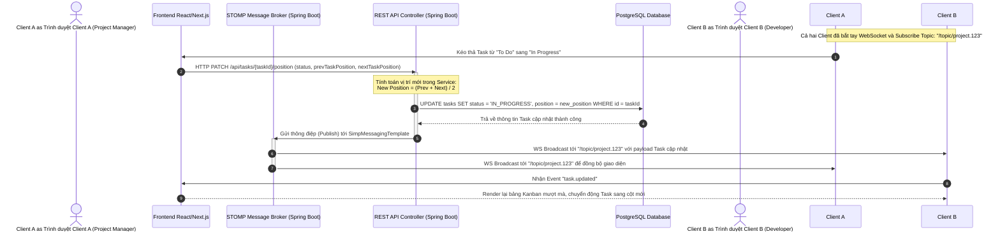
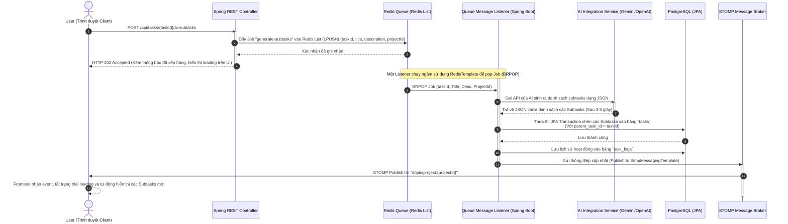

# ĐẶC TẢ CHỨC NĂNG (FUNCTIONAL SPECIFICATION)

Tài liệu này đặc tả chi tiết luồng nghiệp vụ (Business Logic) và thiết kế hệ thống cho 2 tính năng phức tạp nhất trong **Hệ thống Quản lý công việc và Cộng tác dự án thông minh (AI-Powered Project Management Tool)** sử dụng hệ sinh thái **Java Spring Boot**.

---

## 1. Đồng Bộ Real-time Kanban Board qua WebSockets (STOMP Protocol) & Thuật Toán Sắp Xếp Vị Trí Task

### 1.1. Luồng Nghiệp Vụ Kéo Thả (Drag-and-Drop)
Khi một thành viên thực hiện kéo thả một thẻ công việc (Task) trên giao diện bảng Kanban (To Do -> In Progress, thay đổi thứ tự trên/dưới), sự thay đổi này cần được cập nhật ngay lập tức sang màn hình của tất cả các thành viên khác đang làm việc trong cùng dự án mà không cần họ phải F5/Reload trang.

Hệ thống sử dụng giao thức **STOMP (Simple Text Oriented Messaging Protocol)** chạy trên nền WebSockets để quản lý việc truyền tải thông điệp theo mô hình Publish-Subscribe.

### 1.2. Biểu Đồ Trình Tự (Sequence Diagram)

### 1.3. Giải Thuật Sắp Sếp Vị Trí: Số Thập Phân Tỉ Lệ (Fractional Positioning)
Trong một bảng Kanban truyền thống, nếu sắp xếp vị trí bằng số nguyên (`1, 2, 3, ...`), khi kéo một Task vào giữa hai Task khác, chúng ta sẽ phải cập nhật lại chỉ mục (`position`) của tất cả các Task đứng sau nó. Điều này tạo ra hàng loạt truy vấn ghi (write operations) không cần thiết, làm nghẽn database.

**Giải thuật Fractional Positioning** giải quyết triệt để vấn đề này bằng cách sử dụng số thực (`double precision` trong PostgreSQL, ánh xạ sang kiểu `Double` trong Java).
*   **Quy tắc tính toán**:
    *   Khi Task $T$ được kéo vào giữa Task $T_{prev}$ (có vị trí $P_{prev}$) và Task $T_{next}$ (có vị trí $P_{next}$):
        $$P_{new} = \frac{P_{prev} + P_{next}}{2}$$
    *   Nếu kéo Task lên **đầu danh sách**:
        $$P_{new} = P_{first} - 1.0$$ (nếu danh sách trống, mặc định là `65536.0`)
    *   Nếu kéo Task xuống **cuối danh sách**:
        $$P_{new} = P_{last} + 1.0$$

*   **Xử lý giới hạn chính xác số thực (Underflow Exception)**:
    Khi thực hiện kéo thả quá nhiều lần tại cùng một vị trí, khoảng cách giữa $P_{prev}$ và $P_{next}$ sẽ tiệm cận về 0 (vượt quá giới hạn biểu diễn của kiểu số thực double precision).
    *   **Giải pháp**: Hệ thống thiết kế một luồng xử lý ngầm (được lập lịch thông qua Spring Scheduler) chạy định kỳ để phát hiện các dự án có khoảng cách vị trí $\Delta P < 1e^{-10}$. Hàm này sẽ tự động phân phối lại (re-index) vị trí tất cả các Tasks trong Project theo các khoảng cách số nguyên giãn cách đều (`1000, 2000, 3000...`) để khôi phục độ chính xác biểu diễn số thực.

---

## 2. Luồng Xử Xử Lý Bất Đồng Bộ (Background Job) Tích Hợp AI Rã Task Tự Động (AI Auto-Subtasks)

### 2.1. Đặt Vấn Đề
Gọi API của các nhà cung cấp AI (OpenAI, Gemini) thường mất thời gian phản hồi khá lâu (từ 2 đến 10 giây). Nếu gọi trực tiếp trong luồng Request-Response HTTP thông thường:
1.  Gây nghẽn luồng xử lý của server (nếu có quá nhiều request đồng thời).
2.  Trình duyệt client có thể bị lỗi Timeout.
3.  Không thể phục hồi hoặc thử lại (retry) nếu API của AI bị lỗi tạm thời hoặc bị giới hạn lượt gọi (Rate Limit).

Hệ thống thiết kế giải pháp **Asynchronous Queue Processing** sử dụng **Redis Queue (Redis List) và Spring TaskExecutor** để quản lý các tác vụ này dưới dạng Job chạy ngầm.

### 2.2. Biểu Đồ Trình Tự (Sequence Diagram)

### 2.3. Các Kịch Bản Ngoại Lệ & Cơ Chế Phục Hồi (Resilience & Error Handling)
1.  **AI API Rate Limit / Connection Timeout**:
    *   *Xử lý*: Queue Listener được cấu hình cơ chế thử lại (Retry) sử dụng Spring Retry. Nếu gọi API lỗi, nó sẽ tự động chờ và thử lại tối đa 3 lần với khoảng thời gian giãn cách tăng dần (Exponential Backoff, ví dụ: 2s -> 4s -> 8s) trước khi đưa job vào hàng đợi Dead Letter Queue (DLQ) để xử lý thủ công.
2.  **AI trả về dữ liệu không đúng định dạng JSON**:
    *   *Xử lý*: Listener sử dụng Jackson `ObjectMapper` để parse dữ liệu trong block `try-catch`. Nếu parse thất bại, nó ghi log lỗi, cập nhật trạng thái Task gốc và gửi thông báo lỗi chi tiết cho User thông qua websocket client của họ (`/queue/errors`).
3.  **Lỗi tắt nguồn đột ngột (Server/Container crash)**:
    *   *Xử lý*: Do Redis là bộ nhớ lưu trữ bền vững (Redis RDB/AOF), các Job đang xếp hàng sẽ không bị mất. Khi Spring Boot backend khởi chạy lại, tiến trình lắng nghe (Queue Listener) sẽ tiếp tục đọc từ Redis List để xử lý tiếp mà không làm mất yêu cầu của người dùng.
