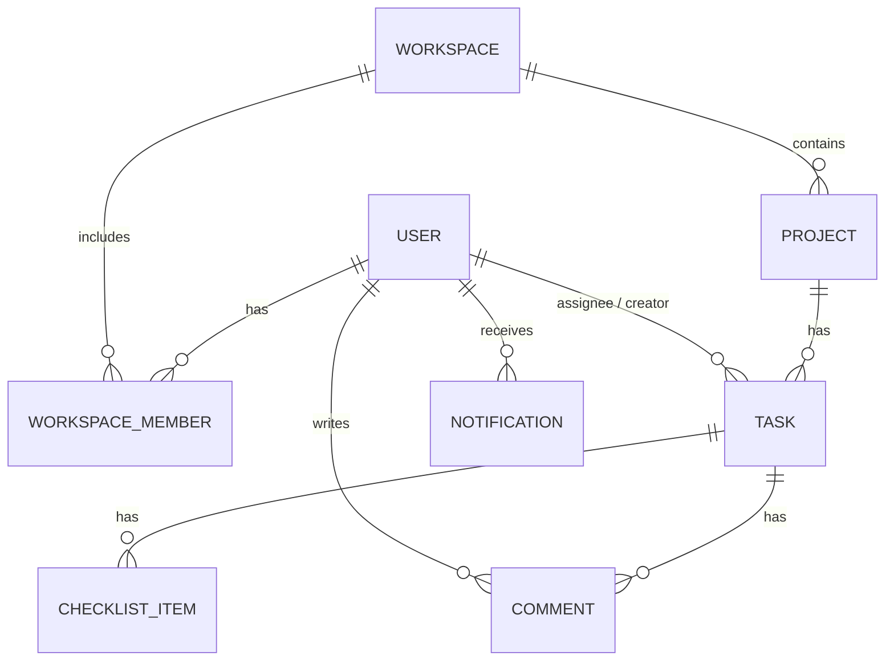

# HƯỚNG DẪN TỪNG BƯỚC TRIỂN KHAI DỰ ÁN QUẢN LÝ CÔNG VIỆC THÔNG MINH TÍCH HỢP AI

Tài liệu này hướng dẫn chi tiết từng bước để xây dựng hệ thống quản lý dự án kết hợp AI trợ lý công việc, dựa trên bản kế hoạch tổng quan từ [Plan.docx](file:///e:/Embe/KL/Plan.docx). Hệ thống tuân thủ tỷ lệ **70% tính năng phần mềm cốt lõi và 30% tính năng thông minh tích hợp AI**.

---

## 1. Chuẩn Bị Công Nghệ (Tech Stack & Prerequisites)

### 1.1. Yêu cầu Môi trường Cài đặt
Trước khi bắt đầu, hãy đảm bảo máy tính của bạn đã cài đặt các công cụ sau:
*   **Node.js**: Phiên bản LTS mới nhất (v18 trở lên, khuyên dùng v20 hoặc v22).
*   **Docker & Docker Compose**: Để chạy nhanh database (PostgreSQL/MySQL) và Redis mà không cần cài đặt trực tiếp lên hệ điều hành.
*   **Git**: Để quản lý mã nguồn.
*   **DBeaver** hoặc **pgAdmin**: Công cụ trực quan hóa cơ sở dữ liệu.
*   **API Client**: Postman hoặc VS Code REST Client để test API.

### 1.2. Danh sách Công nghệ đề xuất (Tech Stack)

| Thành phần | Công nghệ lựa chọn | Vai trò / Lý do lựa chọn |
| :--- | :--- | :--- |
| **Front-end** | Next.js (React), TailwindCSS, Shadcn/ui | Xây dựng giao diện Single Page mượt mà, tối ưu hóa giao diện kéo thả (Kanban Board) và tối ưu SEO/tốc độ tải trang. |
| **Back-end** | Node.js (NestJS) | Framework mạnh mẽ, cấu trúc rõ ràng, áp dụng Clean Architecture, hỗ trợ tốt TypeScript, dễ tích hợp WebSockets và Task Queue. |
| **Database** | PostgreSQL | Hệ quản trị cơ sở dữ liệu quan hệ (RDBMS) mạnh mẽ, hỗ trợ mở rộng tốt, có extension `pgvector` phục vụ tìm kiếm ngữ nghĩa sau này. |
| **Real-time** | WebSockets (Socket.io) | Duy trì kết nối hai chiều liên tục giúp đồng bộ trạng thái Kanban Board giữa các thành viên ngay lập tức. |
| **Queue & Cache**| Redis + BullMQ | Làm bộ nhớ đệm (Cache) và quản lý hàng đợi (Queue) cho các tác vụ tốn thời gian chạy ngầm (gửi mail, đợi AI phản hồi). |
| **AI Integration**| OpenAI API hoặc Gemini API | Cung cấp các mô hình ngôn ngữ lớn (LLM) để thực hiện rã việc, tóm tắt báo cáo và tìm kiếm thông minh thông qua API. |
| **DevOps** | Docker, Docker Compose | Đóng gói toàn bộ các dịch vụ (Client, Server, DB, Redis) thành các Container giúp triển khai đồng nhất ở mọi môi trường. |

---

## 2. Thiết Kế Cơ Sở Dữ Liệu (Database Schema)

Để quản lý dự án hiệu quả, chúng ta thiết kế cơ sở dữ liệu quan hệ gồm các thực thể chính sau:



### Các bảng chi tiết:
1.  **Users**: Lưu thông tin người dùng (id, email, password, name, avatar, role, status).
2.  **Workspaces**: Không gian làm việc chung (id, name, description, ownerId).
3.  **WorkspaceMembers**: Bảng trung gian liên kết Users và Workspaces để phân quyền chi tiết (userId, workspaceId, role: `ADMIN`, `MEMBER`, `VIEWER`).
4.  **Projects**: Các dự án cụ thể thuộc một Workspace (id, name, description, workspaceId, status).
5.  **Tasks**: Các thẻ công việc thuộc Project (id, title, description, status: `TODO`/`IN_PROGRESS`/`DONE`, priority, dueDate, assigneeId, creatorId, projectId, parentTaskId, position).
6.  **ChecklistItems**: Công việc con cần làm để hoàn thành Task lớn (id, title, isCompleted, taskId).
7.  **Comments**: Thảo luận trong từng Task (id, content, userId, taskId).
8.  **Notifications**: Thông báo gửi đến người dùng (id, userId, title, content, isRead, type).

---

## 3. Lộ Trình Triển Khai Từng Bước (Step-by-Step Implementation Roadmap)

### BƯỚC 1: Khởi Tạo Dự Án & Thiết Lập Docker Services
Mục tiêu: Thiết lập môi trường chạy thử và các dịch vụ cơ sở.

1.  **Tạo thư mục gốc cho dự án**:
    ```bash
    mkdir smart-task-manager
    cd smart-task-manager
    ```
2.  **Tạo file `docker-compose.yml` để chạy PostgreSQL và Redis**:
    ```yaml
    version: '3.8'
    services:
      postgres:
        image: postgres:15-alpine
        container_name: task_postgres
        restart: always
        environment:
          POSTGRES_USER: admin
          POSTGRES_PASSWORD: supersecretpassword
          POSTGRES_DB: smart_task_db
        ports:
          - "5432:5432"
        volumes:
          - pgdata:/var/lib/postgresql/data

      redis:
        image: redis:7-alpine
        container_name: task_redis
        restart: always
        ports:
          - "6379:6379"
        volumes:
          - redisdata:/data

    volumes:
      pgdata:
      redisdata:
    ```
3.  Khởi chạy các container bằng lệnh: `docker-compose up -d`.

---

### BƯỚC 2: Phát Triển Back-End - Các Tính Năng Cốt Lõi (70% Phần Mềm)

Sử dụng NestJS làm framework chính cho Back-end.

#### 1. Khởi tạo Project NestJS & Cài đặt Dependencies:
```bash
npx @nestjs/cli new server
cd server
npm install --save @nestjs/typeorm typeorm pg @nestjs/jwt passport-jwt @nestjs/config bcrypt @types/bcrypt
npm install --save @nestjs/websockets @nestjs/platform-socket.io socket.io
npm install --save @nestjs/bullmq bullmq redis
```

#### 2. Phân hệ Xác thực & Phân quyền (Authentication & Authorization - RBAC):
*   Tạo Module `Auth` sử dụng Passport và JWT.
*   Cài đặt tính năng đăng ký, đăng nhập (mã hóa mật khẩu bằng `bcrypt`).
*   Viết `JwtAuthGuard` để bảo vệ các API riêng tư.
*   Viết `RolesGuard` để phân quyền người dùng (RBAC) dựa trên vai trò của họ trong Workspace (`ADMIN`, `MEMBER`, `VIEWER`).

#### 3. Phân hệ Quản lý Workspace & Thành viên:
*   Xây dựng API CRUD cho `Workspace`.
*   Tạo API mời thành viên vào Workspace thông qua Email.
*   *Xử lý bất đồng bộ*: Khi có yêu cầu mời thành viên, gửi thông tin vào hàng đợi **BullMQ** -> Worker sẽ nhận việc và gọi SMTP server gửi email mời.

#### 4. Phân hệ Quản lý Dự án & Kanban Board:
*   Xây dựng API CRUD cho `Project` và `Task`.
*   Thiết kế API cập nhật nhanh trạng thái Task (`status`) và vị trí sắp xếp (`position`) khi người dùng thực hiện thao tác kéo thả trên bảng Kanban.
*   Tạo APIs cho `ChecklistItems` và `Comments`.

#### 5. Đồng Bộ Real-time với WebSockets:
*   Tạo một Gateway WebSockets trong NestJS (`EventsGateway`).
*   Khi một Client tham gia vào một Project, họ sẽ tự động join vào một socket room có ID tương ứng (`project_${projectId}`).
*   Khi có bất kỳ thay đổi nào liên quan đến Task (kéo thả trạng thái, cập nhật nội dung, comment mới), server sẽ gửi (broadcast) sự kiện tới tất cả các client đang ở trong cùng socket room đó để cập nhật giao diện ngay lập tức mà không cần tải lại trang.

---

### BƯỚC 3: Phát Triển Back-End - Các Tính Năng AI Trợ Lý (30% AI)

Sử dụng OpenAI API hoặc Gemini API để phát triển các tính năng thông minh.

#### 1. Cài đặt SDK và Cấu hình Service AI:
*   Cài đặt thư viện: `npm install @google/generative-ai` (nếu chọn Gemini) hoặc `npm install openai` (nếu chọn OpenAI).
*   Đăng ký API Key và lưu vào file `.env`.
*   Tạo `AiService` trong NestJS để đóng gói các hàm gọi API thông minh.

#### 2. Tính năng 1: AI Auto-Subtasks (Tự động rã việc):
*   **Ý tưởng**: Khi người dùng tạo một Task lớn và nhấn nút "Phân rã việc", AI sẽ phân tích tiêu đề và mô tả của Task để đề xuất danh sách các Task con (Checklist).
*   **System Prompt gợi ý**:
    > "Bạn là một kiến trúc sư phần mềm chuyên nghiệp. Nhiệm vụ của bạn là đọc tiêu đề và mô tả của công việc dưới đây, sau đó phân tách nó thành các bước nhỏ hơn (sub-tasks). Hãy trả về kết quả dưới dạng mảng JSON thuần túy, định dạng: `[{"title": "tên bước 1"}, {"title": "tên bước 2"}]`. Không giải thích gì thêm."
*   **Backend Logic**: Gửi prompt tới LLM -> Nhận chuỗi JSON phản hồi -> Parse JSON -> Tự động chèn dữ liệu vào bảng `ChecklistItems` liên kết với Task gốc -> Trả kết quả về cho Client.

#### 3. Tính năng 2: AI Daily Standup Summarizer (Báo cáo ngày):
*   **Ý tưởng**: Vào cuối ngày, Quản lý dự án cần xem hôm nay mọi người đã làm được gì. Hệ thống sẽ gom tất cả log hoạt động (tasks được chuyển trạng thái, comment mới tạo) trong vòng 24h qua của từng người dùng.
*   **System Prompt gợi ý**:
    > "Dưới đây là danh sách hoạt động trong ngày của các thành viên dự án. Hãy tóm tắt ngắn gọn (standup style) theo từng người xem hôm nay họ đã làm được gì và những việc nào đã hoàn thành hoặc đang gặp khó khăn. Định dạng câu trả lời bằng Markdown rõ ràng."
*   **Backend Logic**: Viết API truy vấn toàn bộ lịch sử log/hoạt động của dự án -> Gửi dữ liệu thô qua AI kèm prompt -> Trả về đoạn văn bản Markdown tóm tắt hiển thị trên giao diện Admin.

#### 4. Tính năng 3: AI Smart Search (Tìm kiếm ngữ nghĩa):
*   **Ý tưởng**: Người dùng tìm kiếm bằng câu lệnh tự nhiên: "tìm các việc liên quan đến lỗi server tuần trước".
*   **Cách tiếp cận đơn giản**: Gửi từ khóa tìm kiếm tự nhiên của người dùng sang AI -> Yêu cầu AI chuyển thành một câu truy vấn SQL ngắn hoặc các từ khóa liên quan chặt chẽ -> Thực hiện truy vấn trên Database rồi trả về kết quả.
*   **Cách tiếp cận nâng cao (Khuyên dùng)**: Sử dụng mô hình Embedding của AI để chuyển đổi tiêu đề và mô tả của tất cả các Tasks thành Vector (mảng số thực), lưu vào PostgreSQL sử dụng extension `pgvector`. Khi tìm kiếm, chuyển câu hỏi của người dùng thành Vector và thực hiện phép toán so sánh khoảng cách Cosine (Cosine Similarity) để lấy ra các Task có độ tương đồng ngữ nghĩa cao nhất.

---

### BƯỚC 4: Phát Triển Front-End (Next.js, TailwindCSS & Shadcn/ui)

#### 1. Khởi tạo Project Next.js:
```bash
cd ..
npx -y create-next-app@latest client --typescript --tailwind --eslint --src-dir --app
cd client
```
#### 2. Cài đặt các thư viện bổ sung & Giao diện Shadcn/ui:
```bash
npx -y shadcn-ui@latest init
# Lựa chọn: Default theme, Slate color, CSS variables = Yes
npx -y shadcn-ui@latest add button card dialog input toast avatar dropdown-menu
npm install lucide-react socket.io-client @hello-pangea/dnd axios react-query
```

#### 3. Xây dựng các trang chức năng chính:
1.  **Trang Đăng nhập / Đăng ký (`/login`, `/register`)**:
    *   Thiết kế giao diện đẹp mắt bằng TailwindCSS.
    *   Lưu trữ JWT Token vào Cookies hoặc LocalStorage.
2.  **Dashboard Không gian làm việc (`/workspaces`)**:
    *   Hiển thị danh sách các Workspace người dùng tham gia.
    *   Form tạo mới Workspace và mời thành viên.
3.  **Trang Bảng Công Việc Kanban (`/projects/[id]`)**:
    *   Sử dụng thư viện kéo thả (như `@hello-pangea/dnd`) chia làm 3 cột chính: `To Do`, `In Progress`, `Done`.
    *   Tích hợp `socket.io-client`: Khi kéo thả xong, gửi sự kiện cập nhật vị trí Task lên server qua Socket, đồng thời lắng nghe sự kiện từ Server gửi xuống để cập nhật tức thì giao diện của các thành viên khác đang mở bảng này.
4.  **Hộp thoại Chi tiết Công việc (Task Modal)**:
    *   Hiển thị thông tin: Người thực hiện (Assignee), Hạn chót (Deadline), Mô tả chi tiết.
    *   Tích hợp danh sách Checklist và ô bình luận.
    *   **Nút bấm AI**: Thêm nút "AI gợi ý việc cần làm". Khi nhấn, hiển thị trạng thái loading mượt mà, gọi API `/api/tasks/[id]/ai-subtasks` và tự động cập nhật checklist.
5.  **Trang Báo cáo ngày AI (`/projects/[id]/daily-summary`)**:
    *   Nút bấm "Yêu cầu AI tóm tắt hoạt động hôm nay". Hiển thị báo cáo tóm tắt dưới dạng Markdown được render đẹp mắt.
6.  **Thanh Tìm Kiếm Thông Minh (AI Smart Search)**:
    *   Một ô input tìm kiếm nổi bật ở header. Người dùng gõ câu lệnh tìm kiếm ngữ nghĩa, kết quả trả về hiển thị dưới dạng dropdown gợi ý các Task liên quan.

---

### BƯỚC 5: Đóng Gói Hệ Thống (DevOps & Docker Compose Production)

Khi cả Front-end và Back-end hoạt động tốt, tiến hành đóng gói toàn bộ hệ thống để chạy chỉ bằng 1 câu lệnh.

#### 1. Tạo Dockerfile cho NestJS (`server/Dockerfile`):
```dockerfile
FROM node:20-alpine AS builder
WORKDIR /app
COPY package*.json ./
RUN npm install
COPY . .
RUN npm run build

FROM node:20-alpine
WORKDIR /app
COPY package*.json ./
RUN npm install --only=production
COPY --from=builder /app/dist ./dist
EXPOSE 3000
CMD ["node", "dist/main"]
```

#### 2. Tạo Dockerfile cho Next.js (`client/Dockerfile`):
```dockerfile
FROM node:20-alpine AS builder
WORKDIR /app
COPY package*.json ./
RUN npm install
COPY . .
RUN npm run build

FROM node:20-alpine
WORKDIR /app
COPY package*.json ./
RUN npm install --only=production
COPY --from=builder /app/.next ./.next
COPY --from=builder /app/public ./public
COPY --from=builder /app/package.json ./package.json
EXPOSE 3000
CMD ["npm", "start"]
```

#### 3. Tạo file `docker-compose.prod.yml` chạy toàn bộ dự án:
```yaml
version: '3.8'
services:
  db:
    image: postgres:15-alpine
    container_name: prod_db
    environment:
      POSTGRES_USER: admin
      POSTGRES_PASSWORD: production_password
      POSTGRES_DB: smart_task_prod
    volumes:
      - pg_prod_data:/var/lib/postgresql/data

  redis:
    image: redis:7-alpine
    container_name: prod_redis

  backend:
    build: ./server
    container_name: prod_backend
    ports:
      - "8000:3000"
    environment:
      DATABASE_URL: postgres://admin:production_password@db:5432/smart_task_prod
      REDIS_HOST: redis
      REDIS_PORT: 6379
      JWT_SECRET: highlysecretjwttokenkey
      OPENAI_API_KEY: your_openai_api_key_here
    depends_on:
      - db
      - redis

  frontend:
    build: ./client
    container_name: prod_frontend
    ports:
      - "80:3000"
    environment:
      NEXT_PUBLIC_API_URL: http://backend:3000
    depends_on:
      - backend

volumes:
  pg_prod_data:
```

---

## 4. Kế Hoạch Đánh Giá & Kiểm Thử Hệ Thống

Để đảm bảo dự án chạy ổn định và đạt chất lượng, tiến hành các bước kiểm thử sau:

### 4.1. Kiểm thử Tự động (Automated Testing)
1.  **Unit Tests (Backend)**:
    *   Kiểm thử các dịch vụ cốt lõi: `AuthService`, `TaskService`.
    *   Lệnh chạy kiểm thử có sẵn trong NestJS: `npm run test`.
2.  **API Integration Tests**:
    *   Sử dụng Jest và Supertest để kiểm tra các luồng API chính (đăng ký -> tạo workspace -> tạo dự án -> thêm task).

### 4.2. Kiểm thử Thủ công (Manual Verification Flow)
1.  **Kiểm tra tính năng kéo thả & Real-time**:
    *   Mở đồng thời 2 trình duyệt (1 tab Chrome ẩn danh, 1 tab Firefox) đăng nhập bằng 2 tài khoản khác nhau thuộc cùng một Project.
    *   Kéo thả Task từ cột `To Do` sang `In Progress` ở Chrome, quan sát xem giao diện của Firefox có tự động thay đổi vị trí Task tương ứng trong vòng dưới 1 giây không.
2.  **Kiểm tra tính năng AI Auto-Subtasks**:
    *   Tạo Task với tiêu đề: *"Thiết kế giao diện màn hình Đăng ký"* và mô tả *"Tạo form bao gồm nhập email, mật khẩu, xác nhận mật khẩu, kiểm tra hợp lệ client-side và có nút đăng ký qua Google"*.
    *   Bấm nút **AI Auto-Subtasks**, xác nhận danh sách công việc con được tạo ra có khớp và hợp lý hay không.
3.  **Kiểm tra gửi Email chạy ngầm**:
    *   Tạo một lời mời tham gia workspace.
    *   Kiểm tra xem Redis có ghi nhận Job trong hàng đợi BullMQ hay không và kiểm tra email gửi đến có đúng cấu hình không.
